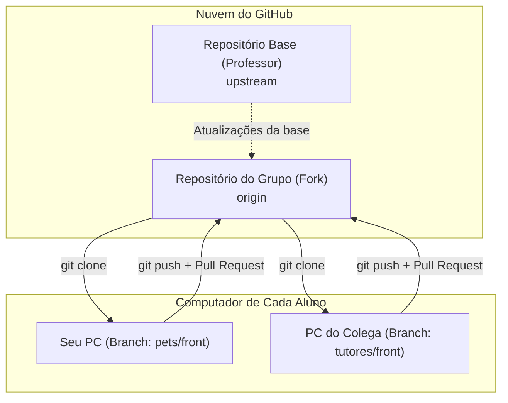
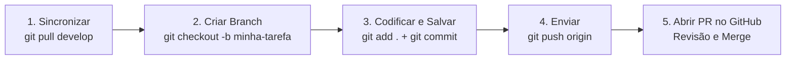

# Guia Definitivo de Git e GitHub (Para Iniciantes)

> **Para quem é este guia:** Para você que nunca usou Git na vida, ou que já usou mas ainda tem medo de perder código, quebrar a branch de um colega ou ver conflitos na tela.  
> Siga este passo a passo: ele foi desenhado para você trabalhar com segurança e tranquilidade.

---

## 1. O Modelo Mental: Entendendo o que está acontecendo

Antes dos comandos, entenda o cenário com uma analogia simples:

- **Git no seu computador:** É como uma **máquina do tempo local**. Ele tira "fotos" (*commits*) do seu código a cada etapa que você conclui.
- **GitHub:** É o **disco virtual na nuvem** onde o grupo guarda o projeto unificado.
- **Repositório Base (Upstream / Professor):** É a matriz oficial de onde saem as novidades do curso.
- **Fork do Grupo (Origin):** É a cópia oficial do seu grupo na nuvem.
- **Branches (Ramificações):** São pistas paralelas de trabalho. Cada aluno trabalha na sua própria pista para **ninguém pisar no código do outro**.



---

## 2. Glossário do Dia a Dia (Sem "tecniquês")

| Termo | O que significa na prática? | Analogia |
| :--- | :--- | :--- |
| **Clone** | Baixar uma cópia do projeto para o seu PC pela primeira vez. | Fazer download da pasta do projeto. |
| **Branch** | Uma linha de desenvolvimento separada. | Uma folha de rascunho com o seu nome. |
| **`develop`** | A branch principal do grupo onde todo o código integrado vive. | O caderno oficial do grupo. |
| **`main`** | A versão final, entregue para avaliação nos checkpoints. | O trabalho encadernado para o professor. |
| **Stage (`add`)** | Separar quais arquivos alterados entrarão no salvamento. | Colocar os itens dentro da caixa de envio. |
| **Commit** | Gravar um ponto seguro no histórico com uma mensagem explicativa. | Fechar a caixa com fita e colar uma etiqueta. |
| **Push** | Enviar seus commits do seu computador para o GitHub. | Despachar a caixa pelo correio. |
| **Pull** | Puxar para o seu computador as novidades que seus colegas enviaram. | Receber as encomendas que chegaram. |
| **Pull Request (PR)** | Pedir aos colegas para revisar e juntar o seu código na `develop`. | Pedir para o colega conferir sua folha antes de colar no caderno oficial. |
| **Merge** | A ação de juntar o código de uma branch na outra. | Colar a folha no caderno oficial. |

---

## 3. Configuração Única (Faça apenas no 1º dia)

Abra o terminal do VS Code (`Ctrl + '` ou menu **Terminal → Novo Terminal**) e execute:

```bash
# 1) Verifique se o Git está instalado (deve mostrar a versão)
git --version

# 2) Diga ao Git quem é você (use o mesmo e-mail da sua conta do GitHub)
git config --global user.name "Seu Nome Completo"
git config --global user.email "seu-email@exemplo.com"

# 3) Deixe o terminal mais amigável com cores automáticas
git config --global color.ui auto

# 4) Defina o nome padrão da branch principal como main
git config --global init.defaultBranch main
```

---

## 4. O Ciclo de Vida do Aluno (Roteiro de Cada Aula)

Este é o fluxo que você fará **em toda aula** para trabalhar no seu módulo sem causar nenhum problema.



### Passo 1: Comece sempre atualizado
Antes de escrever qualquer linha nova de código, vá para a `develop` e baixe o que seus colegas fizeram:

```bash
# Vá para a branch develop
git checkout develop

# Baixe as novidades do GitHub
git pull origin develop
```

---

### Passo 2: Crie a sua branch de trabalho
Nunca programe direto na `develop` ou na `main`. Crie uma branch com o nome do seu módulo e o que vai fazer:

```bash
# O comando -b cria a branch e já troca para ela
git checkout -b pets/listagem

# Para confirmar em qual branch você está:
git branch
# A branch com a estrelinha (*) ou em verde é a sua branch atual
```

> **Padrão de nomes de branches:**  
> - `<modulo>/front` (ex: `pets/front`, `tutores/front`)
> - `<modulo>/listagem` (ex: `servicos/listagem`)
> - `<modulo>/formulario` (ex: `atendimentos/formulario`)
> - `<modulo>/api` (ex: `profissionais/api`)

---

### Passo 3: Trabalhe e salve em passos pequenos
Conforme for programando e testando no navegador, salve seu progresso. Faça commits pequenos (ex: fez a tabela? commit. Fez a validação? commit).

```bash
# 1) Veja quais arquivos você alterou (em vermelho = modificados)
git status

# 2) Adicione todos os arquivos modificados para o pacote
git add .

# 3) Confira novamente (agora aparecem em verde = prontos para o commit)
git status

# 4) Grave o commit com uma mensagem clara em português
git commit -m "feat(pets): cria a tabela de listagem de pets"
```

> **Dicionário de tipos de commit:**
> - `feat(modulo): ...` — para funcionalidade nova na tela ou na API.
> - `fix(modulo): ...` — para correção de algum bug.
> - `style(modulo): ...` — para ajustes visuais ou de CSS.
> - `docs(modulo): ...` — para alterações de documentação.
> - `test(modulo): ...` — para criação ou ajuste de testes.

---

### Passo 4: Envie suas alterações para o GitHub

Quando a tarefa estiver pronta e funcionando no seu PC:

```bash
# O '-u origin' só é necessário no primeiro envio da branch
git push -u origin pets/listagem
```

Nas próximas vezes em que for enviar mais alterações dessa mesma branch, basta:
```bash
git push
```

---

### Passo 5: Abra o Pull Request (No site do GitHub)

Agora o seu código já está na nuvem, mas ainda na sua pista exclusiva. Para juntá-lo ao projeto oficial do grupo:

1. Acesse o repositório do seu grupo no GitHub (`https://github.com/SEU-GRUPO/grupo-N-tema`).
2. O GitHub costuma mostrar um aviso amarelo no topo:  
   **"pets/listagem had recent pushes ... [Compare & pull request]"**.  
   Clique nesse botão verde.
3. Se o aviso não aparecer:
   - Clique na aba **Pull Requests** → botão verde **New pull request**.
   - Na caixa da esquerda (**base**), selecione: `develop`.
   - Na caixa da direita (**compare**), selecione a sua branch: `pets/listagem`.
4. Preencha o formulário do PR:
   - Diga o que você fez em uma ou duas frases.
   - Marque os itens do checklist (ex: `[x] npm run build passou`).
5. Clique no botão verde **Create pull request**.
6. **Aguarde os testes automáticos (Actions):**
   - Um robô vai rodar o build do projeto.
   - Se ficar com um check verde (**✓ All checks have passed**), seu código está perfeito!
   - Se ficar vermelho (**✗**), clique em **Details** para ver qual erro de código ou compilação ocorreu, corrija no seu PC, faça `git add .`, `git commit` e `git push` (o PR atualiza sozinho!).

---

## 5. O Papel do Aluno de "Git e Integração"

Se você é o responsável pelo papel de **Git e Integração** do grupo, você é o guardião do repositório:

### Como revisar e aprovar um Pull Request
1. Abra a aba **Pull Requests** no repositório do grupo no GitHub.
2. Clique no PR do colega.
3. Vá na aba **Files changed** (Arquivos alterados) para inspecionar o código:
   - O colega alterou arquivos que não devia (ex: mexeu na pasta de outro colega ou em `guia/`)?
   - Ele subiu arquivo `.env`? (Se subiu, **não aprove!** Peça para ele remover).
4. Se estiver tudo certo e os testes automáticos estiverem verdes (✓):
   - Clique em **Merge pull request** → **Confirm merge**.
   - Em seguida, clique no botão roxo **Delete branch** (isso apaga a branch antiga da nuvem para manter o repositório limpo).

### Como trazer atualizações do professor para o grupo
Quando o professor avisar que publicou correções ou novas receitas no repositório base:

```bash
# 1) Vá para a develop local e garanta que ela está atualizada
git checkout develop
git pull origin develop

# 2) Busque as novidades da base do professor
git fetch upstream

# 3) Junte as novidades do professor na develop do grupo
git merge upstream/main -m "chore: atualização do repositório base do professor"

# 4) Envie as novidades para o repositório do grupo no GitHub
git push origin develop
```
Depois disso, avise no grupo do WhatsApp/Discord para que cada colega faça `git checkout develop && git pull`.

---

## 6. Primeiros Socorros: "Deu Ruim, e Agora?"

Aqui estão as situações mais comuns e como sair delas sem pânico.

### 🆘 Caso 1: "Deu conflito no merge! Apareceu CONFLICT e códigos estranhos no arquivo!"

**O que aconteceu?** Você e outro colega alteraram as mesmas linhas do mesmo arquivo (por exemplo, adicionaram uma rota no `app.routes.ts` ou um link no `layout.html`).

**Como resolver visualmente no VS Code:**
1. Abra o arquivo que está em conflito.
2. O VS Code vai destacar o trecho com cores e mostrar botões clicáveis logo acima:
   - **Accept Current Change:** mantém o que estava na sua branch.
   - **Accept Incoming Change:** mantém o que veio da branch de integração.
   - **Accept Both Changes:** **(Mais comum!)** mantém o código de ambos, colocando um após o outro.
3. Clique em **Accept Both Changes** (ou ajuste o texto manualmente apagando as linhas `<<<<<<<`, `=======` e `>>>>>>>`).
4. Salve o arquivo (`Ctrl + S`).
5. No terminal:
   ```bash
   git add .
   git commit -m "fix: resolve conflito de merge"
   git push
   ```

---

### 🆘 Caso 2: "Abriu uma tela preta estranha no terminal dizendo MERGE_MSG (Vim) e travou!"

**O que aconteceu?** O Git abriu o editor de texto antigo do Linux (Vim) esperando que você digite uma mensagem de confirmação.

**Como sair:**
1. Pressione a tecla `Esc`.
2. Digite exatamente: `:wq` (dois pontos, letra w, letra q).
3. Pressione `Enter`.
*(Pronto! Ele salva a mensagem e volta ao terminal normal).*

Se só quiser cancelar sem salvar: `Esc` → `:q!` → `Enter`.

---

### 🆘 Caso 3: "O Git rejeitou meu push dizendo '[rejected - non-fast-forward]'!"

**O que aconteceu?** Alguém enviou alterações para o GitHub que ainda não estão no seu computador. O Git não deixa você sobrescrever o trabalho alheio.

**Como resolver:**
```bash
# Puxe primeiro as novidades do GitHub para juntar com as suas:
git pull origin sua-branch

# Se houver conflito, resolva conforme o Caso 1.
# Depois envie novamente:
git push origin sua-branch
```

---

### 🆘 Caso 4: "Fiz alterações na branch errada (na develop ou main) e não commitei ainda!"

**Como resolver sem perder nada:**
```bash
# Guarde suas alterações temporariamente no 'bolso'
git stash

# Crie e vá para a branch correta
git checkout -b modulo/sua-tarefa

# Tire as alterações do bolso e aplique aqui
git stash pop

# Agora sim:
git add .
git commit -m "feat(modulo): minhas alterações"
```

---

### 🆘 Caso 5: "Modifiquei arquivos sem querer e quero voltar ao que estava antes!"

Se você ainda **não** deu `git add`:
```bash
# Descarta todas as alterações nos arquivos e restaura o último commit
git restore .
```

---

## 7. As 5 Regras de Ouro para Não Ter Problemas

1. **Nunca use `--force` (`git push -f`)**: O force pode apagar o código que seus colegas enviaram.
2. **Nunca programe na `main`**: A `main` só recebe código por Pull Request validado.
3. **Commit pequeno é vida**: É muito mais fácil desfazer ou entender um commit de 2 arquivos do que um commit gigante com 40 arquivos.
4. **Antes de abrir o Pull Request, teste o build no seu PC**:
   - `cd backend && npm run build`
   - `cd frontend && npm run build`
   Se compilar no seu computador, o robô do GitHub também vai aprovar.
5. **Na dúvida, não apague a pasta do projeto**: Se travar em algum comando esquisito, não delete tudo nem tente recriar o clone. Chame o colega de Git e Integração ou o professor. Quase tudo no Git tem conserto simples!
