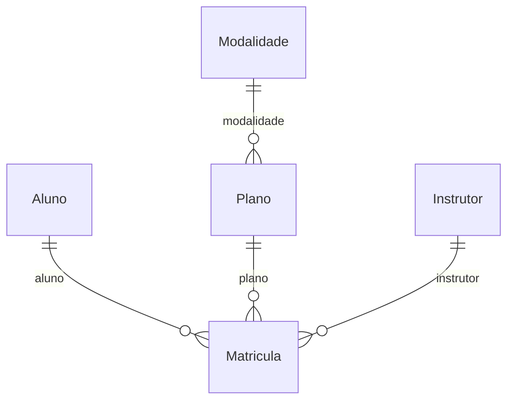
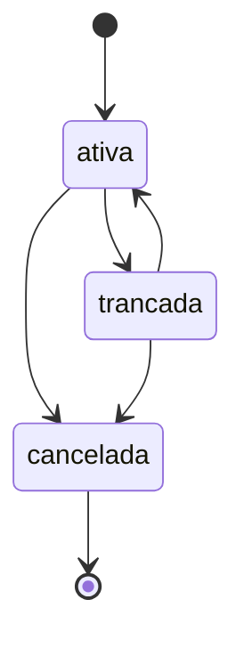

# Tema: Academia

> Manual do grupo. O **Manual de Construção** ensina *como* fazer cada etapa; este arquivo diz *o que* o seu grupo constrói: campos, regras, rotas e telas de cada módulo. Siga os dois juntos.

## O problema

A academia controla matrículas em planilhas. Alunos treinam com plano vencido, as turmas lotam sem aviso e o gestor não sabe quais planos dão mais receita.

## Os 6 módulos e quem faz cada um

| Módulo | Papel transversal de quem faz | Rota da API | Depende de |
| --- | --- | --- | --- |
| **A — Alunos** | PO / Scrum Master | `/alunos` | — |
| **B — Planos** | Git e Integração | `/planos` | Modalidade |
| **C — Matrículas** | Segurança | `/matriculas` | Aluno, Plano, Instrutor |
| **D — Instrutores** | Testes e Qualidade | `/instrutores` | — |
| **E — Modalidades** | UX/UI e Acessibilidade | `/modalidades` | — |
| **F — Relatórios** | Documentação e Apresentação | `/relatorios` | todos (só leitura) |

### Como os dados se ligam



Leia assim: cada linha liga um módulo ao outro pelo campo indicado (por exemplo, o campo `modalidade` guarda o `_id` do outro módulo).

## Roteiro por aula

| Aula | Tarefa de cada aluno no seu módulo | Seção deste arquivo |
| --- | --- | --- |
| 01 | Copiar os requisitos e as regras do seu módulo para o Documento de Visão e as rotas para o Contrato da API (C0) | Requisitos, Regras, Rotas |
| 02 | Criar o modelo, os componentes, a rota e o link no menu | Código de partida → Modelo |
| 03 | Tela de listagem com as colunas e o filtro | Telas |
| 04 | Formulário com as validações | Código de partida → Formulário |
| 05 | Serviço mock com pelo menos 3 registros | Código de partida → Dados para o mock |
| 06 | Revisão das telas (C1) | Telas |
| 07 | Linhas do seu módulo no Dicionário de Dados (C2) | Campos |
| 08 | Schema, registro no módulo e dados no seed | Código de partida → Schema |
| 09 | Service e controller com o CRUD | Rotas |
| 10 | DTOs, testes e Swagger (C3) | Código de partida → DTOs, Testes mínimos |
| 11 | Regras de negócio no service (e o fluxo de estados no módulo C) | Regras de negócio, Fluxo de estados |
| 12–13 | Autenticação, perfis e troca do mock pela API (C4) | Manual de Construção |
| 14–15 | Testes finais, documentação e banca (C5) | Testes mínimos |

## Módulo A — Alunos

**Responsável:** aluno com o papel **PO / Scrum Master** · **Rota da API:** `/api/v1/alunos` · **Coleção:** `alunos`

Cadastro das pessoas que treinam na academia.

**Pastas:** `backend/src/alunos/` e `frontend/src/app/features/alunos/`

### Campos

| Campo | Rótulo na tela | Tipo | Obrigatório | Regras | Exemplo |
| --- | --- | --- | --- | --- | --- |
| `nome` | Nome | texto | sim | 3 a 80 caracteres | `Maria Souza` |
| `email` | E-mail | e-mail | sim | **único** | `maria.souza@email.com` |
| `telefone` | Telefone | telefone | sim | formato (51) 99999-9999 | `(51) 99876-5432` |
| `dataNascimento` | Data de nascimento | data | sim | — | `2004-08-10` |
| `objetivo` | Objetivo | lista de opções | sim | `emagrecimento`, `hipertrofia`, `condicionamento`, `saude` | `condicionamento` |
| `ativo` | Ativo | sim/não | automático | padrão: sim | — |

`_id`, `createdAt` e `updatedAt` são criados automaticamente pelo MongoDB e pelo `timestamps: true`.

### Requisitos funcionais

- **RF01** — O sistema deve permitir cadastrar um aluno com os campos acima.
- **RF02** — O sistema deve listar os alunos ativos, com filtro por objetivo.
- **RF03** — O sistema deve permitir editar um aluno existente.
- **RF04** — O sistema deve permitir excluir um aluno; a exclusão apenas o inativa.

### Regras de negócio

| Código | Regra | Resposta da API quando é violada | Como implementar |
| --- | --- | --- | --- |
| **RN01** | Não pode haver dois alunos com o mesmo e-mail. | 409 — _Já existe um aluno com o e-mail "..."_ | Igual ao `garantirNomeUnico` de Produtos, buscando por `email`. |
| **RN02** | O aluno precisa ter pelo menos 14 anos. | 400 — _A idade mínima para matrícula é 14 anos_ | Calcule a idade a partir de `dataNascimento` no `criar`; crie um método privado `calcularIdade`. |

### Rotas da API

| Método | Rota | O que faz | Respostas |
| --- | --- | --- | --- |
| GET | `/alunos` | Lista (filtro opcional `?objetivo=emagrecimento`, `?todos=true` inclui os inativos) | 200 |
| GET | `/alunos/:id` | Busca pelo id | 200, 400, 404 |
| POST | `/alunos` | Cadastra | 201, 400, 409 |
| PATCH | `/alunos/:id` | Edita | 200, 400, 404 |
| DELETE | `/alunos/:id` | Inativa (exclusão lógica) | 204, 400, 404 |

Filtro no service: `const filtro = objetivo ? { objetivo } : {};`

> **Receitas úteis** ([guia/RECEITAS.md](../RECEITAS.md)): exclusão lógica → receita 2 · datas → receita 6.

### Telas

- **Listagem** (`alunos-lista`): colunas Nome, E-mail, Telefone, Data de nascimento e ações. Filtro: filtro por objetivo. Mensagens de carregando, lista vazia, erro e sucesso.
- **Formulário** (`aluno-form`), usado para cadastrar e editar:

| Campo | Controle na tela |
| --- | --- |
| Nome * | `text` |
| E-mail * | `email` |
| Telefone * | `tel` |
| Data de nascimento * | `date` |
| Objetivo * | `select` |

- **Menu:** link "Alunos" em `layout.html` e rota `alunos` em `app.routes.ts`.

### Código de partida

Use estes trechos junto com o Manual de Construção. Eles substituem os campos de Produtos pelos do seu módulo; o resto (service, controller, serviços do front, telas) segue o modelo de Produtos, como o manual ensina.

<details>
<summary><b>Modelo do front-end (aula 02)</b></summary>

```ts
// frontend/src/app/features/alunos/aluno.model.ts
export const OPCOES_OBJETIVO = [
  'emagrecimento',
  'hipertrofia',
  'condicionamento',
  'saude',
] as const;
export type Objetivo = (typeof OPCOES_OBJETIVO)[number];

/** Aluno como a API devolve (segue o contrato da API). */
export interface Aluno {
  _id: string;
  nome: string;
  email: string;
  telefone: string;
  dataNascimento: string; // ISO: '2026-11-20'
  objetivo: Objetivo;
  ativo: boolean;
  createdAt?: string;
  updatedAt?: string;
}

/** Dados enviados para criar ou editar. */
export interface AlunoEntrada {
  nome: string;
  email: string;
  telefone: string;
  dataNascimento: string; // ISO: '2026-11-20'
  objetivo: Objetivo;
  ativo?: boolean;
}
```

</details>

<details>
<summary><b>Dados para o serviço mock (aula 05)</b></summary>

Comece com este registro e acrescente pelo menos mais 2, variando os casos.

```ts
private alunos: Aluno[] = [
  {
    _id: '1',
    nome: 'Maria Souza',
    email: 'maria.souza@email.com',
    telefone: '(51) 99876-5432',
    dataNascimento: '2004-08-10',
    objetivo: 'condicionamento',
    ativo: true,
  },
];
```

</details>

<details>
<summary><b>Formulário reativo (aula 04)</b></summary>

```ts
// frontend/src/app/features/alunos/aluno-form/aluno-form.ts — dentro da classe
protected readonly form = this.fb.nonNullable.group({
  nome: ['', [Validators.required, Validators.minLength(3), Validators.maxLength(80)]],
  email: ['', [Validators.required, Validators.email]],
  telefone: ['', [Validators.required, Validators.pattern(/^\(\d{2}\) \d{4,5}-\d{4}$/)]],
  dataNascimento: ['', [Validators.required]],
  objetivo: ['' as Objetivo | '', [Validators.required]],
});
```

</details>

<details>
<summary><b>Schema do MongoDB (aula 08)</b></summary>

```ts
// backend/src/alunos/schemas/aluno.schema.ts
import { Prop, Schema, SchemaFactory } from '@nestjs/mongoose';
import { HydratedDocument } from 'mongoose';

export const OPCOES_OBJETIVO = [
  'emagrecimento',
  'hipertrofia',
  'condicionamento',
  'saude',
] as const;
export type Objetivo = (typeof OPCOES_OBJETIVO)[number];
export type AlunoDocument = HydratedDocument<Aluno>;

@Schema({ timestamps: true, collection: 'alunos' })
export class Aluno {
  @Prop({ required: true, trim: true, minlength: 3, maxlength: 80 })
  nome: string;

  @Prop({ required: true, trim: true, lowercase: true, unique: true })
  email: string;

  @Prop({ required: true, trim: true })
  telefone: string;

  @Prop({ type: Date, required: true })
  dataNascimento: Date;

  @Prop({ type: String, required: true, enum: OPCOES_OBJETIVO })
  objetivo: Objetivo;

  @Prop({ default: true })
  ativo: boolean;
}

export const AlunoSchema = SchemaFactory.createForClass(Aluno);
AlunoSchema.index({ objetivo: 1 });
```

</details>

<details>
<summary><b>DTOs de criação e edição (aula 10)</b></summary>

```ts
// backend/src/alunos/dto/create-aluno.dto.ts
import { ApiProperty } from '@nestjs/swagger';
import {
  IsDateString,
  IsEmail,
  IsIn,
  IsNotEmpty,
  IsString,
  Length,
  Matches,
} from 'class-validator';
import { OPCOES_OBJETIVO, type Objetivo } from '../schemas/aluno.schema';

export class CreateAlunoDto {
  @ApiProperty({ example: 'Maria Souza' })
  @IsString()
  @IsNotEmpty({ message: 'Nome é obrigatório' })
  @Length(3, 80, { message: 'Nome deve ter entre 3 e 80 caracteres' })
  nome: string;

  @ApiProperty({ example: 'maria.souza@email.com' })
  @IsEmail({}, { message: 'Informe um e-mail válido' })
  email: string;

  @ApiProperty({ example: '(51) 99876-5432' })
  @IsString()
  @Matches(/^\(\d{2}\) \d{4,5}-\d{4}$/, {
    message: 'Telefone inválido. Use o formato (51) 99999-9999',
  })
  telefone: string;

  @ApiProperty({ example: '2004-08-10' })
  @IsDateString({}, { message: 'Data de nascimento deve ser uma data válida' })
  dataNascimento: string;

  @ApiProperty({ enum: OPCOES_OBJETIVO, example: 'condicionamento' })
  @IsIn(OPCOES_OBJETIVO, {
    message: `Objetivo deve ser: ${OPCOES_OBJETIVO.join(', ')}`,
  })
  objetivo: Objetivo;
}
```

```ts
// backend/src/alunos/dto/update-aluno.dto.ts
import { ApiPropertyOptional, PartialType } from '@nestjs/swagger';
import { IsBoolean, IsOptional } from 'class-validator';
import { CreateAlunoDto } from './create-aluno.dto';

export class UpdateAlunoDto extends PartialType(CreateAlunoDto) {
  @ApiPropertyOptional({ example: true })
  @IsOptional()
  @IsBoolean()
  ativo?: boolean;
}
```

</details>

### Testes mínimos (aula 10)

- [ ] `criar` salva um aluno com dados válidos.
- [ ] `buscarPorId` lança `NotFoundException` (404) quando o aluno não existe.
- [ ] `buscarPorId` lança `BadRequestException` (400) para um id inválido.
- [ ] Regra: não pode haver dois alunos com o mesmo e-mail.
- [ ] Regra: o aluno precisa ter pelo menos 14 anos.

## Módulo B — Planos

**Responsável:** aluno com o papel **Git e Integração** · **Rota da API:** `/api/v1/planos` · **Coleção:** `planos`

Planos vendidos pela academia, ligados a uma modalidade.

**Depende de:** Modalidade (`modalidades`). Até a aula 12 o front usa mocks, então você não precisa esperar os colegas: use ids de exemplo (`'1'`, `'2'`).

**Pastas:** `backend/src/planos/` e `frontend/src/app/features/planos/`

### Campos

| Campo | Rótulo na tela | Tipo | Obrigatório | Regras | Exemplo |
| --- | --- | --- | --- | --- | --- |
| `nome` | Nome | texto | sim | 3 a 60 caracteres; **único** | `Musculação trimestral` |
| `modalidade` | Modalidade | referência → Modalidade | sim | — | _id de Modalidade |
| `valorMensal` | Valor mensal (R$) | número decimal | sim | mínimo 1 | `99.9` |
| `duracaoMeses` | Duração (meses) | lista de opções | sim | `1`, `3`, `6`, `12` | `3` |
| `ativo` | Ativo | sim/não | automático | padrão: sim | — |

`_id`, `createdAt` e `updatedAt` são criados automaticamente pelo MongoDB e pelo `timestamps: true`.

### Requisitos funcionais

- **RF05** — O sistema deve permitir cadastrar um plano com os campos acima.
- **RF06** — O sistema deve listar os planos ativos, com filtro por duração (meses).
- **RF07** — O sistema deve permitir editar um plano existente.
- **RF08** — O sistema deve permitir excluir um plano; a exclusão apenas o inativa.

### Regras de negócio

| Código | Regra | Resposta da API quando é violada | Como implementar |
| --- | --- | --- | --- |
| **RN03** | Não pode haver dois planos com o mesmo nome. | 409 — _Já existe um plano com o nome "..."_ | Igual ao `garantirNomeUnico` de Produtos. |
| **RN04** | A modalidade informada precisa existir. | 404 — _Modalidade ... não encontrada_ | Receita 5 de `guia/RECEITAS.md`: injete o `ModalidadesService`. |

### Rotas da API

| Método | Rota | O que faz | Respostas |
| --- | --- | --- | --- |
| GET | `/planos` | Lista (filtro opcional `?duracaoMeses=1`, `?todos=true` inclui os inativos) | 200 |
| GET | `/planos/:id` | Busca pelo id | 200, 400, 404 |
| POST | `/planos` | Cadastra | 201, 400, 409, 404 |
| PATCH | `/planos/:id` | Edita | 200, 400, 404 |
| DELETE | `/planos/:id` | Inativa (exclusão lógica) | 204, 400, 404 |

Filtro no service: `const filtro = duracaoMeses ? { duracaoMeses } : {};`

> **Receitas úteis** ([guia/RECEITAS.md](../RECEITAS.md)): exclusão lógica → receita 2 · mostrar e escolher referências → receitas 3 e 4.

### Telas

- **Listagem** (`planos-lista`): colunas Nome, Modalidade, Valor mensal (R$), Duração (meses) e ações. Filtro: filtro por duração (meses). Mensagens de carregando, lista vazia, erro e sucesso.
- **Formulário** (`plano-form`), usado para cadastrar e editar:

| Campo | Controle na tela |
| --- | --- |
| Nome * | `text` |
| Modalidade * | `select (receita 4 de guia/RECEITAS.md)` |
| Valor mensal (R$) * | `number, step 0.01` |
| Duração (meses) * | `select` |

- **Menu:** link "Planos" em `layout.html` e rota `planos` em `app.routes.ts`.

### Código de partida

Use estes trechos junto com o Manual de Construção. Eles substituem os campos de Produtos pelos do seu módulo; o resto (service, controller, serviços do front, telas) segue o modelo de Produtos, como o manual ensina.

<details>
<summary><b>Modelo do front-end (aula 02)</b></summary>

```ts
// frontend/src/app/features/planos/plano.model.ts
import { Referencia } from '../../core/models/referencia';

export const OPCOES_DURACAO_MESES = [1, 3, 6, 12] as const;
export type DuracaoMeses = (typeof OPCOES_DURACAO_MESES)[number];

/** Plano como a API devolve (segue o contrato da API). */
export interface Plano {
  _id: string;
  nome: string;
  modalidade: Referencia; // _id ou { _id, nome } (populate)
  valorMensal: number;
  duracaoMeses: DuracaoMeses;
  ativo: boolean;
  createdAt?: string;
  updatedAt?: string;
}

/** Dados enviados para criar ou editar. */
export interface PlanoEntrada {
  nome: string;
  modalidade: string; // _id do Modalidade
  valorMensal: number;
  duracaoMeses: DuracaoMeses;
  ativo?: boolean;
}
```

</details>

<details>
<summary><b>Dados para o serviço mock (aula 05)</b></summary>

Comece com este registro e acrescente pelo menos mais 2, variando os casos.

```ts
private planos: Plano[] = [
  {
    _id: '1',
    nome: 'Musculação trimestral',
    modalidade: '1',
    valorMensal: 99.9,
    duracaoMeses: 3,
    ativo: true,
  },
];
```

</details>

<details>
<summary><b>Formulário reativo (aula 04)</b></summary>

```ts
// frontend/src/app/features/planos/plano-form/plano-form.ts — dentro da classe
protected readonly form = this.fb.nonNullable.group({
  nome: ['', [Validators.required, Validators.minLength(3), Validators.maxLength(60)]],
  modalidade: ['', [Validators.required]],
  valorMensal: [1, [Validators.required, Validators.min(1)]],
  duracaoMeses: [null as DuracaoMeses | null, [Validators.required]],
});
```

</details>

<details>
<summary><b>Schema do MongoDB (aula 08)</b></summary>

```ts
// backend/src/planos/schemas/plano.schema.ts
import { Prop, Schema, SchemaFactory } from '@nestjs/mongoose';
import { HydratedDocument, Types } from 'mongoose';

export const OPCOES_DURACAO_MESES = [1, 3, 6, 12] as const;
export type DuracaoMeses = (typeof OPCOES_DURACAO_MESES)[number];
export type PlanoDocument = HydratedDocument<Plano>;

@Schema({ timestamps: true, collection: 'planos' })
export class Plano {
  @Prop({
    required: true,
    trim: true,
    minlength: 3,
    maxlength: 60,
    unique: true,
  })
  nome: string;

  // Referência ao módulo Modalidade: guarda só o _id
  @Prop({ type: Types.ObjectId, ref: 'Modalidade', required: true })
  modalidade: Types.ObjectId;

  @Prop({ required: true, min: 1 })
  valorMensal: number;

  @Prop({ type: Number, required: true, enum: OPCOES_DURACAO_MESES })
  duracaoMeses: DuracaoMeses;

  @Prop({ default: true })
  ativo: boolean;
}

export const PlanoSchema = SchemaFactory.createForClass(Plano);
PlanoSchema.index({ modalidade: 1 });
PlanoSchema.index({ duracaoMeses: 1 });
```

</details>

<details>
<summary><b>DTOs de criação e edição (aula 10)</b></summary>

```ts
// backend/src/planos/dto/create-plano.dto.ts
import { ApiProperty } from '@nestjs/swagger';
import {
  IsIn,
  IsMongoId,
  IsNotEmpty,
  IsNumber,
  IsString,
  Length,
  Min,
} from 'class-validator';
import {
  OPCOES_DURACAO_MESES,
  type DuracaoMeses,
} from '../schemas/plano.schema';

export class CreatePlanoDto {
  @ApiProperty({ example: 'Musculação trimestral' })
  @IsString()
  @IsNotEmpty({ message: 'Nome é obrigatório' })
  @Length(3, 60, { message: 'Nome deve ter entre 3 e 60 caracteres' })
  nome: string;

  @ApiProperty({ example: '665f1c2b9a1e4b0012345678' })
  @IsMongoId({ message: 'Modalidade: id inválido' })
  modalidade: string;

  @ApiProperty({ example: 99.9 })
  @IsNumber(
    { maxDecimalPlaces: 2 },
    { message: 'Valor mensal (R$) deve ser um número' },
  )
  @Min(1, { message: 'Valor mensal (R$) deve ser no mínimo 1' })
  valorMensal: number;

  @ApiProperty({ enum: OPCOES_DURACAO_MESES, example: 3 })
  @IsIn(OPCOES_DURACAO_MESES, {
    message: `Duração (meses) deve ser: ${OPCOES_DURACAO_MESES.join(', ')}`,
  })
  duracaoMeses: DuracaoMeses;
}
```

```ts
// backend/src/planos/dto/update-plano.dto.ts
import { ApiPropertyOptional, PartialType } from '@nestjs/swagger';
import { IsBoolean, IsOptional } from 'class-validator';
import { CreatePlanoDto } from './create-plano.dto';

export class UpdatePlanoDto extends PartialType(CreatePlanoDto) {
  @ApiPropertyOptional({ example: true })
  @IsOptional()
  @IsBoolean()
  ativo?: boolean;
}
```

</details>

### Testes mínimos (aula 10)

- [ ] `criar` salva um plano com dados válidos.
- [ ] `buscarPorId` lança `NotFoundException` (404) quando o plano não existe.
- [ ] `buscarPorId` lança `BadRequestException` (400) para um id inválido.
- [ ] Regra: não pode haver dois planos com o mesmo nome.
- [ ] Regra: a modalidade informada precisa existir.

## Módulo C — Matrículas

**Responsável:** aluno com o papel **Segurança** · **Rota da API:** `/api/v1/matriculas` · **Coleção:** `matriculas`

Vínculo do aluno com um plano e um instrutor, com o fluxo de estados da matrícula.

**Depende de:** Aluno (`alunos`), Plano (`planos`), Instrutor (`instrutores`). Até a aula 12 o front usa mocks, então você não precisa esperar os colegas: use ids de exemplo (`'1'`, `'2'`).

**Pastas:** `backend/src/matriculas/` e `frontend/src/app/features/matriculas/`

### Campos

| Campo | Rótulo na tela | Tipo | Obrigatório | Regras | Exemplo |
| --- | --- | --- | --- | --- | --- |
| `aluno` | Aluno | referência → Aluno | sim | — | _id de Aluno |
| `plano` | Plano | referência → Plano | sim | — | _id de Plano |
| `instrutor` | Instrutor responsável | referência → Instrutor | sim | — | _id de Instrutor |
| `dataInicio` | Data de início | data | sim | — | `2026-11-03` |
| `status` | Status | lista de opções | automático | `ativa`, `trancada`, `cancelada`; começa em `ativa` | — |

`_id`, `createdAt` e `updatedAt` são criados automaticamente pelo MongoDB e pelo `timestamps: true`.

### Requisitos funcionais

- **RF09** — O sistema deve permitir cadastrar uma matrícula com os campos acima.
- **RF10** — O sistema deve listar as matrículas, com filtro pelo status.
- **RF11** — O sistema deve permitir editar uma matrícula existente.
- **RF12** — O sistema deve permitir mudar o status da matrícula, respeitando o fluxo de estados.

### Regras de negócio

| Código | Regra | Resposta da API quando é violada | Como implementar |
| --- | --- | --- | --- |
| **RN05** | Um aluno não pode ter duas matrículas ativas ao mesmo tempo. | 409 — _O aluno já possui uma matrícula ativa_ | `findOne({ aluno: dto.aluno, status: 'ativa' })` antes de criar (e antes de reativar uma trancada). |
| **RN06** | A data de início não pode ser anterior a hoje. | 400 — _A data de início não pode estar no passado_ | Compare só a data: zere as horas de hoje com `setHours(0, 0, 0, 0)`. |
| **RN07** | O status só pode mudar seguindo o fluxo abaixo. | 400 — _Não é possível passar de "..." para "..."_ | Mapa `TRANSICOES` (código abaixo). |

### Rotas da API

| Método | Rota | O que faz | Respostas |
| --- | --- | --- | --- |
| GET | `/matriculas` | Lista (filtro opcional `?status=ativa`) | 200 |
| GET | `/matriculas/:id` | Busca pelo id | 200, 400, 404 |
| POST | `/matriculas` | Cadastra | 201, 400, 409 |
| PATCH | `/matriculas/:id` | Edita | 200, 400, 404 |
| PATCH | `/matriculas/:id/status` | Muda o status | 200, 400, 404 |

Filtro no service: `const filtro = status ? { status } : {};`

> **Receitas úteis** ([guia/RECEITAS.md](../RECEITAS.md)): mostrar e escolher referências → receitas 3 e 4 · datas → receita 6 · botões de status → receita 7.

### Fluxo de estados



Na tela de listagem, mostre só os botões das transições válidas para o status atual de cada linha.

<details>
<summary><b>Mapa de transições e método mudarStatus</b></summary>

```ts
// backend/src/matriculas/matriculas.service.ts — no topo do arquivo
import { Status } from './schemas/matricula.schema';

// Mapa de transições VÁLIDAS: de → para (PDF 05, cap. 3)
const TRANSICOES: Record<Status, Status[]> = {
  ativa: ['trancada', 'cancelada'],
  trancada: ['ativa', 'cancelada'],
  cancelada: [], // estado final
};

// ...dentro da classe MatriculasService:
async mudarStatus(id: string, novo: Status) {
  const atual = await this.buscarPorId(id);
  if (!TRANSICOES[atual.status].includes(novo)) {
    throw new BadRequestException(
      `Não é possível passar de "${atual.status}" para "${novo}"`,
    );
  }
  return this.matriculaModel
    .findByIdAndUpdate(id, { status: novo }, { new: true })
    .lean()
    .exec();
}
```

</details>

<details>
<summary><b>DTO da mudança de status</b></summary>

```ts
// backend/src/matriculas/dto/mudar-status.dto.ts
import { ApiProperty } from '@nestjs/swagger';
import { IsIn } from 'class-validator';
import { STATUS, type Status } from '../schemas/matricula.schema';

export class MudarStatusDto {
  @ApiProperty({ enum: STATUS, example: 'trancada' })
  @IsIn(STATUS, { message: `Status deve ser: ${STATUS.join(', ')}` })
  status: Status;
}
```

</details>

<details>
<summary><b>Rota no controller</b></summary>

```ts
// backend/src/matriculas/matriculas.controller.ts
@Patch(':id/status')
@ApiOperation({ summary: 'Muda o status (somente transições válidas)' })
@ApiResponse({ status: 400, description: 'Transição de status inválida' })
mudarStatus(@Param('id') id: string, @Body() dto: MudarStatusDto) {
  return this.matriculasService.mudarStatus(id, dto.status);
}
```

</details>

### Telas

- **Listagem** (`matriculas-lista`): colunas Aluno, Plano, Instrutor responsável, Data de início, Status (com a etiqueta colorida) e ações. Filtro: filtro pelo status. Mensagens de carregando, lista vazia, erro e sucesso.
- **Formulário** (`matricula-form`), usado para cadastrar e editar:

| Campo | Controle na tela |
| --- | --- |
| Aluno * | `select (receita 4 de guia/RECEITAS.md)` |
| Plano * | `select (receita 4 de guia/RECEITAS.md)` |
| Instrutor responsável * | `select (receita 4 de guia/RECEITAS.md)` |
| Data de início * | `date` |

- **Menu:** link "Matrículas" em `layout.html` e rota `matriculas` em `app.routes.ts`.

### Código de partida

Use estes trechos junto com o Manual de Construção. Eles substituem os campos de Produtos pelos do seu módulo; o resto (service, controller, serviços do front, telas) segue o modelo de Produtos, como o manual ensina.

<details>
<summary><b>Modelo do front-end (aula 02)</b></summary>

```ts
// frontend/src/app/features/matriculas/matricula.model.ts
import { Referencia } from '../../core/models/referencia';

export const STATUS = ['ativa', 'trancada', 'cancelada'] as const;
export type Status = (typeof STATUS)[number];

/** Matrícula como a API devolve (segue o contrato da API). */
export interface Matricula {
  _id: string;
  aluno: Referencia; // _id ou { _id, nome } (populate)
  plano: Referencia; // _id ou { _id, nome } (populate)
  instrutor: Referencia; // _id ou { _id, nome } (populate)
  dataInicio: string; // ISO: '2026-11-20'
  status: Status;
  createdAt?: string;
  updatedAt?: string;
}

/** Dados enviados para criar ou editar. */
export interface MatriculaEntrada {
  aluno: string; // _id do Aluno
  plano: string; // _id do Plano
  instrutor: string; // _id do Instrutor
  dataInicio: string; // ISO: '2026-11-20'
}
```

</details>

<details>
<summary><b>Dados para o serviço mock (aula 05)</b></summary>

Comece com este registro e acrescente pelo menos mais 2, variando os casos.

```ts
private matriculas: Matricula[] = [
  {
    _id: '1',
    aluno: '1',
    plano: '1',
    instrutor: '1',
    dataInicio: '2026-11-03',
    status: 'ativa',
  },
];
```

</details>

<details>
<summary><b>Formulário reativo (aula 04)</b></summary>

```ts
// frontend/src/app/features/matriculas/matricula-form/matricula-form.ts — dentro da classe
protected readonly form = this.fb.nonNullable.group({
  aluno: ['', [Validators.required]],
  plano: ['', [Validators.required]],
  instrutor: ['', [Validators.required]],
  dataInicio: ['', [Validators.required]],
});
```

</details>

<details>
<summary><b>Schema do MongoDB (aula 08)</b></summary>

```ts
// backend/src/matriculas/schemas/matricula.schema.ts
import { Prop, Schema, SchemaFactory } from '@nestjs/mongoose';
import { HydratedDocument, Types } from 'mongoose';

export const STATUS = ['ativa', 'trancada', 'cancelada'] as const;
export type Status = (typeof STATUS)[number];

export type MatriculaDocument = HydratedDocument<Matricula>;

@Schema({ timestamps: true, collection: 'matriculas' })
export class Matricula {
  // Referência ao módulo Aluno: guarda só o _id
  @Prop({ type: Types.ObjectId, ref: 'Aluno', required: true })
  aluno: Types.ObjectId;

  // Referência ao módulo Plano: guarda só o _id
  @Prop({ type: Types.ObjectId, ref: 'Plano', required: true })
  plano: Types.ObjectId;

  // Referência ao módulo Instrutor: guarda só o _id
  @Prop({ type: Types.ObjectId, ref: 'Instrutor', required: true })
  instrutor: Types.ObjectId;

  @Prop({ type: Date, required: true })
  dataInicio: Date;

  // Fluxo de estados: o status começa em "ativa" e só muda pela rota PATCH /matriculas/:id/status
  @Prop({ type: String, enum: STATUS, default: 'ativa' })
  status: Status;
}

export const MatriculaSchema = SchemaFactory.createForClass(Matricula);
MatriculaSchema.index({ aluno: 1 });
MatriculaSchema.index({ plano: 1 });
MatriculaSchema.index({ instrutor: 1 });
MatriculaSchema.index({ status: 1 });
```

</details>

<details>
<summary><b>DTOs de criação e edição (aula 10)</b></summary>

```ts
// backend/src/matriculas/dto/create-matricula.dto.ts
import { ApiProperty } from '@nestjs/swagger';
import { IsDateString, IsMongoId } from 'class-validator';

export class CreateMatriculaDto {
  @ApiProperty({ example: '665f1c2b9a1e4b0012345678' })
  @IsMongoId({ message: 'Aluno: id inválido' })
  aluno: string;

  @ApiProperty({ example: '665f1c2b9a1e4b0012345678' })
  @IsMongoId({ message: 'Plano: id inválido' })
  plano: string;

  @ApiProperty({ example: '665f1c2b9a1e4b0012345678' })
  @IsMongoId({ message: 'Instrutor responsável: id inválido' })
  instrutor: string;

  @ApiProperty({ example: '2026-11-03' })
  @IsDateString({}, { message: 'Data de início deve ser uma data válida' })
  dataInicio: string;
}
```

```ts
// backend/src/matriculas/dto/update-matricula.dto.ts
import { PartialType } from '@nestjs/swagger';
import { CreateMatriculaDto } from './create-matricula.dto';

// O status NÃO entra aqui: ele só muda pela rota PATCH /:id/status
export class UpdateMatriculaDto extends PartialType(CreateMatriculaDto) {}
```

</details>

### Testes mínimos (aula 10)

- [ ] `criar` salva uma matrícula com dados válidos.
- [ ] `buscarPorId` lança `NotFoundException` (404) quando a matrícula não existe.
- [ ] `buscarPorId` lança `BadRequestException` (400) para um id inválido.
- [ ] Regra: um aluno não pode ter duas matrículas ativas ao mesmo tempo.
- [ ] Regra: a data de início não pode ser anterior a hoje.
- [ ] `mudarStatus` lança 400 numa transição inválida e aceita uma válida.

## Módulo D — Instrutores

**Responsável:** aluno com o papel **Testes e Qualidade** · **Rota da API:** `/api/v1/instrutores` · **Coleção:** `instrutores`

Profissionais de educação física da academia.

**Pastas:** `backend/src/instrutores/` e `frontend/src/app/features/instrutores/`

### Campos

| Campo | Rótulo na tela | Tipo | Obrigatório | Regras | Exemplo |
| --- | --- | --- | --- | --- | --- |
| `nome` | Nome | texto | sim | 3 a 80 caracteres | `Maria Souza` |
| `email` | E-mail | e-mail | sim | **único** | `joao.personal@academia.com` |
| `telefone` | Telefone | telefone | sim | formato (51) 99999-9999 | `(51) 99876-5432` |
| `cref` | CREF | texto | sim | 6 a 15 caracteres; **único** | `012345-G/RS` |
| `turno` | Turno | lista de opções | sim | `manha`, `tarde`, `noite` | `noite` |
| `ativo` | Ativo | sim/não | automático | padrão: sim | — |

`_id`, `createdAt` e `updatedAt` são criados automaticamente pelo MongoDB e pelo `timestamps: true`.

### Requisitos funcionais

- **RF13** — O sistema deve permitir cadastrar um instrutor com os campos acima.
- **RF14** — O sistema deve listar os instrutores ativos, com filtro por turno.
- **RF15** — O sistema deve permitir editar um instrutor existente.
- **RF16** — O sistema deve permitir excluir um instrutor; a exclusão apenas o inativa.

### Regras de negócio

| Código | Regra | Resposta da API quando é violada | Como implementar |
| --- | --- | --- | --- |
| **RN08** | Não pode haver dois instrutores com o mesmo CREF. | 409 — _Já existe um instrutor com o CREF "..."_ | Igual ao `garantirNomeUnico`, buscando por `cref`. |
| **RN09** | Não pode haver dois instrutores com o mesmo e-mail. | 409 — _Já existe um instrutor com o e-mail "..."_ | Mesmo método, buscando por `email`. |

### Rotas da API

| Método | Rota | O que faz | Respostas |
| --- | --- | --- | --- |
| GET | `/instrutores` | Lista (filtro opcional `?turno=manha`, `?todos=true` inclui os inativos) | 200 |
| GET | `/instrutores/:id` | Busca pelo id | 200, 400, 404 |
| POST | `/instrutores` | Cadastra | 201, 400, 409 |
| PATCH | `/instrutores/:id` | Edita | 200, 400, 404 |
| DELETE | `/instrutores/:id` | Inativa (exclusão lógica) | 204, 400, 404 |

Filtro no service: `const filtro = turno ? { turno } : {};`

> **Receitas úteis** ([guia/RECEITAS.md](../RECEITAS.md)): exclusão lógica → receita 2.

### Telas

- **Listagem** (`instrutores-lista`): colunas Nome, E-mail, Telefone, CREF e ações. Filtro: filtro por turno. Mensagens de carregando, lista vazia, erro e sucesso.
- **Formulário** (`instrutor-form`), usado para cadastrar e editar:

| Campo | Controle na tela |
| --- | --- |
| Nome * | `text` |
| E-mail * | `email` |
| Telefone * | `tel` |
| CREF * | `text` |
| Turno * | `select` |

- **Menu:** link "Instrutores" em `layout.html` e rota `instrutores` em `app.routes.ts`.

### Código de partida

Use estes trechos junto com o Manual de Construção. Eles substituem os campos de Produtos pelos do seu módulo; o resto (service, controller, serviços do front, telas) segue o modelo de Produtos, como o manual ensina.

<details>
<summary><b>Modelo do front-end (aula 02)</b></summary>

```ts
// frontend/src/app/features/instrutores/instrutor.model.ts
export const OPCOES_TURNO = ['manha', 'tarde', 'noite'] as const;
export type Turno = (typeof OPCOES_TURNO)[number];

/** Instrutor como a API devolve (segue o contrato da API). */
export interface Instrutor {
  _id: string;
  nome: string;
  email: string;
  telefone: string;
  cref: string;
  turno: Turno;
  ativo: boolean;
  createdAt?: string;
  updatedAt?: string;
}

/** Dados enviados para criar ou editar. */
export interface InstrutorEntrada {
  nome: string;
  email: string;
  telefone: string;
  cref: string;
  turno: Turno;
  ativo?: boolean;
}
```

</details>

<details>
<summary><b>Dados para o serviço mock (aula 05)</b></summary>

Comece com este registro e acrescente pelo menos mais 2, variando os casos.

```ts
private instrutores: Instrutor[] = [
  {
    _id: '1',
    nome: 'Maria Souza',
    email: 'joao.personal@academia.com',
    telefone: '(51) 99876-5432',
    cref: '012345-G/RS',
    turno: 'noite',
    ativo: true,
  },
];
```

</details>

<details>
<summary><b>Formulário reativo (aula 04)</b></summary>

```ts
// frontend/src/app/features/instrutores/instrutor-form/instrutor-form.ts — dentro da classe
protected readonly form = this.fb.nonNullable.group({
  nome: ['', [Validators.required, Validators.minLength(3), Validators.maxLength(80)]],
  email: ['', [Validators.required, Validators.email]],
  telefone: ['', [Validators.required, Validators.pattern(/^\(\d{2}\) \d{4,5}-\d{4}$/)]],
  cref: ['', [Validators.required, Validators.minLength(6), Validators.maxLength(15)]],
  turno: ['' as Turno | '', [Validators.required]],
});
```

</details>

<details>
<summary><b>Schema do MongoDB (aula 08)</b></summary>

```ts
// backend/src/instrutores/schemas/instrutor.schema.ts
import { Prop, Schema, SchemaFactory } from '@nestjs/mongoose';
import { HydratedDocument } from 'mongoose';

export const OPCOES_TURNO = ['manha', 'tarde', 'noite'] as const;
export type Turno = (typeof OPCOES_TURNO)[number];
export type InstrutorDocument = HydratedDocument<Instrutor>;

@Schema({ timestamps: true, collection: 'instrutores' })
export class Instrutor {
  @Prop({ required: true, trim: true, minlength: 3, maxlength: 80 })
  nome: string;

  @Prop({ required: true, trim: true, lowercase: true, unique: true })
  email: string;

  @Prop({ required: true, trim: true })
  telefone: string;

  @Prop({
    required: true,
    trim: true,
    minlength: 6,
    maxlength: 15,
    unique: true,
  })
  cref: string;

  @Prop({ type: String, required: true, enum: OPCOES_TURNO })
  turno: Turno;

  @Prop({ default: true })
  ativo: boolean;
}

export const InstrutorSchema = SchemaFactory.createForClass(Instrutor);
InstrutorSchema.index({ turno: 1 });
```

</details>

<details>
<summary><b>DTOs de criação e edição (aula 10)</b></summary>

```ts
// backend/src/instrutores/dto/create-instrutor.dto.ts
import { ApiProperty } from '@nestjs/swagger';
import {
  IsEmail,
  IsIn,
  IsNotEmpty,
  IsString,
  Length,
  Matches,
} from 'class-validator';
import { OPCOES_TURNO, type Turno } from '../schemas/instrutor.schema';

export class CreateInstrutorDto {
  @ApiProperty({ example: 'Maria Souza' })
  @IsString()
  @IsNotEmpty({ message: 'Nome é obrigatório' })
  @Length(3, 80, { message: 'Nome deve ter entre 3 e 80 caracteres' })
  nome: string;

  @ApiProperty({ example: 'joao.personal@academia.com' })
  @IsEmail({}, { message: 'Informe um e-mail válido' })
  email: string;

  @ApiProperty({ example: '(51) 99876-5432' })
  @IsString()
  @Matches(/^\(\d{2}\) \d{4,5}-\d{4}$/, {
    message: 'Telefone inválido. Use o formato (51) 99999-9999',
  })
  telefone: string;

  @ApiProperty({ example: '012345-G/RS' })
  @IsString()
  @IsNotEmpty({ message: 'CREF é obrigatório' })
  @Length(6, 15, { message: 'CREF deve ter entre 6 e 15 caracteres' })
  cref: string;

  @ApiProperty({ enum: OPCOES_TURNO, example: 'noite' })
  @IsIn(OPCOES_TURNO, { message: `Turno deve ser: ${OPCOES_TURNO.join(', ')}` })
  turno: Turno;
}
```

```ts
// backend/src/instrutores/dto/update-instrutor.dto.ts
import { ApiPropertyOptional, PartialType } from '@nestjs/swagger';
import { IsBoolean, IsOptional } from 'class-validator';
import { CreateInstrutorDto } from './create-instrutor.dto';

export class UpdateInstrutorDto extends PartialType(CreateInstrutorDto) {
  @ApiPropertyOptional({ example: true })
  @IsOptional()
  @IsBoolean()
  ativo?: boolean;
}
```

</details>

### Testes mínimos (aula 10)

- [ ] `criar` salva um instrutor com dados válidos.
- [ ] `buscarPorId` lança `NotFoundException` (404) quando o instrutor não existe.
- [ ] `buscarPorId` lança `BadRequestException` (400) para um id inválido.
- [ ] Regra: não pode haver dois instrutores com o mesmo CREF.
- [ ] Regra: não pode haver dois instrutores com o mesmo e-mail.

## Módulo E — Modalidades

**Responsável:** aluno com o papel **UX/UI e Acessibilidade** · **Rota da API:** `/api/v1/modalidades` · **Coleção:** `modalidades`

Atividades oferecidas: musculação, pilates, spinning etc.

**Pastas:** `backend/src/modalidades/` e `frontend/src/app/features/modalidades/`

### Campos

| Campo | Rótulo na tela | Tipo | Obrigatório | Regras | Exemplo |
| --- | --- | --- | --- | --- | --- |
| `nome` | Nome | texto | sim | 3 a 50 caracteres; **único** | `Musculação` |
| `descricao` | Descrição | texto longo | não | até 300 caracteres | `Treino com pesos e aparelhos` |
| `intensidade` | Intensidade | lista de opções | sim | `leve`, `moderada`, `intensa` | `moderada` |
| `capacidadeMaxima` | Capacidade máxima por turma | número inteiro | sim | de 1 a 50 | `20` |
| `ativo` | Ativo | sim/não | automático | padrão: sim | — |

`_id`, `createdAt` e `updatedAt` são criados automaticamente pelo MongoDB e pelo `timestamps: true`.

### Requisitos funcionais

- **RF17** — O sistema deve permitir cadastrar uma modalidade com os campos acima.
- **RF18** — O sistema deve listar as modalidades ativas, com filtro por intensidade.
- **RF19** — O sistema deve permitir editar uma modalidade existente.
- **RF20** — O sistema deve permitir excluir uma modalidade; a exclusão apenas a inativa.

### Regras de negócio

| Código | Regra | Resposta da API quando é violada | Como implementar |
| --- | --- | --- | --- |
| **RN10** | Não pode haver duas modalidades com o mesmo nome. | 409 — _Já existe uma modalidade com o nome "..."_ | Igual ao `garantirNomeUnico` de Produtos. |
| **RN11** | Excluir uma modalidade apenas a inativa; a listagem padrão mostra só as ativas. | 204 (exclusão vira `ativo: false`) | Receita 2 de `guia/RECEITAS.md`. |

### Rotas da API

| Método | Rota | O que faz | Respostas |
| --- | --- | --- | --- |
| GET | `/modalidades` | Lista (filtro opcional `?intensidade=leve`, `?todos=true` inclui os inativos) | 200 |
| GET | `/modalidades/:id` | Busca pelo id | 200, 400, 404 |
| POST | `/modalidades` | Cadastra | 201, 400, 409 |
| PATCH | `/modalidades/:id` | Edita | 200, 400, 404 |
| DELETE | `/modalidades/:id` | Inativa (exclusão lógica) | 204, 400, 404 |

Filtro no service: `const filtro = intensidade ? { intensidade } : {};`

> **Receitas úteis** ([guia/RECEITAS.md](../RECEITAS.md)): exclusão lógica → receita 2.

### Telas

- **Listagem** (`modalidades-lista`): colunas Nome, Intensidade, Capacidade máxima por turma e ações. Filtro: filtro por intensidade. Mensagens de carregando, lista vazia, erro e sucesso.
- **Formulário** (`modalidade-form`), usado para cadastrar e editar:

| Campo | Controle na tela |
| --- | --- |
| Nome * | `text` |
| Descrição | `textarea` |
| Intensidade * | `select` |
| Capacidade máxima por turma * | `number, step 1` |

- **Menu:** link "Modalidades" em `layout.html` e rota `modalidades` em `app.routes.ts`.

### Código de partida

Use estes trechos junto com o Manual de Construção. Eles substituem os campos de Produtos pelos do seu módulo; o resto (service, controller, serviços do front, telas) segue o modelo de Produtos, como o manual ensina.

<details>
<summary><b>Modelo do front-end (aula 02)</b></summary>

```ts
// frontend/src/app/features/modalidades/modalidade.model.ts
export const OPCOES_INTENSIDADE = ['leve', 'moderada', 'intensa'] as const;
export type Intensidade = (typeof OPCOES_INTENSIDADE)[number];

/** Modalidade como a API devolve (segue o contrato da API). */
export interface Modalidade {
  _id: string;
  nome: string;
  descricao?: string;
  intensidade: Intensidade;
  capacidadeMaxima: number;
  ativo: boolean;
  createdAt?: string;
  updatedAt?: string;
}

/** Dados enviados para criar ou editar. */
export interface ModalidadeEntrada {
  nome: string;
  descricao?: string;
  intensidade: Intensidade;
  capacidadeMaxima: number;
  ativo?: boolean;
}
```

</details>

<details>
<summary><b>Dados para o serviço mock (aula 05)</b></summary>

Comece com este registro e acrescente pelo menos mais 2, variando os casos.

```ts
private modalidades: Modalidade[] = [
  {
    _id: '1',
    nome: 'Musculação',
    descricao: 'Treino com pesos e aparelhos',
    intensidade: 'moderada',
    capacidadeMaxima: 20,
    ativo: true,
  },
];
```

</details>

<details>
<summary><b>Formulário reativo (aula 04)</b></summary>

```ts
// frontend/src/app/features/modalidades/modalidade-form/modalidade-form.ts — dentro da classe
protected readonly form = this.fb.nonNullable.group({
  nome: ['', [Validators.required, Validators.minLength(3), Validators.maxLength(50)]],
  descricao: ['', [Validators.maxLength(300)]],
  intensidade: ['' as Intensidade | '', [Validators.required]],
  capacidadeMaxima: [
    1,
    [Validators.required, Validators.min(1), Validators.max(50), Validators.pattern(/^\d+$/)],
  ],
});
```

</details>

<details>
<summary><b>Schema do MongoDB (aula 08)</b></summary>

```ts
// backend/src/modalidades/schemas/modalidade.schema.ts
import { Prop, Schema, SchemaFactory } from '@nestjs/mongoose';
import { HydratedDocument } from 'mongoose';

export const OPCOES_INTENSIDADE = ['leve', 'moderada', 'intensa'] as const;
export type Intensidade = (typeof OPCOES_INTENSIDADE)[number];
export type ModalidadeDocument = HydratedDocument<Modalidade>;

@Schema({ timestamps: true, collection: 'modalidades' })
export class Modalidade {
  @Prop({
    required: true,
    trim: true,
    minlength: 3,
    maxlength: 50,
    unique: true,
  })
  nome: string;

  @Prop({ trim: true, maxlength: 300 })
  descricao?: string;

  @Prop({ type: String, required: true, enum: OPCOES_INTENSIDADE })
  intensidade: Intensidade;

  @Prop({ required: true, min: 1, max: 50 })
  capacidadeMaxima: number;

  @Prop({ default: true })
  ativo: boolean;
}

export const ModalidadeSchema = SchemaFactory.createForClass(Modalidade);
ModalidadeSchema.index({ intensidade: 1 });
```

</details>

<details>
<summary><b>DTOs de criação e edição (aula 10)</b></summary>

```ts
// backend/src/modalidades/dto/create-modalidade.dto.ts
import { ApiProperty, ApiPropertyOptional } from '@nestjs/swagger';
import {
  IsIn,
  IsInt,
  IsNotEmpty,
  IsOptional,
  IsString,
  Length,
  Max,
  MaxLength,
  Min,
} from 'class-validator';
import {
  OPCOES_INTENSIDADE,
  type Intensidade,
} from '../schemas/modalidade.schema';

export class CreateModalidadeDto {
  @ApiProperty({ example: 'Musculação' })
  @IsString()
  @IsNotEmpty({ message: 'Nome é obrigatório' })
  @Length(3, 50, { message: 'Nome deve ter entre 3 e 50 caracteres' })
  nome: string;

  @ApiPropertyOptional({ example: 'Treino com pesos e aparelhos' })
  @IsOptional()
  @IsString()
  @MaxLength(300, { message: 'Descrição pode ter no máximo 300 caracteres' })
  descricao?: string;

  @ApiProperty({ enum: OPCOES_INTENSIDADE, example: 'moderada' })
  @IsIn(OPCOES_INTENSIDADE, {
    message: `Intensidade deve ser: ${OPCOES_INTENSIDADE.join(', ')}`,
  })
  intensidade: Intensidade;

  @ApiProperty({ example: 20 })
  @IsInt({ message: 'Capacidade máxima por turma deve ser um número inteiro' })
  @Min(1, { message: 'Capacidade máxima por turma deve ser no mínimo 1' })
  @Max(50, { message: 'Capacidade máxima por turma deve ser no máximo 50' })
  capacidadeMaxima: number;
}
```

```ts
// backend/src/modalidades/dto/update-modalidade.dto.ts
import { ApiPropertyOptional, PartialType } from '@nestjs/swagger';
import { IsBoolean, IsOptional } from 'class-validator';
import { CreateModalidadeDto } from './create-modalidade.dto';

export class UpdateModalidadeDto extends PartialType(CreateModalidadeDto) {
  @ApiPropertyOptional({ example: true })
  @IsOptional()
  @IsBoolean()
  ativo?: boolean;
}
```

</details>

### Testes mínimos (aula 10)

- [ ] `criar` salva uma modalidade com dados válidos.
- [ ] `buscarPorId` lança `NotFoundException` (404) quando a modalidade não existe.
- [ ] `buscarPorId` lança `BadRequestException` (400) para um id inválido.
- [ ] Regra: não pode haver duas modalidades com o mesmo nome.
- [ ] Regra: excluir uma modalidade apenas a inativa; a listagem padrão mostra só as ativas.

## Módulo F — Relatórios

**Responsável:** aluno com o papel **Documentação e Apresentação** · **Rota da API:** `/api/v1/relatorios` · **Coleção:** nenhuma (lê as coleções dos colegas)

Painel com alunos ativos e receita por plano.

**Pastas:** `backend/src/relatorios/` e `frontend/src/app/features/relatorios/` (o painel também aparece na tela Início).

Enquanto os colegas não têm schema (até a aula 08), trabalhe no front com um serviço mock que devolve números fixos, no mesmo formato das respostas abaixo.

### Requisitos funcionais

- **RF21** — O sistema deve exibir: totais de alunos, matrículas ativas e trancadas.
- **RF22** — O sistema deve exibir: matrículas ativas e receita mensal por plano.
- **RF23** — O sistema deve exibir: quantidade de alunos ativos por objetivo.
- **RF24** — O painel deve mostrar uma mensagem amigável quando ainda não houver dados.

### Rotas da API

| Método | Rota | O que devolve | Exemplo de resposta (`dados`) |
| --- | --- | --- | --- |
| GET | `/relatorios/resumo` | Totais de alunos, matrículas ativas e trancadas | `{ "alunos": 210, "matriculasAtivas": 180, "matriculasTrancadas": 12 }` |
| GET | `/relatorios/receita-por-plano` | Matrículas ativas e receita mensal por plano | `[{ "plano": "Musculação trimestral", "matriculas": 64, "receitaMensal": 6393.6 }, ...]` |
| GET | `/relatorios/alunos-por-objetivo` | Quantidade de alunos ativos por objetivo | `[{ "_id": "hipertrofia", "quantidade": 70 }, ...]` |

### Registrar os schemas dos colegas

<details>
<summary><b>relatorios.module.ts e construtor do service</b></summary>

```ts
// backend/src/relatorios/relatorios.module.ts
@Module({
  imports: [
    MongooseModule.forFeature([
      { name: Aluno.name, schema: AlunoSchema },
      { name: Matricula.name, schema: MatriculaSchema },
    ]),
  ],
  controllers: [RelatoriosController],
  providers: [RelatoriosService],
})
export class RelatoriosModule {}

// backend/src/relatorios/relatorios.service.ts
@Injectable()
export class RelatoriosService {
  constructor(
    @InjectModel(Aluno.name) private readonly alunoModel: Model<AlunoDocument>,
    @InjectModel(Matricula.name)
    private readonly matriculaModel: Model<MatriculaDocument>,
  ) {}

  // ...consultas abaixo
}
```

</details>

### Consultas

<details>
<summary><b>GET /relatorios/resumo</b></summary>

```ts
async resumo() {
  const [alunos, matriculasAtivas, matriculasTrancadas] = await Promise.all([
    this.alunoModel.countDocuments({ ativo: true }),
    this.matriculaModel.countDocuments({ status: 'ativa' }),
    this.matriculaModel.countDocuments({ status: 'trancada' }),
  ]);
  return { alunos, matriculasAtivas, matriculasTrancadas };
}
```

</details>

<details>
<summary><b>GET /relatorios/receita-por-plano</b></summary>

```ts
async receitaPorPlano() {
  return this.matriculaModel
    .aggregate([
      { $match: { status: 'ativa' } },
      {
        $lookup: {
          from: 'planos',
          localField: 'plano',
          foreignField: '_id',
          as: 'p',
        },
      },
      { $unwind: '$p' },
      {
        $group: {
          _id: '$p.nome',
          matriculas: { $sum: 1 },
          receitaMensal: { $sum: '$p.valorMensal' },
        },
      },
      {
        $project: { _id: 0, plano: '$_id', matriculas: 1, receitaMensal: 1 },
      },
      { $sort: { receitaMensal: -1 } },
    ])
    .exec();
}
```

</details>

<details>
<summary><b>GET /relatorios/alunos-por-objetivo</b></summary>

```ts
async alunosPorObjetivo() {
  return this.alunoModel
    .aggregate([
      { $match: { ativo: true } },
      { $group: { _id: '$objetivo', quantidade: { $sum: 1 } } },
      { $sort: { quantidade: -1 } },
    ])
    .exec();
}
```

</details>

As consultas com `$lookup` leem outra coleção pelo nome dela (`from`), sem precisar injetar o Model dessa coleção.

No controller, cada consulta é um `@Get('<rota>')` que só chama o método do service.

### Telas

- **Painel** (`relatorios-painel`): um cartão por número do `resumo` e uma tabela para cada consulta agrupada. Mostre "carregando", "sem dados" e erro.
- **Início:** coloque os cartões do resumo na tela inicial do sistema.

### Testes mínimos (aula 10)

- [ ] `resumo` devolve os três totais usando `countDocuments` (mock do Model).
- [ ] Cada consulta agrupada chama `aggregate` e devolve o resultado do Model.
- [ ] Quando não há dados, as consultas devolvem lista vazia (não lançam erro).
- [ ] O controller expõe as rotas com os nomes do contrato da API.

> **Desafio:** mostre as consultas em um gráfico de barras (Chart.js ou SVG feito à mão).

## Perfis de acesso sugeridos (aulas 12 e 13)

O papel de Segurança define a versão final com o PO. Sugestão de partida:

| Perfil | Pode |
| --- | --- |
| `admin` | Tudo, inclusive excluir e ver relatórios |
| `atendente` | Cadastrar, editar e mudar status; não exclui |
| `consulta` | Apenas listar e ver detalhes |
