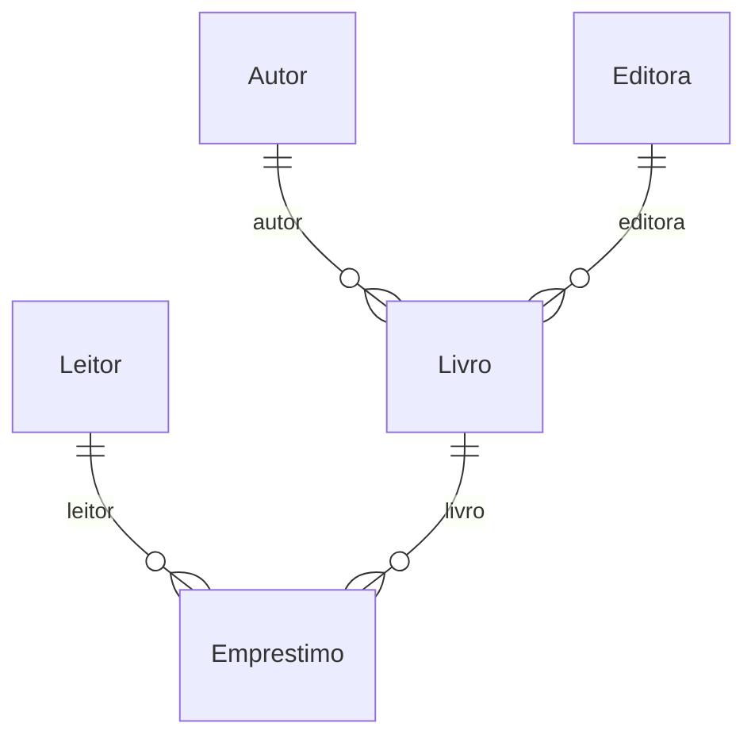
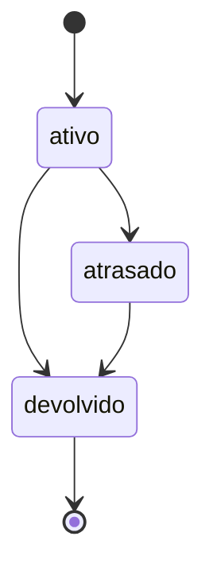

# Tema: Biblioteca

> Manual do grupo. O **Manual de Construção** ensina *como* fazer cada etapa; este arquivo diz *o que* o seu grupo constrói: campos, regras, rotas e telas de cada módulo. Siga os dois juntos.

## O problema

A biblioteca controla empréstimos em fichas de papel. Ninguém sabe quais livros estão atrasados, leitores pegam mais livros do que deveriam e o acervo não tem cadastro confiável.

## Os 6 módulos e quem faz cada um

| Módulo | Papel transversal de quem faz | Rota da API | Depende de |
| --- | --- | --- | --- |
| **A — Leitores** | PO / Scrum Master | `/leitores` | — |
| **B — Livros** | Git e Integração | `/livros` | Autor, Editora |
| **C — Empréstimos** | Segurança | `/emprestimos` | Leitor, Livro |
| **D — Autores** | Testes e Qualidade | `/autores` | — |
| **E — Editoras** | UX/UI e Acessibilidade | `/editoras` | — |
| **F — Relatórios** | Documentação e Apresentação | `/relatorios` | todos (só leitura) |

### Como os dados se ligam



Leia assim: cada linha liga um módulo ao outro pelo campo indicado (por exemplo, o campo `autor` guarda o `_id` do outro módulo).

## Roteiro por aula

| Aula | Tarefa de cada aluno no seu módulo | Seção deste arquivo |
| --- | --- | --- |
| 01 | Copiar os requisitos e as regras do seu módulo para o Documento de Visão e as rotas para o Contrato da API (C0) | Requisitos, Regras, Rotas |
| 02 | Criar o modelo, os componentes, a rota e o link no menu | Código de partida → Modelo |
| 03 | Tela de listagem com as colunas e o filtro | Telas |
| 04 | Formulário com as validações | Código de partida → Formulário |
| 05 | Serviço mock com pelo menos 3 registros | Código de partida → Dados para o mock |
| 06 | Revisão das telas (C1) | Telas |
| 07 | Linhas do seu módulo no Dicionário de Dados (C2) | Campos |
| 08 | Schema, registro no módulo e dados no seed | Código de partida → Schema |
| 09 | Service e controller com o CRUD | Rotas |
| 10 | DTOs, testes e Swagger (C3) | Código de partida → DTOs, Testes mínimos |
| 11 | Regras de negócio no service (e o fluxo de estados no módulo C) | Regras de negócio, Fluxo de estados |
| 12–13 | Autenticação, perfis e troca do mock pela API (C4) | Manual de Construção |
| 14–15 | Testes finais, documentação e banca (C5) | Testes mínimos |

## Módulo A — Leitores

**Responsável:** aluno com o papel **PO / Scrum Master** · **Rota da API:** `/api/v1/leitores` · **Coleção:** `leitores`

Cadastro das pessoas que podem pegar livros emprestados.

**Pastas:** `backend/src/leitores/` e `frontend/src/app/features/leitores/`

### Campos

| Campo | Rótulo na tela | Tipo | Obrigatório | Regras | Exemplo |
| --- | --- | --- | --- | --- | --- |
| `nome` | Nome | texto | sim | 3 a 80 caracteres | `Maria Souza` |
| `email` | E-mail | e-mail | sim | **único** | `maria.souza@email.com` |
| `telefone` | Telefone | telefone | sim | formato (51) 99999-9999 | `(51) 99876-5432` |
| `tipo` | Tipo | lista de opções | sim | `aluno`, `professor`, `comunidade` | `aluno` |
| `matricula` | Matrícula | texto | não | até 20 caracteres | `2026001234` |
| `ativo` | Ativo | sim/não | automático | padrão: sim | — |

`_id`, `createdAt` e `updatedAt` são criados automaticamente pelo MongoDB e pelo `timestamps: true`.

### Requisitos funcionais

- **RF01** — O sistema deve permitir cadastrar um leitor com os campos acima.
- **RF02** — O sistema deve listar os leitores ativos, com filtro por tipo.
- **RF03** — O sistema deve permitir editar um leitor existente.
- **RF04** — O sistema deve permitir excluir um leitor; a exclusão apenas o inativa.

### Regras de negócio

| Código | Regra | Resposta da API quando é violada | Como implementar |
| --- | --- | --- | --- |
| **RN01** | Não pode haver dois leitores com o mesmo e-mail. | 409 — _Já existe um leitor com o e-mail "..."_ | Igual ao `garantirNomeUnico` de Produtos, buscando por `email`. |
| **RN02** | Leitor do tipo "aluno" precisa ter matrícula. | 400 — _A matrícula é obrigatória para alunos_ | Validação contextual (manual, aula 11): `if (dto.tipo === 'aluno' && !dto.matricula)`. |

### Rotas da API

| Método | Rota | O que faz | Respostas |
| --- | --- | --- | --- |
| GET | `/leitores` | Lista (filtro opcional `?tipo=aluno`, `?todos=true` inclui os inativos) | 200 |
| GET | `/leitores/:id` | Busca pelo id | 200, 400, 404 |
| POST | `/leitores` | Cadastra | 201, 400, 409 |
| PATCH | `/leitores/:id` | Edita | 200, 400, 404 |
| DELETE | `/leitores/:id` | Inativa (exclusão lógica) | 204, 400, 404 |

Filtro no service: `const filtro = tipo ? { tipo } : {};`

> **Receitas úteis** ([guia/RECEITAS.md](../RECEITAS.md)): exclusão lógica → receita 2.

### Telas

- **Listagem** (`leitores-lista`): colunas Nome, E-mail, Telefone, Tipo e ações. Filtro: filtro por tipo. Mensagens de carregando, lista vazia, erro e sucesso.
- **Formulário** (`leitor-form`), usado para cadastrar e editar:

| Campo | Controle na tela |
| --- | --- |
| Nome * | `text` |
| E-mail * | `email` |
| Telefone * | `tel` |
| Tipo * | `select` |
| Matrícula | `text` |

- **Menu:** link "Leitores" em `layout.html` e rota `leitores` em `app.routes.ts`.

### Código de partida

Use estes trechos junto com o Manual de Construção. Eles substituem os campos de Produtos pelos do seu módulo; o resto (service, controller, serviços do front, telas) segue o modelo de Produtos, como o manual ensina.

<details>
<summary><b>Modelo do front-end (aula 02)</b></summary>

```ts
// frontend/src/app/features/leitores/leitor.model.ts
export const OPCOES_TIPO = ['aluno', 'professor', 'comunidade'] as const;
export type Tipo = (typeof OPCOES_TIPO)[number];

/** Leitor como a API devolve (segue o contrato da API). */
export interface Leitor {
  _id: string;
  nome: string;
  email: string;
  telefone: string;
  tipo: Tipo;
  matricula?: string;
  ativo: boolean;
  createdAt?: string;
  updatedAt?: string;
}

/** Dados enviados para criar ou editar. */
export interface LeitorEntrada {
  nome: string;
  email: string;
  telefone: string;
  tipo: Tipo;
  matricula?: string;
  ativo?: boolean;
}
```

</details>

<details>
<summary><b>Dados para o serviço mock (aula 05)</b></summary>

Comece com este registro e acrescente pelo menos mais 2, variando os casos.

```ts
private leitores: Leitor[] = [
  {
    _id: '1',
    nome: 'Maria Souza',
    email: 'maria.souza@email.com',
    telefone: '(51) 99876-5432',
    tipo: 'aluno',
    matricula: '2026001234',
    ativo: true,
  },
];
```

</details>

<details>
<summary><b>Formulário reativo (aula 04)</b></summary>

```ts
// frontend/src/app/features/leitores/leitor-form/leitor-form.ts — dentro da classe
protected readonly form = this.fb.nonNullable.group({
  nome: ['', [Validators.required, Validators.minLength(3), Validators.maxLength(80)]],
  email: ['', [Validators.required, Validators.email]],
  telefone: ['', [Validators.required, Validators.pattern(/^\(\d{2}\) \d{4,5}-\d{4}$/)]],
  tipo: ['' as Tipo | '', [Validators.required]],
  matricula: ['', [Validators.maxLength(20)]],
});
```

</details>

<details>
<summary><b>Schema do MongoDB (aula 08)</b></summary>

```ts
// backend/src/leitores/schemas/leitor.schema.ts
import { Prop, Schema, SchemaFactory } from '@nestjs/mongoose';
import { HydratedDocument } from 'mongoose';

export const OPCOES_TIPO = ['aluno', 'professor', 'comunidade'] as const;
export type Tipo = (typeof OPCOES_TIPO)[number];
export type LeitorDocument = HydratedDocument<Leitor>;

@Schema({ timestamps: true, collection: 'leitores' })
export class Leitor {
  @Prop({ required: true, trim: true, minlength: 3, maxlength: 80 })
  nome: string;

  @Prop({ required: true, trim: true, lowercase: true, unique: true })
  email: string;

  @Prop({ required: true, trim: true })
  telefone: string;

  @Prop({ type: String, required: true, enum: OPCOES_TIPO })
  tipo: Tipo;

  @Prop({ trim: true, maxlength: 20 })
  matricula?: string;

  @Prop({ default: true })
  ativo: boolean;
}

export const LeitorSchema = SchemaFactory.createForClass(Leitor);
LeitorSchema.index({ tipo: 1 });
```

</details>

<details>
<summary><b>DTOs de criação e edição (aula 10)</b></summary>

```ts
// backend/src/leitores/dto/create-leitor.dto.ts
import { ApiProperty, ApiPropertyOptional } from '@nestjs/swagger';
import {
  IsEmail,
  IsIn,
  IsNotEmpty,
  IsOptional,
  IsString,
  Length,
  Matches,
  MaxLength,
} from 'class-validator';
import { OPCOES_TIPO, type Tipo } from '../schemas/leitor.schema';

export class CreateLeitorDto {
  @ApiProperty({ example: 'Maria Souza' })
  @IsString()
  @IsNotEmpty({ message: 'Nome é obrigatório' })
  @Length(3, 80, { message: 'Nome deve ter entre 3 e 80 caracteres' })
  nome: string;

  @ApiProperty({ example: 'maria.souza@email.com' })
  @IsEmail({}, { message: 'Informe um e-mail válido' })
  email: string;

  @ApiProperty({ example: '(51) 99876-5432' })
  @IsString()
  @Matches(/^\(\d{2}\) \d{4,5}-\d{4}$/, {
    message: 'Telefone inválido. Use o formato (51) 99999-9999',
  })
  telefone: string;

  @ApiProperty({ enum: OPCOES_TIPO, example: 'aluno' })
  @IsIn(OPCOES_TIPO, { message: `Tipo deve ser: ${OPCOES_TIPO.join(', ')}` })
  tipo: Tipo;

  @ApiPropertyOptional({ example: '2026001234' })
  @IsOptional()
  @IsString()
  @MaxLength(20, { message: 'Matrícula pode ter no máximo 20 caracteres' })
  matricula?: string;
}
```

```ts
// backend/src/leitores/dto/update-leitor.dto.ts
import { ApiPropertyOptional, PartialType } from '@nestjs/swagger';
import { IsBoolean, IsOptional } from 'class-validator';
import { CreateLeitorDto } from './create-leitor.dto';

export class UpdateLeitorDto extends PartialType(CreateLeitorDto) {
  @ApiPropertyOptional({ example: true })
  @IsOptional()
  @IsBoolean()
  ativo?: boolean;
}
```

</details>

### Testes mínimos (aula 10)

- [ ] `criar` salva um leitor com dados válidos.
- [ ] `buscarPorId` lança `NotFoundException` (404) quando o leitor não existe.
- [ ] `buscarPorId` lança `BadRequestException` (400) para um id inválido.
- [ ] Regra: não pode haver dois leitores com o mesmo e-mail.
- [ ] Regra: leitor do tipo "aluno" precisa ter matrícula.

## Módulo B — Livros

**Responsável:** aluno com o papel **Git e Integração** · **Rota da API:** `/api/v1/livros` · **Coleção:** `livros`

Acervo da biblioteca, com autor, editora e quantidade de exemplares.

**Depende de:** Autor (`autores`), Editora (`editoras`). Até a aula 12 o front usa mocks, então você não precisa esperar os colegas: use ids de exemplo (`'1'`, `'2'`).

**Pastas:** `backend/src/livros/` e `frontend/src/app/features/livros/`

### Campos

| Campo | Rótulo na tela | Tipo | Obrigatório | Regras | Exemplo |
| --- | --- | --- | --- | --- | --- |
| `titulo` | Título | texto | sim | 2 a 120 caracteres | `Dom Casmurro` |
| `isbn` | ISBN | texto | sim | 13 caracteres; o isbn deve ter 13 dígitos, sem traços; **único** | `9788535910663` |
| `autor` | Autor | referência → Autor | sim | — | _id de Autor |
| `editora` | Editora | referência → Editora | sim | — | _id de Editora |
| `ano` | Ano de publicação | número inteiro | sim | de 1500 a 2100 | `1899` |
| `exemplares` | Exemplares | número inteiro | sim | de 0 a 100 | `3` |
| `ativo` | Ativo | sim/não | automático | padrão: sim | — |

`_id`, `createdAt` e `updatedAt` são criados automaticamente pelo MongoDB e pelo `timestamps: true`.

### Requisitos funcionais

- **RF05** — O sistema deve permitir cadastrar um livro com os campos acima.
- **RF06** — O sistema deve listar os livros, com busca por parte do título (sem diferenciar maiúsculas).
- **RF07** — O sistema deve permitir editar um livro existente.
- **RF08** — O sistema deve permitir excluir um livro.

### Regras de negócio

| Código | Regra | Resposta da API quando é violada | Como implementar |
| --- | --- | --- | --- |
| **RN03** | Não pode haver dois livros com o mesmo ISBN. | 409 — _Já existe um livro com o ISBN "..."_ | Igual ao `garantirNomeUnico`, buscando por `isbn`. |
| **RN04** | O ano de publicação não pode ser maior que o ano atual. | 400 — _O ano de publicação não pode ser futuro_ | `if (dto.ano > new Date().getFullYear())`. |

### Rotas da API

| Método | Rota | O que faz | Respostas |
| --- | --- | --- | --- |
| GET | `/livros` | Lista (filtro opcional `?busca=texto`) | 200 |
| GET | `/livros/:id` | Busca pelo id | 200, 400, 404 |
| POST | `/livros` | Cadastra | 201, 400, 409 |
| PATCH | `/livros/:id` | Edita | 200, 400, 404 |
| DELETE | `/livros/:id` | Exclui | 204, 400, 404 |

Filtro no service: `const filtro = busca ? { titulo: { $regex: busca, $options: 'i' } } : {};`

> **Receitas úteis** ([guia/RECEITAS.md](../RECEITAS.md)): busca por texto → receita 1 · mostrar e escolher referências → receitas 3 e 4.

### Telas

- **Listagem** (`livros-lista`): colunas Título, ISBN, Autor, Editora e ações. Filtro: busca por parte do título (sem diferenciar maiúsculas). Mensagens de carregando, lista vazia, erro e sucesso.
- **Formulário** (`livro-form`), usado para cadastrar e editar:

| Campo | Controle na tela |
| --- | --- |
| Título * | `text` |
| ISBN * | `text` |
| Autor * | `select (receita 4 de guia/RECEITAS.md)` |
| Editora * | `select (receita 4 de guia/RECEITAS.md)` |
| Ano de publicação * | `number, step 1` |
| Exemplares * | `number, step 1` |

- **Menu:** link "Livros" em `layout.html` e rota `livros` em `app.routes.ts`.

### Código de partida

Use estes trechos junto com o Manual de Construção. Eles substituem os campos de Produtos pelos do seu módulo; o resto (service, controller, serviços do front, telas) segue o modelo de Produtos, como o manual ensina.

<details>
<summary><b>Modelo do front-end (aula 02)</b></summary>

```ts
// frontend/src/app/features/livros/livro.model.ts
import { Referencia } from '../../core/models/referencia';

/** Livro como a API devolve (segue o contrato da API). */
export interface Livro {
  _id: string;
  titulo: string;
  isbn: string;
  autor: Referencia; // _id ou { _id, nome } (populate)
  editora: Referencia; // _id ou { _id, nome } (populate)
  ano: number;
  exemplares: number;
  ativo: boolean;
  createdAt?: string;
  updatedAt?: string;
}

/** Dados enviados para criar ou editar. */
export interface LivroEntrada {
  titulo: string;
  isbn: string;
  autor: string; // _id do Autor
  editora: string; // _id do Editora
  ano: number;
  exemplares: number;
  ativo?: boolean;
}
```

</details>

<details>
<summary><b>Dados para o serviço mock (aula 05)</b></summary>

Comece com este registro e acrescente pelo menos mais 2, variando os casos.

```ts
private livros: Livro[] = [
  {
    _id: '1',
    titulo: 'Dom Casmurro',
    isbn: '9788535910663',
    autor: '1',
    editora: '1',
    ano: 1899,
    exemplares: 3,
    ativo: true,
  },
];
```

</details>

<details>
<summary><b>Formulário reativo (aula 04)</b></summary>

```ts
// frontend/src/app/features/livros/livro-form/livro-form.ts — dentro da classe
protected readonly form = this.fb.nonNullable.group({
  titulo: ['', [Validators.required, Validators.minLength(2), Validators.maxLength(120)]],
  isbn: [
    '',
    [
      Validators.required,
      Validators.minLength(13),
      Validators.maxLength(13),
      Validators.pattern(/^\d{13}$/),
    ],
  ],
  autor: ['', [Validators.required]],
  editora: ['', [Validators.required]],
  ano: [
    1500,
    [
      Validators.required,
      Validators.min(1500),
      Validators.max(2100),
      Validators.pattern(/^\d+$/),
    ],
  ],
  exemplares: [
    0,
    [Validators.required, Validators.min(0), Validators.max(100), Validators.pattern(/^\d+$/)],
  ],
});
```

</details>

<details>
<summary><b>Schema do MongoDB (aula 08)</b></summary>

```ts
// backend/src/livros/schemas/livro.schema.ts
import { Prop, Schema, SchemaFactory } from '@nestjs/mongoose';
import { HydratedDocument, Types } from 'mongoose';

export type LivroDocument = HydratedDocument<Livro>;

@Schema({ timestamps: true, collection: 'livros' })
export class Livro {
  @Prop({ required: true, trim: true, minlength: 2, maxlength: 120 })
  titulo: string;

  @Prop({
    required: true,
    trim: true,
    minlength: 13,
    maxlength: 13,
    unique: true,
  })
  isbn: string;

  // Referência ao módulo Autor: guarda só o _id
  @Prop({ type: Types.ObjectId, ref: 'Autor', required: true })
  autor: Types.ObjectId;

  // Referência ao módulo Editora: guarda só o _id
  @Prop({ type: Types.ObjectId, ref: 'Editora', required: true })
  editora: Types.ObjectId;

  @Prop({ required: true, min: 1500, max: 2100 })
  ano: number;

  @Prop({ required: true, min: 0, max: 100 })
  exemplares: number;

  @Prop({ default: true })
  ativo: boolean;
}

export const LivroSchema = SchemaFactory.createForClass(Livro);
LivroSchema.index({ autor: 1 });
LivroSchema.index({ editora: 1 });
```

</details>

<details>
<summary><b>DTOs de criação e edição (aula 10)</b></summary>

```ts
// backend/src/livros/dto/create-livro.dto.ts
import { ApiProperty } from '@nestjs/swagger';
import {
  IsInt,
  IsMongoId,
  IsNotEmpty,
  IsString,
  Length,
  Matches,
  Max,
  Min,
} from 'class-validator';

export class CreateLivroDto {
  @ApiProperty({ example: 'Dom Casmurro' })
  @IsString()
  @IsNotEmpty({ message: 'Título é obrigatório' })
  @Length(2, 120, { message: 'Título deve ter entre 2 e 120 caracteres' })
  titulo: string;

  @ApiProperty({ example: '9788535910663' })
  @IsString()
  @IsNotEmpty({ message: 'ISBN é obrigatório' })
  @Length(13, 13, { message: 'ISBN deve ter 13 caracteres' })
  @Matches(/^\d{13}$/, { message: 'O ISBN deve ter 13 dígitos, sem traços' })
  isbn: string;

  @ApiProperty({ example: '665f1c2b9a1e4b0012345678' })
  @IsMongoId({ message: 'Autor: id inválido' })
  autor: string;

  @ApiProperty({ example: '665f1c2b9a1e4b0012345678' })
  @IsMongoId({ message: 'Editora: id inválido' })
  editora: string;

  @ApiProperty({ example: 1899 })
  @IsInt({ message: 'Ano de publicação deve ser um número inteiro' })
  @Min(1500, { message: 'Ano de publicação deve ser no mínimo 1500' })
  @Max(2100, { message: 'Ano de publicação deve ser no máximo 2100' })
  ano: number;

  @ApiProperty({ example: 3 })
  @IsInt({ message: 'Exemplares deve ser um número inteiro' })
  @Min(0, { message: 'Exemplares deve ser no mínimo 0' })
  @Max(100, { message: 'Exemplares deve ser no máximo 100' })
  exemplares: number;
}
```

```ts
// backend/src/livros/dto/update-livro.dto.ts
import { ApiPropertyOptional, PartialType } from '@nestjs/swagger';
import { IsBoolean, IsOptional } from 'class-validator';
import { CreateLivroDto } from './create-livro.dto';

export class UpdateLivroDto extends PartialType(CreateLivroDto) {
  @ApiPropertyOptional({ example: true })
  @IsOptional()
  @IsBoolean()
  ativo?: boolean;
}
```

</details>

### Testes mínimos (aula 10)

- [ ] `criar` salva um livro com dados válidos.
- [ ] `buscarPorId` lança `NotFoundException` (404) quando o livro não existe.
- [ ] `buscarPorId` lança `BadRequestException` (400) para um id inválido.
- [ ] Regra: não pode haver dois livros com o mesmo ISBN.
- [ ] Regra: o ano de publicação não pode ser maior que o ano atual.

## Módulo C — Empréstimos

**Responsável:** aluno com o papel **Segurança** · **Rota da API:** `/api/v1/emprestimos` · **Coleção:** `emprestimos`

Registro de retirada e devolução de livros, com o fluxo de estados do empréstimo.

**Depende de:** Leitor (`leitores`), Livro (`livros`). Até a aula 12 o front usa mocks, então você não precisa esperar os colegas: use ids de exemplo (`'1'`, `'2'`).

**Pastas:** `backend/src/emprestimos/` e `frontend/src/app/features/emprestimos/`

### Campos

| Campo | Rótulo na tela | Tipo | Obrigatório | Regras | Exemplo |
| --- | --- | --- | --- | --- | --- |
| `leitor` | Leitor | referência → Leitor | sim | — | _id de Leitor |
| `livro` | Livro | referência → Livro | sim | — | _id de Livro |
| `dataPrevistaDevolucao` | Devolução prevista | data | sim | — | `2026-11-05` |
| `status` | Status | lista de opções | automático | `ativo`, `atrasado`, `devolvido`; começa em `ativo` | — |

`_id`, `createdAt` e `updatedAt` são criados automaticamente pelo MongoDB e pelo `timestamps: true`.

### Requisitos funcionais

- **RF09** — O sistema deve permitir cadastrar um empréstimo com os campos acima.
- **RF10** — O sistema deve listar os empréstimos, com filtro pelo status.
- **RF11** — O sistema deve permitir editar um empréstimo existente.
- **RF12** — O sistema deve permitir mudar o status do empréstimo, respeitando o fluxo de estados.

### Regras de negócio

| Código | Regra | Resposta da API quando é violada | Como implementar |
| --- | --- | --- | --- |
| **RN05** | Um leitor pode ter no máximo 3 empréstimos ativos ou atrasados. | 409 — _O leitor já tem 3 empréstimos em aberto_ | `countDocuments({ leitor: dto.leitor, status: { $in: ['ativo', 'atrasado'] } })` antes de criar. |
| **RN06** | A devolução prevista deve ficar entre 1 e 14 dias a partir de hoje. | 400 — _A devolução prevista deve ser entre 1 e 14 dias a partir de hoje_ | Calcule a diferença em dias: `(new Date(dto.dataPrevistaDevolucao).getTime() - Date.now()) / 86400000`. |
| **RN07** | O status só pode mudar seguindo o fluxo abaixo. | 400 — _Não é possível passar de "..." para "..."_ | Mapa `TRANSICOES` (código abaixo). |

### Rotas da API

| Método | Rota | O que faz | Respostas |
| --- | --- | --- | --- |
| GET | `/emprestimos` | Lista (filtro opcional `?status=ativo`) | 200 |
| GET | `/emprestimos/:id` | Busca pelo id | 200, 400, 404 |
| POST | `/emprestimos` | Cadastra | 201, 400, 409 |
| PATCH | `/emprestimos/:id` | Edita | 200, 400, 404 |
| PATCH | `/emprestimos/:id/status` | Muda o status | 200, 400, 404 |

Filtro no service: `const filtro = status ? { status } : {};`

> **Receitas úteis** ([guia/RECEITAS.md](../RECEITAS.md)): mostrar e escolher referências → receitas 3 e 4 · datas → receita 6 · botões de status → receita 7.

### Fluxo de estados



Na tela de listagem, mostre só os botões das transições válidas para o status atual de cada linha.

<details>
<summary><b>Mapa de transições e método mudarStatus</b></summary>

```ts
// backend/src/emprestimos/emprestimos.service.ts — no topo do arquivo
import { Status } from './schemas/emprestimo.schema';

// Mapa de transições VÁLIDAS: de → para (PDF 05, cap. 3)
const TRANSICOES: Record<Status, Status[]> = {
  ativo: ['atrasado', 'devolvido'],
  atrasado: ['devolvido'],
  devolvido: [], // estado final
};

// ...dentro da classe EmprestimosService:
async mudarStatus(id: string, novo: Status) {
  const atual = await this.buscarPorId(id);
  if (!TRANSICOES[atual.status].includes(novo)) {
    throw new BadRequestException(
      `Não é possível passar de "${atual.status}" para "${novo}"`,
    );
  }
  return this.emprestimoModel
    .findByIdAndUpdate(id, { status: novo }, { new: true })
    .lean()
    .exec();
}
```

</details>

<details>
<summary><b>DTO da mudança de status</b></summary>

```ts
// backend/src/emprestimos/dto/mudar-status.dto.ts
import { ApiProperty } from '@nestjs/swagger';
import { IsIn } from 'class-validator';
import { STATUS, type Status } from '../schemas/emprestimo.schema';

export class MudarStatusDto {
  @ApiProperty({ enum: STATUS, example: 'atrasado' })
  @IsIn(STATUS, { message: `Status deve ser: ${STATUS.join(', ')}` })
  status: Status;
}
```

</details>

<details>
<summary><b>Rota no controller</b></summary>

```ts
// backend/src/emprestimos/emprestimos.controller.ts
@Patch(':id/status')
@ApiOperation({ summary: 'Muda o status (somente transições válidas)' })
@ApiResponse({ status: 400, description: 'Transição de status inválida' })
mudarStatus(@Param('id') id: string, @Body() dto: MudarStatusDto) {
  return this.emprestimosService.mudarStatus(id, dto.status);
}
```

</details>

### Telas

- **Listagem** (`emprestimos-lista`): colunas Leitor, Livro, Devolução prevista, Status (com a etiqueta colorida) e ações. Filtro: filtro pelo status. Mensagens de carregando, lista vazia, erro e sucesso.
- **Formulário** (`emprestimo-form`), usado para cadastrar e editar:

| Campo | Controle na tela |
| --- | --- |
| Leitor * | `select (receita 4 de guia/RECEITAS.md)` |
| Livro * | `select (receita 4 de guia/RECEITAS.md)` |
| Devolução prevista * | `date` |

- **Menu:** link "Empréstimos" em `layout.html` e rota `emprestimos` em `app.routes.ts`.

### Código de partida

Use estes trechos junto com o Manual de Construção. Eles substituem os campos de Produtos pelos do seu módulo; o resto (service, controller, serviços do front, telas) segue o modelo de Produtos, como o manual ensina.

<details>
<summary><b>Modelo do front-end (aula 02)</b></summary>

```ts
// frontend/src/app/features/emprestimos/emprestimo.model.ts
import { Referencia } from '../../core/models/referencia';

export const STATUS = ['ativo', 'atrasado', 'devolvido'] as const;
export type Status = (typeof STATUS)[number];

/** Empréstimo como a API devolve (segue o contrato da API). */
export interface Emprestimo {
  _id: string;
  leitor: Referencia; // _id ou { _id, nome } (populate)
  livro: Referencia; // _id ou { _id, titulo } (populate)
  dataPrevistaDevolucao: string; // ISO: '2026-11-20'
  status: Status;
  createdAt?: string;
  updatedAt?: string;
}

/** Dados enviados para criar ou editar. */
export interface EmprestimoEntrada {
  leitor: string; // _id do Leitor
  livro: string; // _id do Livro
  dataPrevistaDevolucao: string; // ISO: '2026-11-20'
}
```

</details>

<details>
<summary><b>Dados para o serviço mock (aula 05)</b></summary>

Comece com este registro e acrescente pelo menos mais 2, variando os casos.

```ts
private emprestimos: Emprestimo[] = [
  {
    _id: '1',
    leitor: '1',
    livro: '1',
    dataPrevistaDevolucao: '2026-11-05',
    status: 'ativo',
  },
];
```

</details>

<details>
<summary><b>Formulário reativo (aula 04)</b></summary>

```ts
// frontend/src/app/features/emprestimos/emprestimo-form/emprestimo-form.ts — dentro da classe
protected readonly form = this.fb.nonNullable.group({
  leitor: ['', [Validators.required]],
  livro: ['', [Validators.required]],
  dataPrevistaDevolucao: ['', [Validators.required]],
});
```

</details>

<details>
<summary><b>Schema do MongoDB (aula 08)</b></summary>

```ts
// backend/src/emprestimos/schemas/emprestimo.schema.ts
import { Prop, Schema, SchemaFactory } from '@nestjs/mongoose';
import { HydratedDocument, Types } from 'mongoose';

export const STATUS = ['ativo', 'atrasado', 'devolvido'] as const;
export type Status = (typeof STATUS)[number];

export type EmprestimoDocument = HydratedDocument<Emprestimo>;

@Schema({ timestamps: true, collection: 'emprestimos' })
export class Emprestimo {
  // Referência ao módulo Leitor: guarda só o _id
  @Prop({ type: Types.ObjectId, ref: 'Leitor', required: true })
  leitor: Types.ObjectId;

  // Referência ao módulo Livro: guarda só o _id
  @Prop({ type: Types.ObjectId, ref: 'Livro', required: true })
  livro: Types.ObjectId;

  @Prop({ type: Date, required: true })
  dataPrevistaDevolucao: Date;

  // Fluxo de estados: o status começa em "ativo" e só muda pela rota PATCH /emprestimos/:id/status
  @Prop({ type: String, enum: STATUS, default: 'ativo' })
  status: Status;
}

export const EmprestimoSchema = SchemaFactory.createForClass(Emprestimo);
EmprestimoSchema.index({ leitor: 1 });
EmprestimoSchema.index({ livro: 1 });
EmprestimoSchema.index({ status: 1 });
```

</details>

<details>
<summary><b>DTOs de criação e edição (aula 10)</b></summary>

```ts
// backend/src/emprestimos/dto/create-emprestimo.dto.ts
import { ApiProperty } from '@nestjs/swagger';
import { IsDateString, IsMongoId } from 'class-validator';

export class CreateEmprestimoDto {
  @ApiProperty({ example: '665f1c2b9a1e4b0012345678' })
  @IsMongoId({ message: 'Leitor: id inválido' })
  leitor: string;

  @ApiProperty({ example: '665f1c2b9a1e4b0012345678' })
  @IsMongoId({ message: 'Livro: id inválido' })
  livro: string;

  @ApiProperty({ example: '2026-11-05' })
  @IsDateString({}, { message: 'Devolução prevista deve ser uma data válida' })
  dataPrevistaDevolucao: string;
}
```

```ts
// backend/src/emprestimos/dto/update-emprestimo.dto.ts
import { PartialType } from '@nestjs/swagger';
import { CreateEmprestimoDto } from './create-emprestimo.dto';

// O status NÃO entra aqui: ele só muda pela rota PATCH /:id/status
export class UpdateEmprestimoDto extends PartialType(CreateEmprestimoDto) {}
```

</details>

### Testes mínimos (aula 10)

- [ ] `criar` salva um empréstimo com dados válidos.
- [ ] `buscarPorId` lança `NotFoundException` (404) quando o empréstimo não existe.
- [ ] `buscarPorId` lança `BadRequestException` (400) para um id inválido.
- [ ] Regra: um leitor pode ter no máximo 3 empréstimos ativos ou atrasados.
- [ ] Regra: a devolução prevista deve ficar entre 1 e 14 dias a partir de hoje.
- [ ] `mudarStatus` lança 400 numa transição inválida e aceita uma válida.

## Módulo D — Autores

**Responsável:** aluno com o papel **Testes e Qualidade** · **Rota da API:** `/api/v1/autores` · **Coleção:** `autores`

Cadastro dos autores do acervo.

**Pastas:** `backend/src/autores/` e `frontend/src/app/features/autores/`

### Campos

| Campo | Rótulo na tela | Tipo | Obrigatório | Regras | Exemplo |
| --- | --- | --- | --- | --- | --- |
| `nome` | Nome | texto | sim | 3 a 80 caracteres; **único** | `Machado de Assis` |
| `nacionalidade` | Nacionalidade | texto | sim | 3 a 40 caracteres | `brasileira` |
| `anoNascimento` | Ano de nascimento | número inteiro | não | de 1000 a 2100 | `1839` |
| `biografia` | Biografia | texto longo | não | até 500 caracteres | `Escritor carioca, fundador da Academia Brasileira de Letras.` |
| `ativo` | Ativo | sim/não | automático | padrão: sim | — |

`_id`, `createdAt` e `updatedAt` são criados automaticamente pelo MongoDB e pelo `timestamps: true`.

### Requisitos funcionais

- **RF13** — O sistema deve permitir cadastrar um autor com os campos acima.
- **RF14** — O sistema deve listar os autores, com busca por parte do nome (sem diferenciar maiúsculas).
- **RF15** — O sistema deve permitir editar um autor existente.
- **RF16** — O sistema deve permitir excluir um autor.

### Regras de negócio

| Código | Regra | Resposta da API quando é violada | Como implementar |
| --- | --- | --- | --- |
| **RN08** | Não pode haver dois autores com o mesmo nome. | 409 — _Já existe um autor com o nome "..."_ | Igual ao `garantirNomeUnico` de Produtos. |
| **RN09** | O ano de nascimento não pode ser maior que o ano atual. | 400 — _O ano de nascimento não pode ser futuro_ | `if (dto.anoNascimento && dto.anoNascimento > new Date().getFullYear())`. |

### Rotas da API

| Método | Rota | O que faz | Respostas |
| --- | --- | --- | --- |
| GET | `/autores` | Lista (filtro opcional `?busca=texto`) | 200 |
| GET | `/autores/:id` | Busca pelo id | 200, 400, 404 |
| POST | `/autores` | Cadastra | 201, 400, 409 |
| PATCH | `/autores/:id` | Edita | 200, 400, 404 |
| DELETE | `/autores/:id` | Exclui | 204, 400, 404 |

Filtro no service: `const filtro = busca ? { nome: { $regex: busca, $options: 'i' } } : {};`

> **Receitas úteis** ([guia/RECEITAS.md](../RECEITAS.md)): busca por texto → receita 1.

### Telas

- **Listagem** (`autores-lista`): colunas Nome, Nacionalidade, Ano de nascimento e ações. Filtro: busca por parte do nome (sem diferenciar maiúsculas). Mensagens de carregando, lista vazia, erro e sucesso.
- **Formulário** (`autor-form`), usado para cadastrar e editar:

| Campo | Controle na tela |
| --- | --- |
| Nome * | `text` |
| Nacionalidade * | `text` |
| Ano de nascimento | `number, step 1` |
| Biografia | `textarea` |

- **Menu:** link "Autores" em `layout.html` e rota `autores` em `app.routes.ts`.

### Código de partida

Use estes trechos junto com o Manual de Construção. Eles substituem os campos de Produtos pelos do seu módulo; o resto (service, controller, serviços do front, telas) segue o modelo de Produtos, como o manual ensina.

<details>
<summary><b>Modelo do front-end (aula 02)</b></summary>

```ts
// frontend/src/app/features/autores/autor.model.ts

/** Autor como a API devolve (segue o contrato da API). */
export interface Autor {
  _id: string;
  nome: string;
  nacionalidade: string;
  anoNascimento?: number;
  biografia?: string;
  ativo: boolean;
  createdAt?: string;
  updatedAt?: string;
}

/** Dados enviados para criar ou editar. */
export interface AutorEntrada {
  nome: string;
  nacionalidade: string;
  anoNascimento?: number;
  biografia?: string;
  ativo?: boolean;
}
```

</details>

<details>
<summary><b>Dados para o serviço mock (aula 05)</b></summary>

Comece com este registro e acrescente pelo menos mais 2, variando os casos.

```ts
private autores: Autor[] = [
  {
    _id: '1',
    nome: 'Machado de Assis',
    nacionalidade: 'brasileira',
    anoNascimento: 1839,
    biografia: 'Escritor carioca, fundador da Academia Brasileira de Letras.',
    ativo: true,
  },
];
```

</details>

<details>
<summary><b>Formulário reativo (aula 04)</b></summary>

```ts
// frontend/src/app/features/autores/autor-form/autor-form.ts — dentro da classe
protected readonly form = this.fb.nonNullable.group({
  nome: ['', [Validators.required, Validators.minLength(3), Validators.maxLength(80)]],
  nacionalidade: ['', [Validators.required, Validators.minLength(3), Validators.maxLength(40)]],
  anoNascimento: [
    null as number | null,
    [Validators.min(1000), Validators.max(2100), Validators.pattern(/^\d+$/)],
  ],
  biografia: ['', [Validators.maxLength(500)]],
});
```

</details>

<details>
<summary><b>Schema do MongoDB (aula 08)</b></summary>

```ts
// backend/src/autores/schemas/autor.schema.ts
import { Prop, Schema, SchemaFactory } from '@nestjs/mongoose';
import { HydratedDocument } from 'mongoose';

export type AutorDocument = HydratedDocument<Autor>;

@Schema({ timestamps: true, collection: 'autores' })
export class Autor {
  @Prop({
    required: true,
    trim: true,
    minlength: 3,
    maxlength: 80,
    unique: true,
  })
  nome: string;

  @Prop({ required: true, trim: true, minlength: 3, maxlength: 40 })
  nacionalidade: string;

  @Prop({ min: 1000, max: 2100 })
  anoNascimento?: number;

  @Prop({ trim: true, maxlength: 500 })
  biografia?: string;

  @Prop({ default: true })
  ativo: boolean;
}

export const AutorSchema = SchemaFactory.createForClass(Autor);
```

</details>

<details>
<summary><b>DTOs de criação e edição (aula 10)</b></summary>

```ts
// backend/src/autores/dto/create-autor.dto.ts
import { ApiProperty, ApiPropertyOptional } from '@nestjs/swagger';
import {
  IsInt,
  IsNotEmpty,
  IsOptional,
  IsString,
  Length,
  Max,
  MaxLength,
  Min,
} from 'class-validator';

export class CreateAutorDto {
  @ApiProperty({ example: 'Machado de Assis' })
  @IsString()
  @IsNotEmpty({ message: 'Nome é obrigatório' })
  @Length(3, 80, { message: 'Nome deve ter entre 3 e 80 caracteres' })
  nome: string;

  @ApiProperty({ example: 'brasileira' })
  @IsString()
  @IsNotEmpty({ message: 'Nacionalidade é obrigatório' })
  @Length(3, 40, { message: 'Nacionalidade deve ter entre 3 e 40 caracteres' })
  nacionalidade: string;

  @ApiPropertyOptional({ example: 1839 })
  @IsOptional()
  @IsInt({ message: 'Ano de nascimento deve ser um número inteiro' })
  @Min(1000, { message: 'Ano de nascimento deve ser no mínimo 1000' })
  @Max(2100, { message: 'Ano de nascimento deve ser no máximo 2100' })
  anoNascimento?: number;

  @ApiPropertyOptional({
    example: 'Escritor carioca, fundador da Academia Brasileira de Letras.',
  })
  @IsOptional()
  @IsString()
  @MaxLength(500, { message: 'Biografia pode ter no máximo 500 caracteres' })
  biografia?: string;
}
```

```ts
// backend/src/autores/dto/update-autor.dto.ts
import { ApiPropertyOptional, PartialType } from '@nestjs/swagger';
import { IsBoolean, IsOptional } from 'class-validator';
import { CreateAutorDto } from './create-autor.dto';

export class UpdateAutorDto extends PartialType(CreateAutorDto) {
  @ApiPropertyOptional({ example: true })
  @IsOptional()
  @IsBoolean()
  ativo?: boolean;
}
```

</details>

### Testes mínimos (aula 10)

- [ ] `criar` salva um autor com dados válidos.
- [ ] `buscarPorId` lança `NotFoundException` (404) quando o autor não existe.
- [ ] `buscarPorId` lança `BadRequestException` (400) para um id inválido.
- [ ] Regra: não pode haver dois autores com o mesmo nome.
- [ ] Regra: o ano de nascimento não pode ser maior que o ano atual.

## Módulo E — Editoras

**Responsável:** aluno com o papel **UX/UI e Acessibilidade** · **Rota da API:** `/api/v1/editoras` · **Coleção:** `editoras`

Cadastro das editoras do acervo.

**Pastas:** `backend/src/editoras/` e `frontend/src/app/features/editoras/`

### Campos

| Campo | Rótulo na tela | Tipo | Obrigatório | Regras | Exemplo |
| --- | --- | --- | --- | --- | --- |
| `nome` | Nome | texto | sim | 3 a 80 caracteres; **único** | `Companhia das Letras` |
| `cidade` | Cidade | texto | sim | 2 a 60 caracteres | `São Paulo` |
| `site` | Site | endereço web | não | — | `https://www.companhiadasletras.com.br` |
| `telefone` | Telefone | telefone | não | formato (51) 99999-9999 | `(51) 99876-5432` |
| `ativo` | Ativo | sim/não | automático | padrão: sim | — |

`_id`, `createdAt` e `updatedAt` são criados automaticamente pelo MongoDB e pelo `timestamps: true`.

### Requisitos funcionais

- **RF17** — O sistema deve permitir cadastrar uma editora com os campos acima.
- **RF18** — O sistema deve listar as editoras ativas, com busca por parte do nome (sem diferenciar maiúsculas).
- **RF19** — O sistema deve permitir editar uma editora existente.
- **RF20** — O sistema deve permitir excluir uma editora; a exclusão apenas a inativa.

### Regras de negócio

| Código | Regra | Resposta da API quando é violada | Como implementar |
| --- | --- | --- | --- |
| **RN10** | Não pode haver duas editoras com o mesmo nome. | 409 — _Já existe uma editora com o nome "..."_ | Igual ao `garantirNomeUnico` de Produtos. |
| **RN11** | Excluir uma editora apenas a inativa; a listagem padrão mostra só as ativas. | 204 (exclusão vira `ativo: false`) | Receita 2 de `guia/RECEITAS.md`. |

### Rotas da API

| Método | Rota | O que faz | Respostas |
| --- | --- | --- | --- |
| GET | `/editoras` | Lista (filtro opcional `?busca=texto`, `?todos=true` inclui os inativos) | 200 |
| GET | `/editoras/:id` | Busca pelo id | 200, 400, 404 |
| POST | `/editoras` | Cadastra | 201, 400, 409 |
| PATCH | `/editoras/:id` | Edita | 200, 400, 404 |
| DELETE | `/editoras/:id` | Inativa (exclusão lógica) | 204, 400, 404 |

Filtro no service: `const filtro = busca ? { nome: { $regex: busca, $options: 'i' } } : {};`

> **Receitas úteis** ([guia/RECEITAS.md](../RECEITAS.md)): busca por texto → receita 1 · exclusão lógica → receita 2.

### Telas

- **Listagem** (`editoras-lista`): colunas Nome, Cidade, Site, Telefone e ações. Filtro: busca por parte do nome (sem diferenciar maiúsculas). Mensagens de carregando, lista vazia, erro e sucesso.
- **Formulário** (`editora-form`), usado para cadastrar e editar:

| Campo | Controle na tela |
| --- | --- |
| Nome * | `text` |
| Cidade * | `text` |
| Site | `url` |
| Telefone | `tel` |

- **Menu:** link "Editoras" em `layout.html` e rota `editoras` em `app.routes.ts`.

### Código de partida

Use estes trechos junto com o Manual de Construção. Eles substituem os campos de Produtos pelos do seu módulo; o resto (service, controller, serviços do front, telas) segue o modelo de Produtos, como o manual ensina.

<details>
<summary><b>Modelo do front-end (aula 02)</b></summary>

```ts
// frontend/src/app/features/editoras/editora.model.ts

/** Editora como a API devolve (segue o contrato da API). */
export interface Editora {
  _id: string;
  nome: string;
  cidade: string;
  site?: string;
  telefone?: string;
  ativo: boolean;
  createdAt?: string;
  updatedAt?: string;
}

/** Dados enviados para criar ou editar. */
export interface EditoraEntrada {
  nome: string;
  cidade: string;
  site?: string;
  telefone?: string;
  ativo?: boolean;
}
```

</details>

<details>
<summary><b>Dados para o serviço mock (aula 05)</b></summary>

Comece com este registro e acrescente pelo menos mais 2, variando os casos.

```ts
private editoras: Editora[] = [
  {
    _id: '1',
    nome: 'Companhia das Letras',
    cidade: 'São Paulo',
    site: 'https://www.companhiadasletras.com.br',
    telefone: '(51) 99876-5432',
    ativo: true,
  },
];
```

</details>

<details>
<summary><b>Formulário reativo (aula 04)</b></summary>

```ts
// frontend/src/app/features/editoras/editora-form/editora-form.ts — dentro da classe
protected readonly form = this.fb.nonNullable.group({
  nome: ['', [Validators.required, Validators.minLength(3), Validators.maxLength(80)]],
  cidade: ['', [Validators.required, Validators.minLength(2), Validators.maxLength(60)]],
  site: ['', []],
  telefone: ['', [Validators.pattern(/^\(\d{2}\) \d{4,5}-\d{4}$/)]],
});
```

</details>

<details>
<summary><b>Schema do MongoDB (aula 08)</b></summary>

```ts
// backend/src/editoras/schemas/editora.schema.ts
import { Prop, Schema, SchemaFactory } from '@nestjs/mongoose';
import { HydratedDocument } from 'mongoose';

export type EditoraDocument = HydratedDocument<Editora>;

@Schema({ timestamps: true, collection: 'editoras' })
export class Editora {
  @Prop({
    required: true,
    trim: true,
    minlength: 3,
    maxlength: 80,
    unique: true,
  })
  nome: string;

  @Prop({ required: true, trim: true, minlength: 2, maxlength: 60 })
  cidade: string;

  @Prop({ trim: true, maxlength: 200 })
  site?: string;

  @Prop({ trim: true })
  telefone?: string;

  @Prop({ default: true })
  ativo: boolean;
}

export const EditoraSchema = SchemaFactory.createForClass(Editora);
```

</details>

<details>
<summary><b>DTOs de criação e edição (aula 10)</b></summary>

```ts
// backend/src/editoras/dto/create-editora.dto.ts
import { ApiProperty, ApiPropertyOptional } from '@nestjs/swagger';
import {
  IsNotEmpty,
  IsOptional,
  IsString,
  IsUrl,
  Length,
  Matches,
} from 'class-validator';

export class CreateEditoraDto {
  @ApiProperty({ example: 'Companhia das Letras' })
  @IsString()
  @IsNotEmpty({ message: 'Nome é obrigatório' })
  @Length(3, 80, { message: 'Nome deve ter entre 3 e 80 caracteres' })
  nome: string;

  @ApiProperty({ example: 'São Paulo' })
  @IsString()
  @IsNotEmpty({ message: 'Cidade é obrigatório' })
  @Length(2, 60, { message: 'Cidade deve ter entre 2 e 60 caracteres' })
  cidade: string;

  @ApiPropertyOptional({ example: 'https://www.companhiadasletras.com.br' })
  @IsOptional()
  @IsUrl({}, { message: 'Informe um endereço válido, começando com https://' })
  site?: string;

  @ApiPropertyOptional({ example: '(51) 99876-5432' })
  @IsOptional()
  @IsString()
  @Matches(/^\(\d{2}\) \d{4,5}-\d{4}$/, {
    message: 'Telefone inválido. Use o formato (51) 99999-9999',
  })
  telefone?: string;
}
```

```ts
// backend/src/editoras/dto/update-editora.dto.ts
import { ApiPropertyOptional, PartialType } from '@nestjs/swagger';
import { IsBoolean, IsOptional } from 'class-validator';
import { CreateEditoraDto } from './create-editora.dto';

export class UpdateEditoraDto extends PartialType(CreateEditoraDto) {
  @ApiPropertyOptional({ example: true })
  @IsOptional()
  @IsBoolean()
  ativo?: boolean;
}
```

</details>

### Testes mínimos (aula 10)

- [ ] `criar` salva uma editora com dados válidos.
- [ ] `buscarPorId` lança `NotFoundException` (404) quando a editora não existe.
- [ ] `buscarPorId` lança `BadRequestException` (400) para um id inválido.
- [ ] Regra: não pode haver duas editoras com o mesmo nome.
- [ ] Regra: excluir uma editora apenas a inativa; a listagem padrão mostra só as ativas.

## Módulo F — Relatórios

**Responsável:** aluno com o papel **Documentação e Apresentação** · **Rota da API:** `/api/v1/relatorios` · **Coleção:** nenhuma (lê as coleções dos colegas)

Painel com números do acervo e dos empréstimos.

**Pastas:** `backend/src/relatorios/` e `frontend/src/app/features/relatorios/` (o painel também aparece na tela Início).

Enquanto os colegas não têm schema (até a aula 08), trabalhe no front com um serviço mock que devolve números fixos, no mesmo formato das respostas abaixo.

### Requisitos funcionais

- **RF21** — O sistema deve exibir: totais de livros, leitores e empréstimos atrasados.
- **RF22** — O sistema deve exibir: quantidade de empréstimos em cada status.
- **RF23** — O sistema deve exibir: os 5 livros mais emprestados.
- **RF24** — O painel deve mostrar uma mensagem amigável quando ainda não houver dados.

### Rotas da API

| Método | Rota | O que devolve | Exemplo de resposta (`dados`) |
| --- | --- | --- | --- |
| GET | `/relatorios/resumo` | Totais de livros, leitores e empréstimos atrasados | `{ "livros": 320, "leitores": 85, "emprestimosAtrasados": 6 }` |
| GET | `/relatorios/emprestimos-por-status` | Quantidade de empréstimos em cada status | `[{ "_id": "devolvido", "quantidade": 140 }, ...]` |
| GET | `/relatorios/livros-mais-emprestados` | Os 5 livros mais emprestados | `[{ "titulo": "Dom Casmurro", "quantidade": 18 }, ...]` |

### Registrar os schemas dos colegas

<details>
<summary><b>relatorios.module.ts e construtor do service</b></summary>

```ts
// backend/src/relatorios/relatorios.module.ts
@Module({
  imports: [
    MongooseModule.forFeature([
      { name: Livro.name, schema: LivroSchema },
      { name: Leitor.name, schema: LeitorSchema },
      { name: Emprestimo.name, schema: EmprestimoSchema },
    ]),
  ],
  controllers: [RelatoriosController],
  providers: [RelatoriosService],
})
export class RelatoriosModule {}

// backend/src/relatorios/relatorios.service.ts
@Injectable()
export class RelatoriosService {
  constructor(
    @InjectModel(Livro.name) private readonly livroModel: Model<LivroDocument>,
    @InjectModel(Leitor.name)
    private readonly leitorModel: Model<LeitorDocument>,
    @InjectModel(Emprestimo.name)
    private readonly emprestimoModel: Model<EmprestimoDocument>,
  ) {}

  // ...consultas abaixo
}
```

</details>

### Consultas

<details>
<summary><b>GET /relatorios/resumo</b></summary>

```ts
async resumo() {
  const [livros, leitores, emprestimosAtrasados] = await Promise.all([
    this.livroModel.countDocuments(),
    this.leitorModel.countDocuments({ ativo: true }),
    this.emprestimoModel.countDocuments({ status: 'atrasado' }),
  ]);
  return { livros, leitores, emprestimosAtrasados };
}
```

</details>

<details>
<summary><b>GET /relatorios/emprestimos-por-status</b></summary>

```ts
async emprestimosPorStatus() {
  return this.emprestimoModel
    .aggregate([
      { $group: { _id: '$status', quantidade: { $sum: 1 } } },
      { $sort: { quantidade: -1 } },
    ])
    .exec();
}
```

</details>

<details>
<summary><b>GET /relatorios/livros-mais-emprestados</b></summary>

```ts
async livrosMaisEmprestados() {
  return this.emprestimoModel
    .aggregate([
      { $group: { _id: '$livro', quantidade: { $sum: 1 } } },
      { $sort: { quantidade: -1 } },
      { $limit: 5 },
      {
        $lookup: {
          from: 'livros',
          localField: '_id',
          foreignField: '_id',
          as: 'l',
        },
      },
      { $unwind: '$l' },
      { $project: { _id: 0, titulo: '$l.titulo', quantidade: 1 } },
    ])
    .exec();
}
```

</details>

As consultas com `$lookup` leem outra coleção pelo nome dela (`from`), sem precisar injetar o Model dessa coleção.

No controller, cada consulta é um `@Get('<rota>')` que só chama o método do service.

### Telas

- **Painel** (`relatorios-painel`): um cartão por número do `resumo` e uma tabela para cada consulta agrupada. Mostre "carregando", "sem dados" e erro.
- **Início:** coloque os cartões do resumo na tela inicial do sistema.

### Testes mínimos (aula 10)

- [ ] `resumo` devolve os três totais usando `countDocuments` (mock do Model).
- [ ] Cada consulta agrupada chama `aggregate` e devolve o resultado do Model.
- [ ] Quando não há dados, as consultas devolvem lista vazia (não lançam erro).
- [ ] O controller expõe as rotas com os nomes do contrato da API.

> **Desafio:** mostre as consultas em um gráfico de barras (Chart.js ou SVG feito à mão).

## Perfis de acesso sugeridos (aulas 12 e 13)

O papel de Segurança define a versão final com o PO. Sugestão de partida:

| Perfil | Pode |
| --- | --- |
| `admin` | Tudo, inclusive excluir e ver relatórios |
| `atendente` | Cadastrar, editar e mudar status; não exclui |
| `consulta` | Apenas listar e ver detalhes |
