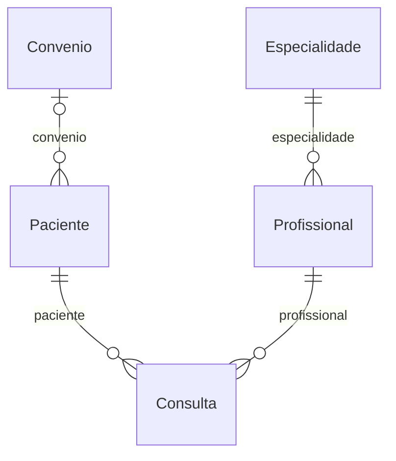
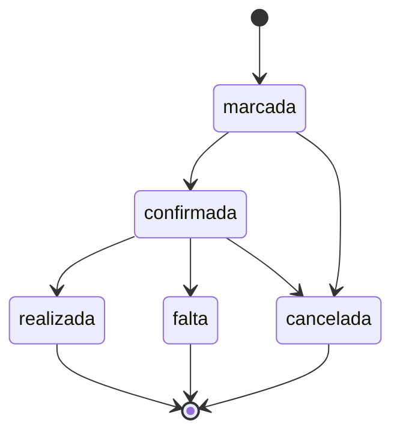

# Tema: Clínica

> Manual do grupo. O **Manual de Construção** ensina *como* fazer cada etapa; este arquivo diz *o que* o seu grupo constrói: campos, regras, rotas e telas de cada módulo. Siga os dois juntos.

## O problema

A clínica marca consultas por telefone em uma agenda de papel. Há horários duplicados, muitas faltas sem registro e nenhuma informação sobre quais especialidades têm mais procura.

## Os 6 módulos e quem faz cada um

| Módulo | Papel transversal de quem faz | Rota da API | Depende de |
| --- | --- | --- | --- |
| **A — Pacientes** | PO / Scrum Master | `/pacientes` | Convenio |
| **B — Profissionais** | Git e Integração | `/profissionais` | Especialidade |
| **C — Consultas** | Segurança | `/consultas` | Paciente, Profissional |
| **D — Especialidades** | Testes e Qualidade | `/especialidades` | — |
| **E — Convênios** | UX/UI e Acessibilidade | `/convenios` | — |
| **F — Relatórios** | Documentação e Apresentação | `/relatorios` | todos (só leitura) |

### Como os dados se ligam



Leia assim: cada linha liga um módulo ao outro pelo campo indicado (por exemplo, o campo `convenio` guarda o `_id` do outro módulo).

## Roteiro por aula

| Aula | Tarefa de cada aluno no seu módulo | Seção deste arquivo |
| --- | --- | --- |
| 01 | Copiar os requisitos e as regras do seu módulo para o Documento de Visão e as rotas para o Contrato da API (C0) | Requisitos, Regras, Rotas |
| 02 | Criar o modelo, os componentes, a rota e o link no menu | Código de partida → Modelo |
| 03 | Tela de listagem com as colunas e o filtro | Telas |
| 04 | Formulário com as validações | Código de partida → Formulário |
| 05 | Serviço mock com pelo menos 3 registros | Código de partida → Dados para o mock |
| 06 | Revisão das telas (C1) | Telas |
| 07 | Linhas do seu módulo no Dicionário de Dados (C2) | Campos |
| 08 | Schema, registro no módulo e dados no seed | Código de partida → Schema |
| 09 | Service e controller com o CRUD | Rotas |
| 10 | DTOs, testes e Swagger (C3) | Código de partida → DTOs, Testes mínimos |
| 11 | Regras de negócio no service (e o fluxo de estados no módulo C) | Regras de negócio, Fluxo de estados |
| 12–13 | Autenticação, perfis e troca do mock pela API (C4) | Manual de Construção |
| 14–15 | Testes finais, documentação e banca (C5) | Testes mínimos |

## Módulo A — Pacientes

**Responsável:** aluno com o papel **PO / Scrum Master** · **Rota da API:** `/api/v1/pacientes` · **Coleção:** `pacientes`

Cadastro das pessoas atendidas pela clínica.

**Depende de:** Convenio (`convenios`). Até a aula 12 o front usa mocks, então você não precisa esperar os colegas: use ids de exemplo (`'1'`, `'2'`).

**Pastas:** `backend/src/pacientes/` e `frontend/src/app/features/pacientes/`

### Campos

| Campo | Rótulo na tela | Tipo | Obrigatório | Regras | Exemplo |
| --- | --- | --- | --- | --- | --- |
| `nome` | Nome | texto | sim | 3 a 80 caracteres | `Maria Souza` |
| `email` | E-mail | e-mail | sim | **único** | `maria.souza@email.com` |
| `telefone` | Telefone | telefone | sim | formato (51) 99999-9999 | `(51) 99876-5432` |
| `dataNascimento` | Data de nascimento | data | sim | — | `1990-05-21` |
| `convenio` | Convênio | referência → Convenio | não | — | _id de Convenio |
| `ativo` | Ativo | sim/não | automático | padrão: sim | — |

`_id`, `createdAt` e `updatedAt` são criados automaticamente pelo MongoDB e pelo `timestamps: true`.

### Requisitos funcionais

- **RF01** — O sistema deve permitir cadastrar um paciente com os campos acima.
- **RF02** — O sistema deve listar os pacientes ativos, com busca por parte do nome (sem diferenciar maiúsculas).
- **RF03** — O sistema deve permitir editar um paciente existente.
- **RF04** — O sistema deve permitir excluir um paciente; a exclusão apenas o inativa.

### Regras de negócio

| Código | Regra | Resposta da API quando é violada | Como implementar |
| --- | --- | --- | --- |
| **RN01** | Não pode haver dois pacientes com o mesmo e-mail. | 409 — _Já existe um paciente com o e-mail "..."_ | Igual ao `garantirNomeUnico` de Produtos, buscando por `email`. |
| **RN02** | A data de nascimento não pode ser no futuro. | 400 — _A data de nascimento não pode ser futura_ | `if (new Date(dto.dataNascimento) > new Date())`. |

### Rotas da API

| Método | Rota | O que faz | Respostas |
| --- | --- | --- | --- |
| GET | `/pacientes` | Lista (filtro opcional `?busca=texto`, `?todos=true` inclui os inativos) | 200 |
| GET | `/pacientes/:id` | Busca pelo id | 200, 400, 404 |
| POST | `/pacientes` | Cadastra | 201, 400, 409 |
| PATCH | `/pacientes/:id` | Edita | 200, 400, 404 |
| DELETE | `/pacientes/:id` | Inativa (exclusão lógica) | 204, 400, 404 |

Filtro no service: `const filtro = busca ? { nome: { $regex: busca, $options: 'i' } } : {};`

> **Receitas úteis** ([guia/RECEITAS.md](../RECEITAS.md)): busca por texto → receita 1 · exclusão lógica → receita 2 · mostrar e escolher referências → receitas 3 e 4 · datas → receita 6.

### Telas

- **Listagem** (`pacientes-lista`): colunas Nome, E-mail, Telefone, Data de nascimento e ações. Filtro: busca por parte do nome (sem diferenciar maiúsculas). Mensagens de carregando, lista vazia, erro e sucesso.
- **Formulário** (`paciente-form`), usado para cadastrar e editar:

| Campo | Controle na tela |
| --- | --- |
| Nome * | `text` |
| E-mail * | `email` |
| Telefone * | `tel` |
| Data de nascimento * | `date` |
| Convênio | `select (receita 4 de guia/RECEITAS.md)` |

- **Menu:** link "Pacientes" em `layout.html` e rota `pacientes` em `app.routes.ts`.

### Código de partida

Use estes trechos junto com o Manual de Construção. Eles substituem os campos de Produtos pelos do seu módulo; o resto (service, controller, serviços do front, telas) segue o modelo de Produtos, como o manual ensina.

<details>
<summary><b>Modelo do front-end (aula 02)</b></summary>

```ts
// frontend/src/app/features/pacientes/paciente.model.ts
import { Referencia } from '../../core/models/referencia';

/** Paciente como a API devolve (segue o contrato da API). */
export interface Paciente {
  _id: string;
  nome: string;
  email: string;
  telefone: string;
  dataNascimento: string; // ISO: '2026-11-20'
  convenio?: Referencia; // _id ou { _id, nome } (populate)
  ativo: boolean;
  createdAt?: string;
  updatedAt?: string;
}

/** Dados enviados para criar ou editar. */
export interface PacienteEntrada {
  nome: string;
  email: string;
  telefone: string;
  dataNascimento: string; // ISO: '2026-11-20'
  convenio?: string; // _id do Convenio
  ativo?: boolean;
}
```

</details>

<details>
<summary><b>Dados para o serviço mock (aula 05)</b></summary>

Comece com este registro e acrescente pelo menos mais 2, variando os casos.

```ts
private pacientes: Paciente[] = [
  {
    _id: '1',
    nome: 'Maria Souza',
    email: 'maria.souza@email.com',
    telefone: '(51) 99876-5432',
    dataNascimento: '1990-05-21',
    convenio: '1',
    ativo: true,
  },
];
```

</details>

<details>
<summary><b>Formulário reativo (aula 04)</b></summary>

```ts
// frontend/src/app/features/pacientes/paciente-form/paciente-form.ts — dentro da classe
protected readonly form = this.fb.nonNullable.group({
  nome: ['', [Validators.required, Validators.minLength(3), Validators.maxLength(80)]],
  email: ['', [Validators.required, Validators.email]],
  telefone: ['', [Validators.required, Validators.pattern(/^\(\d{2}\) \d{4,5}-\d{4}$/)]],
  dataNascimento: ['', [Validators.required]],
  convenio: ['', []],
});
```

</details>

<details>
<summary><b>Schema do MongoDB (aula 08)</b></summary>

```ts
// backend/src/pacientes/schemas/paciente.schema.ts
import { Prop, Schema, SchemaFactory } from '@nestjs/mongoose';
import { HydratedDocument, Types } from 'mongoose';

export type PacienteDocument = HydratedDocument<Paciente>;

@Schema({ timestamps: true, collection: 'pacientes' })
export class Paciente {
  @Prop({ required: true, trim: true, minlength: 3, maxlength: 80 })
  nome: string;

  @Prop({ required: true, trim: true, lowercase: true, unique: true })
  email: string;

  @Prop({ required: true, trim: true })
  telefone: string;

  @Prop({ type: Date, required: true })
  dataNascimento: Date;

  // Referência ao módulo Convenio: guarda só o _id
  @Prop({ type: Types.ObjectId, ref: 'Convenio' })
  convenio?: Types.ObjectId;

  @Prop({ default: true })
  ativo: boolean;
}

export const PacienteSchema = SchemaFactory.createForClass(Paciente);
PacienteSchema.index({ convenio: 1 });
```

</details>

<details>
<summary><b>DTOs de criação e edição (aula 10)</b></summary>

```ts
// backend/src/pacientes/dto/create-paciente.dto.ts
import { ApiProperty, ApiPropertyOptional } from '@nestjs/swagger';
import {
  IsDateString,
  IsEmail,
  IsMongoId,
  IsNotEmpty,
  IsOptional,
  IsString,
  Length,
  Matches,
} from 'class-validator';

export class CreatePacienteDto {
  @ApiProperty({ example: 'Maria Souza' })
  @IsString()
  @IsNotEmpty({ message: 'Nome é obrigatório' })
  @Length(3, 80, { message: 'Nome deve ter entre 3 e 80 caracteres' })
  nome: string;

  @ApiProperty({ example: 'maria.souza@email.com' })
  @IsEmail({}, { message: 'Informe um e-mail válido' })
  email: string;

  @ApiProperty({ example: '(51) 99876-5432' })
  @IsString()
  @Matches(/^\(\d{2}\) \d{4,5}-\d{4}$/, {
    message: 'Telefone inválido. Use o formato (51) 99999-9999',
  })
  telefone: string;

  @ApiProperty({ example: '1990-05-21' })
  @IsDateString({}, { message: 'Data de nascimento deve ser uma data válida' })
  dataNascimento: string;

  @ApiPropertyOptional({ example: '665f1c2b9a1e4b0012345678' })
  @IsOptional()
  @IsMongoId({ message: 'Convênio: id inválido' })
  convenio?: string;
}
```

```ts
// backend/src/pacientes/dto/update-paciente.dto.ts
import { ApiPropertyOptional, PartialType } from '@nestjs/swagger';
import { IsBoolean, IsOptional } from 'class-validator';
import { CreatePacienteDto } from './create-paciente.dto';

export class UpdatePacienteDto extends PartialType(CreatePacienteDto) {
  @ApiPropertyOptional({ example: true })
  @IsOptional()
  @IsBoolean()
  ativo?: boolean;
}
```

</details>

### Testes mínimos (aula 10)

- [ ] `criar` salva um paciente com dados válidos.
- [ ] `buscarPorId` lança `NotFoundException` (404) quando o paciente não existe.
- [ ] `buscarPorId` lança `BadRequestException` (400) para um id inválido.
- [ ] Regra: não pode haver dois pacientes com o mesmo e-mail.
- [ ] Regra: a data de nascimento não pode ser no futuro.

## Módulo B — Profissionais

**Responsável:** aluno com o papel **Git e Integração** · **Rota da API:** `/api/v1/profissionais` · **Coleção:** `profissionais`

Médicos, psicólogos e demais profissionais que atendem na clínica.

**Depende de:** Especialidade (`especialidades`). Até a aula 12 o front usa mocks, então você não precisa esperar os colegas: use ids de exemplo (`'1'`, `'2'`).

**Pastas:** `backend/src/profissionais/` e `frontend/src/app/features/profissionais/`

### Campos

| Campo | Rótulo na tela | Tipo | Obrigatório | Regras | Exemplo |
| --- | --- | --- | --- | --- | --- |
| `nome` | Nome | texto | sim | 3 a 80 caracteres | `Dra. Ana Lima` |
| `registro` | Registro profissional (CRM, CRP...) | texto | sim | 4 a 20 caracteres; **único**; salvo em maiúsculas | `CRM-RS 45678` |
| `especialidade` | Especialidade | referência → Especialidade | sim | — | _id de Especialidade |
| `email` | E-mail | e-mail | sim | **único** | `ana.lima@clinica.com` |
| `telefone` | Telefone | telefone | sim | formato (51) 99999-9999 | `(51) 99876-5432` |
| `ativo` | Ativo | sim/não | automático | padrão: sim | — |

`_id`, `createdAt` e `updatedAt` são criados automaticamente pelo MongoDB e pelo `timestamps: true`.

### Requisitos funcionais

- **RF05** — O sistema deve permitir cadastrar um profissional com os campos acima.
- **RF06** — O sistema deve listar os profissionais ativos, com busca por parte do nome (sem diferenciar maiúsculas).
- **RF07** — O sistema deve permitir editar um profissional existente.
- **RF08** — O sistema deve permitir excluir um profissional; a exclusão apenas o inativa.

### Regras de negócio

| Código | Regra | Resposta da API quando é violada | Como implementar |
| --- | --- | --- | --- |
| **RN03** | Não pode haver dois profissionais com o mesmo registro. | 409 — _Já existe um profissional com o registro "..."_ | Igual ao `garantirNomeUnico`, buscando por `registro`. |
| **RN04** | A especialidade informada precisa existir. | 404 — _Especialidade ... não encontrada_ | Receita 5 de `guia/RECEITAS.md`: injete o `EspecialidadesService`. |

### Rotas da API

| Método | Rota | O que faz | Respostas |
| --- | --- | --- | --- |
| GET | `/profissionais` | Lista (filtro opcional `?busca=texto`, `?todos=true` inclui os inativos) | 200 |
| GET | `/profissionais/:id` | Busca pelo id | 200, 400, 404 |
| POST | `/profissionais` | Cadastra | 201, 400, 409, 404 |
| PATCH | `/profissionais/:id` | Edita | 200, 400, 404 |
| DELETE | `/profissionais/:id` | Inativa (exclusão lógica) | 204, 400, 404 |

Filtro no service: `const filtro = busca ? { nome: { $regex: busca, $options: 'i' } } : {};`

> **Receitas úteis** ([guia/RECEITAS.md](../RECEITAS.md)): busca por texto → receita 1 · exclusão lógica → receita 2 · mostrar e escolher referências → receitas 3 e 4.

### Telas

- **Listagem** (`profissionais-lista`): colunas Nome, Registro profissional (CRM, CRP...), Especialidade, E-mail e ações. Filtro: busca por parte do nome (sem diferenciar maiúsculas). Mensagens de carregando, lista vazia, erro e sucesso.
- **Formulário** (`profissional-form`), usado para cadastrar e editar:

| Campo | Controle na tela |
| --- | --- |
| Nome * | `text` |
| Registro profissional (CRM, CRP...) * | `text` |
| Especialidade * | `select (receita 4 de guia/RECEITAS.md)` |
| E-mail * | `email` |
| Telefone * | `tel` |

- **Menu:** link "Profissionais" em `layout.html` e rota `profissionais` em `app.routes.ts`.

### Código de partida

Use estes trechos junto com o Manual de Construção. Eles substituem os campos de Produtos pelos do seu módulo; o resto (service, controller, serviços do front, telas) segue o modelo de Produtos, como o manual ensina.

<details>
<summary><b>Modelo do front-end (aula 02)</b></summary>

```ts
// frontend/src/app/features/profissionais/profissional.model.ts
import { Referencia } from '../../core/models/referencia';

/** Profissional como a API devolve (segue o contrato da API). */
export interface Profissional {
  _id: string;
  nome: string;
  registro: string;
  especialidade: Referencia; // _id ou { _id, nome } (populate)
  email: string;
  telefone: string;
  ativo: boolean;
  createdAt?: string;
  updatedAt?: string;
}

/** Dados enviados para criar ou editar. */
export interface ProfissionalEntrada {
  nome: string;
  registro: string;
  especialidade: string; // _id do Especialidade
  email: string;
  telefone: string;
  ativo?: boolean;
}
```

</details>

<details>
<summary><b>Dados para o serviço mock (aula 05)</b></summary>

Comece com este registro e acrescente pelo menos mais 2, variando os casos.

```ts
private profissionais: Profissional[] = [
  {
    _id: '1',
    nome: 'Dra. Ana Lima',
    registro: 'CRM-RS 45678',
    especialidade: '1',
    email: 'ana.lima@clinica.com',
    telefone: '(51) 99876-5432',
    ativo: true,
  },
];
```

</details>

<details>
<summary><b>Formulário reativo (aula 04)</b></summary>

```ts
// frontend/src/app/features/profissionais/profissional-form/profissional-form.ts — dentro da classe
protected readonly form = this.fb.nonNullable.group({
  nome: ['', [Validators.required, Validators.minLength(3), Validators.maxLength(80)]],
  registro: ['', [Validators.required, Validators.minLength(4), Validators.maxLength(20)]],
  especialidade: ['', [Validators.required]],
  email: ['', [Validators.required, Validators.email]],
  telefone: ['', [Validators.required, Validators.pattern(/^\(\d{2}\) \d{4,5}-\d{4}$/)]],
});
```

</details>

<details>
<summary><b>Schema do MongoDB (aula 08)</b></summary>

```ts
// backend/src/profissionais/schemas/profissional.schema.ts
import { Prop, Schema, SchemaFactory } from '@nestjs/mongoose';
import { HydratedDocument, Types } from 'mongoose';

export type ProfissionalDocument = HydratedDocument<Profissional>;

@Schema({ timestamps: true, collection: 'profissionais' })
export class Profissional {
  @Prop({ required: true, trim: true, minlength: 3, maxlength: 80 })
  nome: string;

  @Prop({
    required: true,
    trim: true,
    minlength: 4,
    maxlength: 20,
    uppercase: true,
    unique: true,
  })
  registro: string;

  // Referência ao módulo Especialidade: guarda só o _id
  @Prop({ type: Types.ObjectId, ref: 'Especialidade', required: true })
  especialidade: Types.ObjectId;

  @Prop({ required: true, trim: true, lowercase: true, unique: true })
  email: string;

  @Prop({ required: true, trim: true })
  telefone: string;

  @Prop({ default: true })
  ativo: boolean;
}

export const ProfissionalSchema = SchemaFactory.createForClass(Profissional);
ProfissionalSchema.index({ especialidade: 1 });
```

</details>

<details>
<summary><b>DTOs de criação e edição (aula 10)</b></summary>

```ts
// backend/src/profissionais/dto/create-profissional.dto.ts
import { ApiProperty } from '@nestjs/swagger';
import {
  IsEmail,
  IsMongoId,
  IsNotEmpty,
  IsString,
  Length,
  Matches,
} from 'class-validator';

export class CreateProfissionalDto {
  @ApiProperty({ example: 'Dra. Ana Lima' })
  @IsString()
  @IsNotEmpty({ message: 'Nome é obrigatório' })
  @Length(3, 80, { message: 'Nome deve ter entre 3 e 80 caracteres' })
  nome: string;

  @ApiProperty({ example: 'CRM-RS 45678' })
  @IsString()
  @IsNotEmpty({ message: 'Registro profissional (CRM, CRP...) é obrigatório' })
  @Length(4, 20, {
    message:
      'Registro profissional (CRM, CRP...) deve ter entre 4 e 20 caracteres',
  })
  registro: string;

  @ApiProperty({ example: '665f1c2b9a1e4b0012345678' })
  @IsMongoId({ message: 'Especialidade: id inválido' })
  especialidade: string;

  @ApiProperty({ example: 'ana.lima@clinica.com' })
  @IsEmail({}, { message: 'Informe um e-mail válido' })
  email: string;

  @ApiProperty({ example: '(51) 99876-5432' })
  @IsString()
  @Matches(/^\(\d{2}\) \d{4,5}-\d{4}$/, {
    message: 'Telefone inválido. Use o formato (51) 99999-9999',
  })
  telefone: string;
}
```

```ts
// backend/src/profissionais/dto/update-profissional.dto.ts
import { ApiPropertyOptional, PartialType } from '@nestjs/swagger';
import { IsBoolean, IsOptional } from 'class-validator';
import { CreateProfissionalDto } from './create-profissional.dto';

export class UpdateProfissionalDto extends PartialType(CreateProfissionalDto) {
  @ApiPropertyOptional({ example: true })
  @IsOptional()
  @IsBoolean()
  ativo?: boolean;
}
```

</details>

### Testes mínimos (aula 10)

- [ ] `criar` salva um profissional com dados válidos.
- [ ] `buscarPorId` lança `NotFoundException` (404) quando o profissional não existe.
- [ ] `buscarPorId` lança `BadRequestException` (400) para um id inválido.
- [ ] Regra: não pode haver dois profissionais com o mesmo registro.
- [ ] Regra: a especialidade informada precisa existir.

## Módulo C — Consultas

**Responsável:** aluno com o papel **Segurança** · **Rota da API:** `/api/v1/consultas` · **Coleção:** `consultas`

Agenda de consultas, com o fluxo de estados da consulta.

**Depende de:** Paciente (`pacientes`), Profissional (`profissionais`). Até a aula 12 o front usa mocks, então você não precisa esperar os colegas: use ids de exemplo (`'1'`, `'2'`).

**Pastas:** `backend/src/consultas/` e `frontend/src/app/features/consultas/`

### Campos

| Campo | Rótulo na tela | Tipo | Obrigatório | Regras | Exemplo |
| --- | --- | --- | --- | --- | --- |
| `paciente` | Paciente | referência → Paciente | sim | — | _id de Paciente |
| `profissional` | Profissional | referência → Profissional | sim | — | _id de Profissional |
| `dataHora` | Data e hora | data e hora | sim | — | `2026-11-24T13:30:00.000Z` |
| `motivo` | Motivo da consulta | texto longo | não | até 300 caracteres | `Retorno com exames` |
| `status` | Status | lista de opções | automático | `marcada`, `confirmada`, `realizada`, `falta`, `cancelada`; começa em `marcada` | — |

`_id`, `createdAt` e `updatedAt` são criados automaticamente pelo MongoDB e pelo `timestamps: true`.

### Requisitos funcionais

- **RF09** — O sistema deve permitir cadastrar uma consulta com os campos acima.
- **RF10** — O sistema deve listar as consultas, com filtro pelo status.
- **RF11** — O sistema deve permitir editar uma consulta existente.
- **RF12** — O sistema deve permitir mudar o status da consulta, respeitando o fluxo de estados.

### Regras de negócio

| Código | Regra | Resposta da API quando é violada | Como implementar |
| --- | --- | --- | --- |
| **RN05** | Um profissional não pode ter duas consultas no mesmo dia e horário (exceto canceladas). | 409 — _O profissional já tem uma consulta neste horário_ | `findOne({ profissional: dto.profissional, dataHora: dto.dataHora, status: { $ne: 'cancelada' } })`. |
| **RN06** | Consultas só podem ser marcadas de segunda a sexta, das 8h às 18h, no futuro. | 400 — _Horário fora do expediente da clínica_ | Use `getDay()` (0 = domingo, 6 = sábado) e `getHours()` sobre `new Date(dto.dataHora)`. |
| **RN07** | O status só pode mudar seguindo o fluxo abaixo. | 400 — _Não é possível passar de "..." para "..."_ | Mapa `TRANSICOES` (código abaixo). |

### Rotas da API

| Método | Rota | O que faz | Respostas |
| --- | --- | --- | --- |
| GET | `/consultas` | Lista (filtro opcional `?status=marcada`) | 200 |
| GET | `/consultas/:id` | Busca pelo id | 200, 400, 404 |
| POST | `/consultas` | Cadastra | 201, 400, 409 |
| PATCH | `/consultas/:id` | Edita | 200, 400, 404 |
| PATCH | `/consultas/:id/status` | Muda o status | 200, 400, 404 |

Filtro no service: `const filtro = status ? { status } : {};`

> **Receitas úteis** ([guia/RECEITAS.md](../RECEITAS.md)): mostrar e escolher referências → receitas 3 e 4 · datas → receita 6 · botões de status → receita 7.

### Fluxo de estados



Na tela de listagem, mostre só os botões das transições válidas para o status atual de cada linha.

<details>
<summary><b>Mapa de transições e método mudarStatus</b></summary>

```ts
// backend/src/consultas/consultas.service.ts — no topo do arquivo
import { Status } from './schemas/consulta.schema';

// Mapa de transições VÁLIDAS: de → para (PDF 05, cap. 3)
const TRANSICOES: Record<Status, Status[]> = {
  marcada: ['confirmada', 'cancelada'],
  confirmada: ['realizada', 'falta', 'cancelada'],
  realizada: [], // estado final
  falta: [], // estado final
  cancelada: [], // estado final
};

// ...dentro da classe ConsultasService:
async mudarStatus(id: string, novo: Status) {
  const atual = await this.buscarPorId(id);
  if (!TRANSICOES[atual.status].includes(novo)) {
    throw new BadRequestException(
      `Não é possível passar de "${atual.status}" para "${novo}"`,
    );
  }
  return this.consultaModel
    .findByIdAndUpdate(id, { status: novo }, { new: true })
    .lean()
    .exec();
}
```

</details>

<details>
<summary><b>DTO da mudança de status</b></summary>

```ts
// backend/src/consultas/dto/mudar-status.dto.ts
import { ApiProperty } from '@nestjs/swagger';
import { IsIn } from 'class-validator';
import { STATUS, type Status } from '../schemas/consulta.schema';

export class MudarStatusDto {
  @ApiProperty({ enum: STATUS, example: 'confirmada' })
  @IsIn(STATUS, { message: `Status deve ser: ${STATUS.join(', ')}` })
  status: Status;
}
```

</details>

<details>
<summary><b>Rota no controller</b></summary>

```ts
// backend/src/consultas/consultas.controller.ts
@Patch(':id/status')
@ApiOperation({ summary: 'Muda o status (somente transições válidas)' })
@ApiResponse({ status: 400, description: 'Transição de status inválida' })
mudarStatus(@Param('id') id: string, @Body() dto: MudarStatusDto) {
  return this.consultasService.mudarStatus(id, dto.status);
}
```

</details>

### Telas

- **Listagem** (`consultas-lista`): colunas Paciente, Profissional, Data e hora, Status (com a etiqueta colorida) e ações. Filtro: filtro pelo status. Mensagens de carregando, lista vazia, erro e sucesso.
- **Formulário** (`consulta-form`), usado para cadastrar e editar:

| Campo | Controle na tela |
| --- | --- |
| Paciente * | `select (receita 4 de guia/RECEITAS.md)` |
| Profissional * | `select (receita 4 de guia/RECEITAS.md)` |
| Data e hora * | `datetime-local` |
| Motivo da consulta | `textarea` |

- **Menu:** link "Consultas" em `layout.html` e rota `consultas` em `app.routes.ts`.

### Código de partida

Use estes trechos junto com o Manual de Construção. Eles substituem os campos de Produtos pelos do seu módulo; o resto (service, controller, serviços do front, telas) segue o modelo de Produtos, como o manual ensina.

<details>
<summary><b>Modelo do front-end (aula 02)</b></summary>

```ts
// frontend/src/app/features/consultas/consulta.model.ts
import { Referencia } from '../../core/models/referencia';

export const STATUS = ['marcada', 'confirmada', 'realizada', 'falta', 'cancelada'] as const;
export type Status = (typeof STATUS)[number];

/** Consulta como a API devolve (segue o contrato da API). */
export interface Consulta {
  _id: string;
  paciente: Referencia; // _id ou { _id, nome } (populate)
  profissional: Referencia; // _id ou { _id, nome } (populate)
  dataHora: string; // ISO: '2026-11-20T14:00'
  motivo?: string;
  status: Status;
  createdAt?: string;
  updatedAt?: string;
}

/** Dados enviados para criar ou editar. */
export interface ConsultaEntrada {
  paciente: string; // _id do Paciente
  profissional: string; // _id do Profissional
  dataHora: string; // ISO: '2026-11-20T14:00'
  motivo?: string;
}
```

</details>

<details>
<summary><b>Dados para o serviço mock (aula 05)</b></summary>

Comece com este registro e acrescente pelo menos mais 2, variando os casos.

```ts
private consultas: Consulta[] = [
  {
    _id: '1',
    paciente: '1',
    profissional: '1',
    dataHora: '2026-11-24T13:30',
    motivo: 'Retorno com exames',
    status: 'marcada',
  },
];
```

</details>

<details>
<summary><b>Formulário reativo (aula 04)</b></summary>

```ts
// frontend/src/app/features/consultas/consulta-form/consulta-form.ts — dentro da classe
protected readonly form = this.fb.nonNullable.group({
  paciente: ['', [Validators.required]],
  profissional: ['', [Validators.required]],
  dataHora: ['', [Validators.required]],
  motivo: ['', [Validators.maxLength(300)]],
});
```

</details>

<details>
<summary><b>Schema do MongoDB (aula 08)</b></summary>

```ts
// backend/src/consultas/schemas/consulta.schema.ts
import { Prop, Schema, SchemaFactory } from '@nestjs/mongoose';
import { HydratedDocument, Types } from 'mongoose';

export const STATUS = [
  'marcada',
  'confirmada',
  'realizada',
  'falta',
  'cancelada',
] as const;
export type Status = (typeof STATUS)[number];

export type ConsultaDocument = HydratedDocument<Consulta>;

@Schema({ timestamps: true, collection: 'consultas' })
export class Consulta {
  // Referência ao módulo Paciente: guarda só o _id
  @Prop({ type: Types.ObjectId, ref: 'Paciente', required: true })
  paciente: Types.ObjectId;

  // Referência ao módulo Profissional: guarda só o _id
  @Prop({ type: Types.ObjectId, ref: 'Profissional', required: true })
  profissional: Types.ObjectId;

  @Prop({ type: Date, required: true })
  dataHora: Date;

  @Prop({ trim: true, maxlength: 300 })
  motivo?: string;

  // Fluxo de estados: o status começa em "marcada" e só muda pela rota PATCH /consultas/:id/status
  @Prop({ type: String, enum: STATUS, default: 'marcada' })
  status: Status;
}

export const ConsultaSchema = SchemaFactory.createForClass(Consulta);
ConsultaSchema.index({ paciente: 1 });
ConsultaSchema.index({ profissional: 1 });
ConsultaSchema.index({ status: 1 });
```

</details>

<details>
<summary><b>DTOs de criação e edição (aula 10)</b></summary>

```ts
// backend/src/consultas/dto/create-consulta.dto.ts
import { ApiProperty, ApiPropertyOptional } from '@nestjs/swagger';
import {
  IsDateString,
  IsMongoId,
  IsOptional,
  IsString,
  MaxLength,
} from 'class-validator';

export class CreateConsultaDto {
  @ApiProperty({ example: '665f1c2b9a1e4b0012345678' })
  @IsMongoId({ message: 'Paciente: id inválido' })
  paciente: string;

  @ApiProperty({ example: '665f1c2b9a1e4b0012345678' })
  @IsMongoId({ message: 'Profissional: id inválido' })
  profissional: string;

  @ApiProperty({ example: '2026-11-24T13:30:00.000Z' })
  @IsDateString({}, { message: 'Data e hora deve ser uma data válida' })
  dataHora: string;

  @ApiPropertyOptional({ example: 'Retorno com exames' })
  @IsOptional()
  @IsString()
  @MaxLength(300, {
    message: 'Motivo da consulta pode ter no máximo 300 caracteres',
  })
  motivo?: string;
}
```

```ts
// backend/src/consultas/dto/update-consulta.dto.ts
import { PartialType } from '@nestjs/swagger';
import { CreateConsultaDto } from './create-consulta.dto';

// O status NÃO entra aqui: ele só muda pela rota PATCH /:id/status
export class UpdateConsultaDto extends PartialType(CreateConsultaDto) {}
```

</details>

### Testes mínimos (aula 10)

- [ ] `criar` salva uma consulta com dados válidos.
- [ ] `buscarPorId` lança `NotFoundException` (404) quando a consulta não existe.
- [ ] `buscarPorId` lança `BadRequestException` (400) para um id inválido.
- [ ] Regra: um profissional não pode ter duas consultas no mesmo dia e horário (exceto canceladas).
- [ ] Regra: consultas só podem ser marcadas de segunda a sexta, das 8h às 18h, no futuro.
- [ ] `mudarStatus` lança 400 numa transição inválida e aceita uma válida.

## Módulo D — Especialidades

**Responsável:** aluno com o papel **Testes e Qualidade** · **Rota da API:** `/api/v1/especialidades` · **Coleção:** `especialidades`

Especialidades atendidas, com duração e valor da consulta particular.

**Pastas:** `backend/src/especialidades/` e `frontend/src/app/features/especialidades/`

### Campos

| Campo | Rótulo na tela | Tipo | Obrigatório | Regras | Exemplo |
| --- | --- | --- | --- | --- | --- |
| `nome` | Nome | texto | sim | 3 a 50 caracteres; **único** | `Cardiologia` |
| `descricao` | Descrição | texto longo | não | até 300 caracteres | `Cuidados com o coração e a circulação` |
| `duracaoConsultaMin` | Duração da consulta (min) | número inteiro | sim | de 15 a 120 | `30` |
| `valorParticular` | Valor particular (R$) | número decimal | sim | mínimo 0 | `250` |
| `ativo` | Ativo | sim/não | automático | padrão: sim | — |

`_id`, `createdAt` e `updatedAt` são criados automaticamente pelo MongoDB e pelo `timestamps: true`.

### Requisitos funcionais

- **RF13** — O sistema deve permitir cadastrar uma especialidade com os campos acima.
- **RF14** — O sistema deve listar as especialidades ativas, com busca por parte do nome (sem diferenciar maiúsculas).
- **RF15** — O sistema deve permitir editar uma especialidade existente.
- **RF16** — O sistema deve permitir excluir uma especialidade; a exclusão apenas a inativa.

### Regras de negócio

| Código | Regra | Resposta da API quando é violada | Como implementar |
| --- | --- | --- | --- |
| **RN08** | Não pode haver duas especialidades com o mesmo nome. | 409 — _Já existe uma especialidade com o nome "..."_ | Igual ao `garantirNomeUnico` de Produtos. |
| **RN09** | Excluir uma especialidade apenas a inativa; a listagem padrão mostra só as ativas. | 204 (exclusão vira `ativo: false`) | Receita 2 de `guia/RECEITAS.md`. |

### Rotas da API

| Método | Rota | O que faz | Respostas |
| --- | --- | --- | --- |
| GET | `/especialidades` | Lista (filtro opcional `?busca=texto`, `?todos=true` inclui os inativos) | 200 |
| GET | `/especialidades/:id` | Busca pelo id | 200, 400, 404 |
| POST | `/especialidades` | Cadastra | 201, 400, 409 |
| PATCH | `/especialidades/:id` | Edita | 200, 400, 404 |
| DELETE | `/especialidades/:id` | Inativa (exclusão lógica) | 204, 400, 404 |

Filtro no service: `const filtro = busca ? { nome: { $regex: busca, $options: 'i' } } : {};`

> **Receitas úteis** ([guia/RECEITAS.md](../RECEITAS.md)): busca por texto → receita 1 · exclusão lógica → receita 2.

### Telas

- **Listagem** (`especialidades-lista`): colunas Nome, Duração da consulta (min), Valor particular (R$) e ações. Filtro: busca por parte do nome (sem diferenciar maiúsculas). Mensagens de carregando, lista vazia, erro e sucesso.
- **Formulário** (`especialidade-form`), usado para cadastrar e editar:

| Campo | Controle na tela |
| --- | --- |
| Nome * | `text` |
| Descrição | `textarea` |
| Duração da consulta (min) * | `number, step 1` |
| Valor particular (R$) * | `number, step 0.01` |

- **Menu:** link "Especialidades" em `layout.html` e rota `especialidades` em `app.routes.ts`.

### Código de partida

Use estes trechos junto com o Manual de Construção. Eles substituem os campos de Produtos pelos do seu módulo; o resto (service, controller, serviços do front, telas) segue o modelo de Produtos, como o manual ensina.

<details>
<summary><b>Modelo do front-end (aula 02)</b></summary>

```ts
// frontend/src/app/features/especialidades/especialidade.model.ts

/** Especialidade como a API devolve (segue o contrato da API). */
export interface Especialidade {
  _id: string;
  nome: string;
  descricao?: string;
  duracaoConsultaMin: number;
  valorParticular: number;
  ativo: boolean;
  createdAt?: string;
  updatedAt?: string;
}

/** Dados enviados para criar ou editar. */
export interface EspecialidadeEntrada {
  nome: string;
  descricao?: string;
  duracaoConsultaMin: number;
  valorParticular: number;
  ativo?: boolean;
}
```

</details>

<details>
<summary><b>Dados para o serviço mock (aula 05)</b></summary>

Comece com este registro e acrescente pelo menos mais 2, variando os casos.

```ts
private especialidades: Especialidade[] = [
  {
    _id: '1',
    nome: 'Cardiologia',
    descricao: 'Cuidados com o coração e a circulação',
    duracaoConsultaMin: 30,
    valorParticular: 250,
    ativo: true,
  },
];
```

</details>

<details>
<summary><b>Formulário reativo (aula 04)</b></summary>

```ts
// frontend/src/app/features/especialidades/especialidade-form/especialidade-form.ts — dentro da classe
protected readonly form = this.fb.nonNullable.group({
  nome: ['', [Validators.required, Validators.minLength(3), Validators.maxLength(50)]],
  descricao: ['', [Validators.maxLength(300)]],
  duracaoConsultaMin: [
    15,
    [Validators.required, Validators.min(15), Validators.max(120), Validators.pattern(/^\d+$/)],
  ],
  valorParticular: [0, [Validators.required, Validators.min(0)]],
});
```

</details>

<details>
<summary><b>Schema do MongoDB (aula 08)</b></summary>

```ts
// backend/src/especialidades/schemas/especialidade.schema.ts
import { Prop, Schema, SchemaFactory } from '@nestjs/mongoose';
import { HydratedDocument } from 'mongoose';

export type EspecialidadeDocument = HydratedDocument<Especialidade>;

@Schema({ timestamps: true, collection: 'especialidades' })
export class Especialidade {
  @Prop({
    required: true,
    trim: true,
    minlength: 3,
    maxlength: 50,
    unique: true,
  })
  nome: string;

  @Prop({ trim: true, maxlength: 300 })
  descricao?: string;

  @Prop({ required: true, min: 15, max: 120 })
  duracaoConsultaMin: number;

  @Prop({ required: true, min: 0 })
  valorParticular: number;

  @Prop({ default: true })
  ativo: boolean;
}

export const EspecialidadeSchema = SchemaFactory.createForClass(Especialidade);
```

</details>

<details>
<summary><b>DTOs de criação e edição (aula 10)</b></summary>

```ts
// backend/src/especialidades/dto/create-especialidade.dto.ts
import { ApiProperty, ApiPropertyOptional } from '@nestjs/swagger';
import {
  IsInt,
  IsNotEmpty,
  IsNumber,
  IsOptional,
  IsString,
  Length,
  Max,
  MaxLength,
  Min,
} from 'class-validator';

export class CreateEspecialidadeDto {
  @ApiProperty({ example: 'Cardiologia' })
  @IsString()
  @IsNotEmpty({ message: 'Nome é obrigatório' })
  @Length(3, 50, { message: 'Nome deve ter entre 3 e 50 caracteres' })
  nome: string;

  @ApiPropertyOptional({ example: 'Cuidados com o coração e a circulação' })
  @IsOptional()
  @IsString()
  @MaxLength(300, { message: 'Descrição pode ter no máximo 300 caracteres' })
  descricao?: string;

  @ApiProperty({ example: 30 })
  @IsInt({ message: 'Duração da consulta (min) deve ser um número inteiro' })
  @Min(15, { message: 'Duração da consulta (min) deve ser no mínimo 15' })
  @Max(120, { message: 'Duração da consulta (min) deve ser no máximo 120' })
  duracaoConsultaMin: number;

  @ApiProperty({ example: 250 })
  @IsNumber(
    { maxDecimalPlaces: 2 },
    { message: 'Valor particular (R$) deve ser um número' },
  )
  @Min(0, { message: 'Valor particular (R$) deve ser no mínimo 0' })
  valorParticular: number;
}
```

```ts
// backend/src/especialidades/dto/update-especialidade.dto.ts
import { ApiPropertyOptional, PartialType } from '@nestjs/swagger';
import { IsBoolean, IsOptional } from 'class-validator';
import { CreateEspecialidadeDto } from './create-especialidade.dto';

export class UpdateEspecialidadeDto extends PartialType(
  CreateEspecialidadeDto,
) {
  @ApiPropertyOptional({ example: true })
  @IsOptional()
  @IsBoolean()
  ativo?: boolean;
}
```

</details>

### Testes mínimos (aula 10)

- [ ] `criar` salva uma especialidade com dados válidos.
- [ ] `buscarPorId` lança `NotFoundException` (404) quando a especialidade não existe.
- [ ] `buscarPorId` lança `BadRequestException` (400) para um id inválido.
- [ ] Regra: não pode haver duas especialidades com o mesmo nome.
- [ ] Regra: excluir uma especialidade apenas a inativa; a listagem padrão mostra só as ativas.

## Módulo E — Convênios

**Responsável:** aluno com o papel **UX/UI e Acessibilidade** · **Rota da API:** `/api/v1/convenios` · **Coleção:** `convenios`

Planos de saúde aceitos pela clínica.

**Pastas:** `backend/src/convenios/` e `frontend/src/app/features/convenios/`

### Campos

| Campo | Rótulo na tela | Tipo | Obrigatório | Regras | Exemplo |
| --- | --- | --- | --- | --- | --- |
| `nome` | Nome | texto | sim | 3 a 60 caracteres; **único** | `Saúde Mais` |
| `codigoAns` | Código ANS | texto | sim | 6 caracteres; o código ans tem 6 dígitos; **único** | `123456` |
| `percentualCobertura` | Cobertura (%) | número inteiro | sim | de 0 a 100 | `80` |
| `telefone` | Telefone | telefone | não | formato (51) 99999-9999 | `(51) 99876-5432` |
| `ativo` | Ativo | sim/não | automático | padrão: sim | — |

`_id`, `createdAt` e `updatedAt` são criados automaticamente pelo MongoDB e pelo `timestamps: true`.

### Requisitos funcionais

- **RF17** — O sistema deve permitir cadastrar um convênio com os campos acima.
- **RF18** — O sistema deve listar os convênios ativos, com busca por parte do nome (sem diferenciar maiúsculas).
- **RF19** — O sistema deve permitir editar um convênio existente.
- **RF20** — O sistema deve permitir excluir um convênio; a exclusão apenas o inativa.

### Regras de negócio

| Código | Regra | Resposta da API quando é violada | Como implementar |
| --- | --- | --- | --- |
| **RN10** | Não pode haver dois convênios com o mesmo código ANS. | 409 — _Já existe um convênio com o código ANS "..."_ | Igual ao `garantirNomeUnico`, buscando por `codigoAns`. |
| **RN11** | Excluir um convênio apenas o inativa; a listagem padrão mostra só os ativos. | 204 (exclusão vira `ativo: false`) | Receita 2 de `guia/RECEITAS.md`. |

### Rotas da API

| Método | Rota | O que faz | Respostas |
| --- | --- | --- | --- |
| GET | `/convenios` | Lista (filtro opcional `?busca=texto`, `?todos=true` inclui os inativos) | 200 |
| GET | `/convenios/:id` | Busca pelo id | 200, 400, 404 |
| POST | `/convenios` | Cadastra | 201, 400, 409 |
| PATCH | `/convenios/:id` | Edita | 200, 400, 404 |
| DELETE | `/convenios/:id` | Inativa (exclusão lógica) | 204, 400, 404 |

Filtro no service: `const filtro = busca ? { nome: { $regex: busca, $options: 'i' } } : {};`

> **Receitas úteis** ([guia/RECEITAS.md](../RECEITAS.md)): busca por texto → receita 1 · exclusão lógica → receita 2.

### Telas

- **Listagem** (`convenios-lista`): colunas Nome, Código ANS, Cobertura (%), Telefone e ações. Filtro: busca por parte do nome (sem diferenciar maiúsculas). Mensagens de carregando, lista vazia, erro e sucesso.
- **Formulário** (`convenio-form`), usado para cadastrar e editar:

| Campo | Controle na tela |
| --- | --- |
| Nome * | `text` |
| Código ANS * | `text` |
| Cobertura (%) * | `number, step 1` |
| Telefone | `tel` |

- **Menu:** link "Convênios" em `layout.html` e rota `convenios` em `app.routes.ts`.

### Código de partida

Use estes trechos junto com o Manual de Construção. Eles substituem os campos de Produtos pelos do seu módulo; o resto (service, controller, serviços do front, telas) segue o modelo de Produtos, como o manual ensina.

<details>
<summary><b>Modelo do front-end (aula 02)</b></summary>

```ts
// frontend/src/app/features/convenios/convenio.model.ts

/** Convênio como a API devolve (segue o contrato da API). */
export interface Convenio {
  _id: string;
  nome: string;
  codigoAns: string;
  percentualCobertura: number;
  telefone?: string;
  ativo: boolean;
  createdAt?: string;
  updatedAt?: string;
}

/** Dados enviados para criar ou editar. */
export interface ConvenioEntrada {
  nome: string;
  codigoAns: string;
  percentualCobertura: number;
  telefone?: string;
  ativo?: boolean;
}
```

</details>

<details>
<summary><b>Dados para o serviço mock (aula 05)</b></summary>

Comece com este registro e acrescente pelo menos mais 2, variando os casos.

```ts
private convenios: Convenio[] = [
  {
    _id: '1',
    nome: 'Saúde Mais',
    codigoAns: '123456',
    percentualCobertura: 80,
    telefone: '(51) 99876-5432',
    ativo: true,
  },
];
```

</details>

<details>
<summary><b>Formulário reativo (aula 04)</b></summary>

```ts
// frontend/src/app/features/convenios/convenio-form/convenio-form.ts — dentro da classe
protected readonly form = this.fb.nonNullable.group({
  nome: ['', [Validators.required, Validators.minLength(3), Validators.maxLength(60)]],
  codigoAns: [
    '',
    [
      Validators.required,
      Validators.minLength(6),
      Validators.maxLength(6),
      Validators.pattern(/^\d{6}$/),
    ],
  ],
  percentualCobertura: [
    0,
    [Validators.required, Validators.min(0), Validators.max(100), Validators.pattern(/^\d+$/)],
  ],
  telefone: ['', [Validators.pattern(/^\(\d{2}\) \d{4,5}-\d{4}$/)]],
});
```

</details>

<details>
<summary><b>Schema do MongoDB (aula 08)</b></summary>

```ts
// backend/src/convenios/schemas/convenio.schema.ts
import { Prop, Schema, SchemaFactory } from '@nestjs/mongoose';
import { HydratedDocument } from 'mongoose';

export type ConvenioDocument = HydratedDocument<Convenio>;

@Schema({ timestamps: true, collection: 'convenios' })
export class Convenio {
  @Prop({
    required: true,
    trim: true,
    minlength: 3,
    maxlength: 60,
    unique: true,
  })
  nome: string;

  @Prop({
    required: true,
    trim: true,
    minlength: 6,
    maxlength: 6,
    unique: true,
  })
  codigoAns: string;

  @Prop({ required: true, min: 0, max: 100 })
  percentualCobertura: number;

  @Prop({ trim: true })
  telefone?: string;

  @Prop({ default: true })
  ativo: boolean;
}

export const ConvenioSchema = SchemaFactory.createForClass(Convenio);
```

</details>

<details>
<summary><b>DTOs de criação e edição (aula 10)</b></summary>

```ts
// backend/src/convenios/dto/create-convenio.dto.ts
import { ApiProperty, ApiPropertyOptional } from '@nestjs/swagger';
import {
  IsInt,
  IsNotEmpty,
  IsOptional,
  IsString,
  Length,
  Matches,
  Max,
  Min,
} from 'class-validator';

export class CreateConvenioDto {
  @ApiProperty({ example: 'Saúde Mais' })
  @IsString()
  @IsNotEmpty({ message: 'Nome é obrigatório' })
  @Length(3, 60, { message: 'Nome deve ter entre 3 e 60 caracteres' })
  nome: string;

  @ApiProperty({ example: '123456' })
  @IsString()
  @IsNotEmpty({ message: 'Código ANS é obrigatório' })
  @Length(6, 6, { message: 'Código ANS deve ter 6 caracteres' })
  @Matches(/^\d{6}$/, { message: 'O código ANS tem 6 dígitos' })
  codigoAns: string;

  @ApiProperty({ example: 80 })
  @IsInt({ message: 'Cobertura (%) deve ser um número inteiro' })
  @Min(0, { message: 'Cobertura (%) deve ser no mínimo 0' })
  @Max(100, { message: 'Cobertura (%) deve ser no máximo 100' })
  percentualCobertura: number;

  @ApiPropertyOptional({ example: '(51) 99876-5432' })
  @IsOptional()
  @IsString()
  @Matches(/^\(\d{2}\) \d{4,5}-\d{4}$/, {
    message: 'Telefone inválido. Use o formato (51) 99999-9999',
  })
  telefone?: string;
}
```

```ts
// backend/src/convenios/dto/update-convenio.dto.ts
import { ApiPropertyOptional, PartialType } from '@nestjs/swagger';
import { IsBoolean, IsOptional } from 'class-validator';
import { CreateConvenioDto } from './create-convenio.dto';

export class UpdateConvenioDto extends PartialType(CreateConvenioDto) {
  @ApiPropertyOptional({ example: true })
  @IsOptional()
  @IsBoolean()
  ativo?: boolean;
}
```

</details>

### Testes mínimos (aula 10)

- [ ] `criar` salva um convênio com dados válidos.
- [ ] `buscarPorId` lança `NotFoundException` (404) quando o convênio não existe.
- [ ] `buscarPorId` lança `BadRequestException` (400) para um id inválido.
- [ ] Regra: não pode haver dois convênios com o mesmo código ANS.
- [ ] Regra: excluir um convênio apenas o inativa; a listagem padrão mostra só os ativos.

## Módulo F — Relatórios

**Responsável:** aluno com o papel **Documentação e Apresentação** · **Rota da API:** `/api/v1/relatorios` · **Coleção:** nenhuma (lê as coleções dos colegas)

Painel com consultas do dia, faltas e procura por especialidade.

**Pastas:** `backend/src/relatorios/` e `frontend/src/app/features/relatorios/` (o painel também aparece na tela Início).

Enquanto os colegas não têm schema (até a aula 08), trabalhe no front com um serviço mock que devolve números fixos, no mesmo formato das respostas abaixo.

### Requisitos funcionais

- **RF21** — O sistema deve exibir: totais de pacientes, consultas marcadas e faltas.
- **RF22** — O sistema deve exibir: quantidade de consultas em cada status.
- **RF23** — O sistema deve exibir: consultas realizadas por especialidade.
- **RF24** — O painel deve mostrar uma mensagem amigável quando ainda não houver dados.

### Rotas da API

| Método | Rota | O que devolve | Exemplo de resposta (`dados`) |
| --- | --- | --- | --- |
| GET | `/relatorios/resumo` | Totais de pacientes, consultas marcadas e faltas | `{ "pacientes": 480, "consultasMarcadas": 37, "faltas": 15 }` |
| GET | `/relatorios/consultas-por-status` | Quantidade de consultas em cada status | `[{ "_id": "realizada", "quantidade": 210 }, ...]` |
| GET | `/relatorios/consultas-por-especialidade` | Consultas realizadas por especialidade | `[{ "especialidade": "Cardiologia", "quantidade": 54 }, ...]` |

### Registrar os schemas dos colegas

<details>
<summary><b>relatorios.module.ts e construtor do service</b></summary>

```ts
// backend/src/relatorios/relatorios.module.ts
@Module({
  imports: [
    MongooseModule.forFeature([
      { name: Paciente.name, schema: PacienteSchema },
      { name: Consulta.name, schema: ConsultaSchema },
    ]),
  ],
  controllers: [RelatoriosController],
  providers: [RelatoriosService],
})
export class RelatoriosModule {}

// backend/src/relatorios/relatorios.service.ts
@Injectable()
export class RelatoriosService {
  constructor(
    @InjectModel(Paciente.name)
    private readonly pacienteModel: Model<PacienteDocument>,
    @InjectModel(Consulta.name)
    private readonly consultaModel: Model<ConsultaDocument>,
  ) {}

  // ...consultas abaixo
}
```

</details>

### Consultas

<details>
<summary><b>GET /relatorios/resumo</b></summary>

```ts
async resumo() {
  const [pacientes, consultasMarcadas, faltas] = await Promise.all([
    this.pacienteModel.countDocuments({ ativo: true }),
    this.consultaModel.countDocuments({
      status: { $in: ['marcada', 'confirmada'] },
    }),
    this.consultaModel.countDocuments({ status: 'falta' }),
  ]);
  return { pacientes, consultasMarcadas, faltas };
}
```

</details>

<details>
<summary><b>GET /relatorios/consultas-por-status</b></summary>

```ts
async consultasPorStatus() {
  return this.consultaModel
    .aggregate([
      { $group: { _id: '$status', quantidade: { $sum: 1 } } },
      { $sort: { quantidade: -1 } },
    ])
    .exec();
}
```

</details>

<details>
<summary><b>GET /relatorios/consultas-por-especialidade</b></summary>

```ts
async consultasPorEspecialidade() {
  return this.consultaModel
    .aggregate([
      { $match: { status: 'realizada' } },
      {
        $lookup: {
          from: 'profissionais',
          localField: 'profissional',
          foreignField: '_id',
          as: 'p',
        },
      },
      { $unwind: '$p' },
      {
        $lookup: {
          from: 'especialidades',
          localField: 'p.especialidade',
          foreignField: '_id',
          as: 'e',
        },
      },
      { $unwind: '$e' },
      { $group: { _id: '$e.nome', quantidade: { $sum: 1 } } },
      { $project: { _id: 0, especialidade: '$_id', quantidade: 1 } },
      { $sort: { quantidade: -1 } },
    ])
    .exec();
}
```

</details>

As consultas com `$lookup` leem outra coleção pelo nome dela (`from`), sem precisar injetar o Model dessa coleção.

No controller, cada consulta é um `@Get('<rota>')` que só chama o método do service.

### Telas

- **Painel** (`relatorios-painel`): um cartão por número do `resumo` e uma tabela para cada consulta agrupada. Mostre "carregando", "sem dados" e erro.
- **Início:** coloque os cartões do resumo na tela inicial do sistema.

### Testes mínimos (aula 10)

- [ ] `resumo` devolve os três totais usando `countDocuments` (mock do Model).
- [ ] Cada consulta agrupada chama `aggregate` e devolve o resultado do Model.
- [ ] Quando não há dados, as consultas devolvem lista vazia (não lançam erro).
- [ ] O controller expõe as rotas com os nomes do contrato da API.

> **Desafio:** mostre as consultas em um gráfico de barras (Chart.js ou SVG feito à mão).

## Perfis de acesso sugeridos (aulas 12 e 13)

O papel de Segurança define a versão final com o PO. Sugestão de partida:

| Perfil | Pode |
| --- | --- |
| `admin` | Tudo, inclusive excluir e ver relatórios |
| `atendente` | Cadastrar, editar e mudar status; não exclui |
| `consulta` | Apenas listar e ver detalhes |
