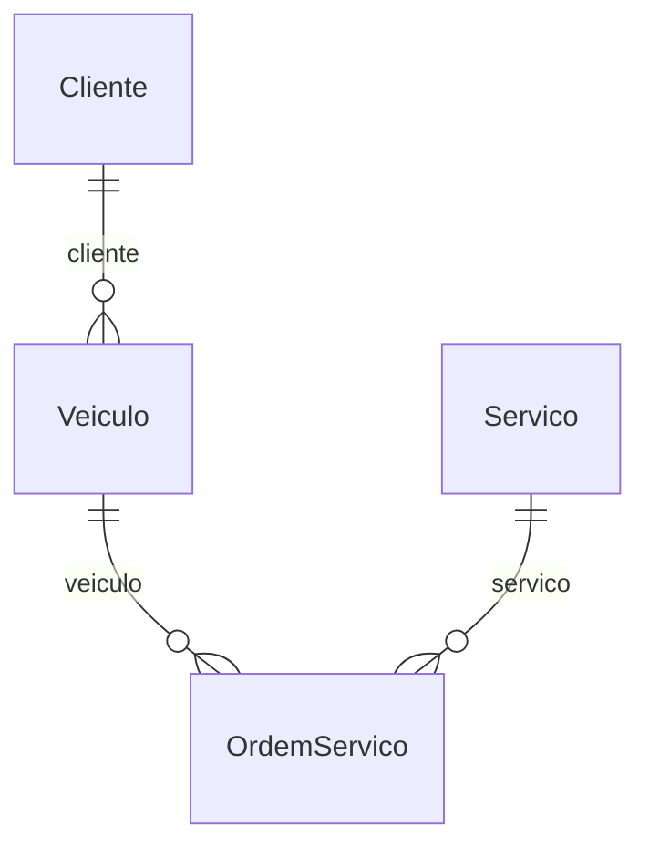
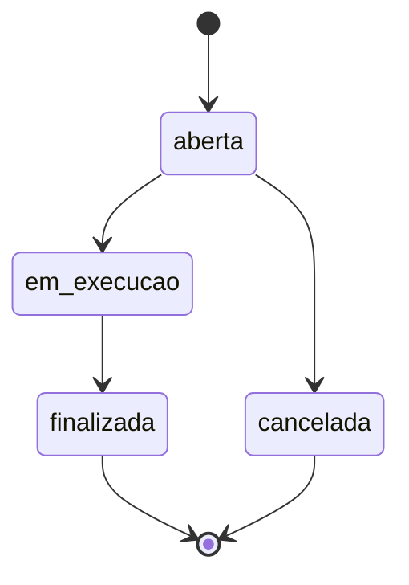

# Tema: Oficina mecânica

> Manual do grupo. O **Manual de Construção** ensina *como* fazer cada etapa; este arquivo diz *o que* o seu grupo constrói: campos, regras, rotas e telas de cada módulo. Siga os dois juntos.

## O problema

A oficina anota os serviços em blocos de papel. O cliente liga para saber se o carro está pronto e ninguém sabe responder, peças acabam sem aviso e o dono não sabe quais serviços dão mais lucro.

## Os 6 módulos e quem faz cada um

| Módulo | Papel transversal de quem faz | Rota da API | Depende de |
| --- | --- | --- | --- |
| **A — Clientes** | PO / Scrum Master | `/clientes` | — |
| **B — Veículos** | Git e Integração | `/veiculos` | Cliente |
| **C — Ordens de serviço** | Segurança | `/ordens-servico` | Veiculo, Servico |
| **D — Serviços** | Testes e Qualidade | `/servicos` | — |
| **E — Peças** | UX/UI e Acessibilidade | `/pecas` | — |
| **F — Relatórios** | Documentação e Apresentação | `/relatorios` | todos (só leitura) |

### Como os dados se ligam



Leia assim: cada linha liga um módulo ao outro pelo campo indicado (por exemplo, o campo `cliente` guarda o `_id` do outro módulo).

## Roteiro por aula

| Aula | Tarefa de cada aluno no seu módulo | Seção deste arquivo |
| --- | --- | --- |
| 01 | Copiar os requisitos e as regras do seu módulo para o Documento de Visão e as rotas para o Contrato da API (C0) | Requisitos, Regras, Rotas |
| 02 | Criar o modelo, os componentes, a rota e o link no menu | Código de partida → Modelo |
| 03 | Tela de listagem com as colunas e o filtro | Telas |
| 04 | Formulário com as validações | Código de partida → Formulário |
| 05 | Serviço mock com pelo menos 3 registros | Código de partida → Dados para o mock |
| 06 | Revisão das telas (C1) | Telas |
| 07 | Linhas do seu módulo no Dicionário de Dados (C2) | Campos |
| 08 | Schema, registro no módulo e dados no seed | Código de partida → Schema |
| 09 | Service e controller com o CRUD | Rotas |
| 10 | DTOs, testes e Swagger (C3) | Código de partida → DTOs, Testes mínimos |
| 11 | Regras de negócio no service (e o fluxo de estados no módulo C) | Regras de negócio, Fluxo de estados |
| 12–13 | Autenticação, perfis e troca do mock pela API (C4) | Manual de Construção |
| 14–15 | Testes finais, documentação e banca (C5) | Testes mínimos |

## Módulo A — Clientes

**Responsável:** aluno com o papel **PO / Scrum Master** · **Rota da API:** `/api/v1/clientes` · **Coleção:** `clientes`

Cadastro dos donos dos veículos.

**Pastas:** `backend/src/clientes/` e `frontend/src/app/features/clientes/`

### Campos

| Campo | Rótulo na tela | Tipo | Obrigatório | Regras | Exemplo |
| --- | --- | --- | --- | --- | --- |
| `nome` | Nome | texto | sim | 3 a 80 caracteres | `Maria Souza` |
| `telefone` | Telefone | telefone | sim | formato (51) 99999-9999 | `(51) 99876-5432` |
| `email` | E-mail | e-mail | sim | **único** | `maria.souza@email.com` |
| `endereco` | Endereço | texto longo | não | até 150 caracteres | `Av. Brasil, 900 – Canoas` |
| `ativo` | Ativo | sim/não | automático | padrão: sim | — |

`_id`, `createdAt` e `updatedAt` são criados automaticamente pelo MongoDB e pelo `timestamps: true`.

### Requisitos funcionais

- **RF01** — O sistema deve permitir cadastrar um cliente com os campos acima.
- **RF02** — O sistema deve listar os clientes ativos, com busca por parte do nome (sem diferenciar maiúsculas).
- **RF03** — O sistema deve permitir editar um cliente existente.
- **RF04** — O sistema deve permitir excluir um cliente; a exclusão apenas o inativa.

### Regras de negócio

| Código | Regra | Resposta da API quando é violada | Como implementar |
| --- | --- | --- | --- |
| **RN01** | Não pode haver dois clientes com o mesmo e-mail. | 409 — _Já existe um cliente com o e-mail "..."_ | Igual ao `garantirNomeUnico` de Produtos, buscando por `email`. |
| **RN02** | O nome precisa ter nome e sobrenome (pelo menos duas palavras). | 400 — _Informe nome e sobrenome_ | `if (dto.nome.trim().split(/\s+/).length < 2)`. |

### Rotas da API

| Método | Rota | O que faz | Respostas |
| --- | --- | --- | --- |
| GET | `/clientes` | Lista (filtro opcional `?busca=texto`, `?todos=true` inclui os inativos) | 200 |
| GET | `/clientes/:id` | Busca pelo id | 200, 400, 404 |
| POST | `/clientes` | Cadastra | 201, 400, 409 |
| PATCH | `/clientes/:id` | Edita | 200, 400, 404 |
| DELETE | `/clientes/:id` | Inativa (exclusão lógica) | 204, 400, 404 |

Filtro no service: `const filtro = busca ? { nome: { $regex: busca, $options: 'i' } } : {};`

> **Receitas úteis** ([guia/RECEITAS.md](../RECEITAS.md)): busca por texto → receita 1 · exclusão lógica → receita 2.

### Telas

- **Listagem** (`clientes-lista`): colunas Nome, Telefone, E-mail e ações. Filtro: busca por parte do nome (sem diferenciar maiúsculas). Mensagens de carregando, lista vazia, erro e sucesso.
- **Formulário** (`cliente-form`), usado para cadastrar e editar:

| Campo | Controle na tela |
| --- | --- |
| Nome * | `text` |
| Telefone * | `tel` |
| E-mail * | `email` |
| Endereço | `textarea` |

- **Menu:** link "Clientes" em `layout.html` e rota `clientes` em `app.routes.ts`.

### Código de partida

Use estes trechos junto com o Manual de Construção. Eles substituem os campos de Produtos pelos do seu módulo; o resto (service, controller, serviços do front, telas) segue o modelo de Produtos, como o manual ensina.

<details>
<summary><b>Modelo do front-end (aula 02)</b></summary>

```ts
// frontend/src/app/features/clientes/cliente.model.ts

/** Cliente como a API devolve (segue o contrato da API). */
export interface Cliente {
  _id: string;
  nome: string;
  telefone: string;
  email: string;
  endereco?: string;
  ativo: boolean;
  createdAt?: string;
  updatedAt?: string;
}

/** Dados enviados para criar ou editar. */
export interface ClienteEntrada {
  nome: string;
  telefone: string;
  email: string;
  endereco?: string;
  ativo?: boolean;
}
```

</details>

<details>
<summary><b>Dados para o serviço mock (aula 05)</b></summary>

Comece com este registro e acrescente pelo menos mais 2, variando os casos.

```ts
private clientes: Cliente[] = [
  {
    _id: '1',
    nome: 'Maria Souza',
    telefone: '(51) 99876-5432',
    email: 'maria.souza@email.com',
    endereco: 'Av. Brasil, 900 – Canoas',
    ativo: true,
  },
];
```

</details>

<details>
<summary><b>Formulário reativo (aula 04)</b></summary>

```ts
// frontend/src/app/features/clientes/cliente-form/cliente-form.ts — dentro da classe
protected readonly form = this.fb.nonNullable.group({
  nome: ['', [Validators.required, Validators.minLength(3), Validators.maxLength(80)]],
  telefone: ['', [Validators.required, Validators.pattern(/^\(\d{2}\) \d{4,5}-\d{4}$/)]],
  email: ['', [Validators.required, Validators.email]],
  endereco: ['', [Validators.maxLength(150)]],
});
```

</details>

<details>
<summary><b>Schema do MongoDB (aula 08)</b></summary>

```ts
// backend/src/clientes/schemas/cliente.schema.ts
import { Prop, Schema, SchemaFactory } from '@nestjs/mongoose';
import { HydratedDocument } from 'mongoose';

export type ClienteDocument = HydratedDocument<Cliente>;

@Schema({ timestamps: true, collection: 'clientes' })
export class Cliente {
  @Prop({ required: true, trim: true, minlength: 3, maxlength: 80 })
  nome: string;

  @Prop({ required: true, trim: true })
  telefone: string;

  @Prop({ required: true, trim: true, lowercase: true, unique: true })
  email: string;

  @Prop({ trim: true, maxlength: 150 })
  endereco?: string;

  @Prop({ default: true })
  ativo: boolean;
}

export const ClienteSchema = SchemaFactory.createForClass(Cliente);
```

</details>

<details>
<summary><b>DTOs de criação e edição (aula 10)</b></summary>

```ts
// backend/src/clientes/dto/create-cliente.dto.ts
import { ApiProperty, ApiPropertyOptional } from '@nestjs/swagger';
import {
  IsEmail,
  IsNotEmpty,
  IsOptional,
  IsString,
  Length,
  Matches,
  MaxLength,
} from 'class-validator';

export class CreateClienteDto {
  @ApiProperty({ example: 'Maria Souza' })
  @IsString()
  @IsNotEmpty({ message: 'Nome é obrigatório' })
  @Length(3, 80, { message: 'Nome deve ter entre 3 e 80 caracteres' })
  nome: string;

  @ApiProperty({ example: '(51) 99876-5432' })
  @IsString()
  @Matches(/^\(\d{2}\) \d{4,5}-\d{4}$/, {
    message: 'Telefone inválido. Use o formato (51) 99999-9999',
  })
  telefone: string;

  @ApiProperty({ example: 'maria.souza@email.com' })
  @IsEmail({}, { message: 'Informe um e-mail válido' })
  email: string;

  @ApiPropertyOptional({ example: 'Av. Brasil, 900 – Canoas' })
  @IsOptional()
  @IsString()
  @MaxLength(150, { message: 'Endereço pode ter no máximo 150 caracteres' })
  endereco?: string;
}
```

```ts
// backend/src/clientes/dto/update-cliente.dto.ts
import { ApiPropertyOptional, PartialType } from '@nestjs/swagger';
import { IsBoolean, IsOptional } from 'class-validator';
import { CreateClienteDto } from './create-cliente.dto';

export class UpdateClienteDto extends PartialType(CreateClienteDto) {
  @ApiPropertyOptional({ example: true })
  @IsOptional()
  @IsBoolean()
  ativo?: boolean;
}
```

</details>

### Testes mínimos (aula 10)

- [ ] `criar` salva um cliente com dados válidos.
- [ ] `buscarPorId` lança `NotFoundException` (404) quando o cliente não existe.
- [ ] `buscarPorId` lança `BadRequestException` (400) para um id inválido.
- [ ] Regra: não pode haver dois clientes com o mesmo e-mail.
- [ ] Regra: o nome precisa ter nome e sobrenome (pelo menos duas palavras).

## Módulo B — Veículos

**Responsável:** aluno com o papel **Git e Integração** · **Rota da API:** `/api/v1/veiculos` · **Coleção:** `veiculos`

Veículos atendidos, cada um ligado ao seu dono.

**Depende de:** Cliente (`clientes`). Até a aula 12 o front usa mocks, então você não precisa esperar os colegas: use ids de exemplo (`'1'`, `'2'`).

**Pastas:** `backend/src/veiculos/` e `frontend/src/app/features/veiculos/`

### Campos

| Campo | Rótulo na tela | Tipo | Obrigatório | Regras | Exemplo |
| --- | --- | --- | --- | --- | --- |
| `placa` | Placa | texto | sim | 7 caracteres; use o formato abc1d23 ou abc1234; **único**; salvo em maiúsculas | `IXA4B21` |
| `marca` | Marca | texto | sim | 2 a 30 caracteres | `Volkswagen` |
| `modelo` | Modelo | texto | sim | 1 a 40 caracteres | `Gol` |
| `ano` | Ano | número inteiro | sim | de 1950 a 2100 | `2018` |
| `cliente` | Cliente | referência → Cliente | sim | — | _id de Cliente |
| `ativo` | Ativo | sim/não | automático | padrão: sim | — |

`_id`, `createdAt` e `updatedAt` são criados automaticamente pelo MongoDB e pelo `timestamps: true`.

### Requisitos funcionais

- **RF05** — O sistema deve permitir cadastrar um veículo com os campos acima.
- **RF06** — O sistema deve listar os veículos, com busca por parte do placa (sem diferenciar maiúsculas).
- **RF07** — O sistema deve permitir editar um veículo existente.
- **RF08** — O sistema deve permitir excluir um veículo.

### Regras de negócio

| Código | Regra | Resposta da API quando é violada | Como implementar |
| --- | --- | --- | --- |
| **RN03** | Não pode haver dois veículos com a mesma placa. | 409 — _Já existe um veículo com a placa "..."_ | Igual ao `garantirNomeUnico`; converta a placa para maiúsculas antes de buscar. |
| **RN04** | O ano não pode passar do ano atual + 1 (modelo do ano seguinte). | 400 — _Ano do veículo inválido_ | `if (dto.ano > new Date().getFullYear() + 1)`. |

### Rotas da API

| Método | Rota | O que faz | Respostas |
| --- | --- | --- | --- |
| GET | `/veiculos` | Lista (filtro opcional `?busca=texto`) | 200 |
| GET | `/veiculos/:id` | Busca pelo id | 200, 400, 404 |
| POST | `/veiculos` | Cadastra | 201, 400, 409 |
| PATCH | `/veiculos/:id` | Edita | 200, 400, 404 |
| DELETE | `/veiculos/:id` | Exclui | 204, 400, 404 |

Filtro no service: `const filtro = busca ? { placa: { $regex: busca, $options: 'i' } } : {};`

> **Receitas úteis** ([guia/RECEITAS.md](../RECEITAS.md)): busca por texto → receita 1 · mostrar e escolher referências → receitas 3 e 4.

### Telas

- **Listagem** (`veiculos-lista`): colunas Placa, Marca, Modelo, Ano e ações. Filtro: busca por parte do placa (sem diferenciar maiúsculas). Mensagens de carregando, lista vazia, erro e sucesso.
- **Formulário** (`veiculo-form`), usado para cadastrar e editar:

| Campo | Controle na tela |
| --- | --- |
| Placa * | `text` |
| Marca * | `text` |
| Modelo * | `text` |
| Ano * | `number, step 1` |
| Cliente * | `select (receita 4 de guia/RECEITAS.md)` |

- **Menu:** link "Veículos" em `layout.html` e rota `veiculos` em `app.routes.ts`.

### Código de partida

Use estes trechos junto com o Manual de Construção. Eles substituem os campos de Produtos pelos do seu módulo; o resto (service, controller, serviços do front, telas) segue o modelo de Produtos, como o manual ensina.

<details>
<summary><b>Modelo do front-end (aula 02)</b></summary>

```ts
// frontend/src/app/features/veiculos/veiculo.model.ts
import { Referencia } from '../../core/models/referencia';

/** Veículo como a API devolve (segue o contrato da API). */
export interface Veiculo {
  _id: string;
  placa: string;
  marca: string;
  modelo: string;
  ano: number;
  cliente: Referencia; // _id ou { _id, nome } (populate)
  ativo: boolean;
  createdAt?: string;
  updatedAt?: string;
}

/** Dados enviados para criar ou editar. */
export interface VeiculoEntrada {
  placa: string;
  marca: string;
  modelo: string;
  ano: number;
  cliente: string; // _id do Cliente
  ativo?: boolean;
}
```

</details>

<details>
<summary><b>Dados para o serviço mock (aula 05)</b></summary>

Comece com este registro e acrescente pelo menos mais 2, variando os casos.

```ts
private veiculos: Veiculo[] = [
  {
    _id: '1',
    placa: 'IXA4B21',
    marca: 'Volkswagen',
    modelo: 'Gol',
    ano: 2018,
    cliente: '1',
    ativo: true,
  },
];
```

</details>

<details>
<summary><b>Formulário reativo (aula 04)</b></summary>

```ts
// frontend/src/app/features/veiculos/veiculo-form/veiculo-form.ts — dentro da classe
protected readonly form = this.fb.nonNullable.group({
  placa: [
    '',
    [
      Validators.required,
      Validators.minLength(7),
      Validators.maxLength(7),
      Validators.pattern(/^[A-Za-z]{3}[0-9][A-Za-z0-9][0-9]{2}$/),
    ],
  ],
  marca: ['', [Validators.required, Validators.minLength(2), Validators.maxLength(30)]],
  modelo: ['', [Validators.required, Validators.minLength(1), Validators.maxLength(40)]],
  ano: [
    1950,
    [
      Validators.required,
      Validators.min(1950),
      Validators.max(2100),
      Validators.pattern(/^\d+$/),
    ],
  ],
  cliente: ['', [Validators.required]],
});
```

</details>

<details>
<summary><b>Schema do MongoDB (aula 08)</b></summary>

```ts
// backend/src/veiculos/schemas/veiculo.schema.ts
import { Prop, Schema, SchemaFactory } from '@nestjs/mongoose';
import { HydratedDocument, Types } from 'mongoose';

export type VeiculoDocument = HydratedDocument<Veiculo>;

@Schema({ timestamps: true, collection: 'veiculos' })
export class Veiculo {
  @Prop({
    required: true,
    trim: true,
    minlength: 7,
    maxlength: 7,
    uppercase: true,
    unique: true,
  })
  placa: string;

  @Prop({ required: true, trim: true, minlength: 2, maxlength: 30 })
  marca: string;

  @Prop({ required: true, trim: true, minlength: 1, maxlength: 40 })
  modelo: string;

  @Prop({ required: true, min: 1950, max: 2100 })
  ano: number;

  // Referência ao módulo Cliente: guarda só o _id
  @Prop({ type: Types.ObjectId, ref: 'Cliente', required: true })
  cliente: Types.ObjectId;

  @Prop({ default: true })
  ativo: boolean;
}

export const VeiculoSchema = SchemaFactory.createForClass(Veiculo);
VeiculoSchema.index({ cliente: 1 });
```

</details>

<details>
<summary><b>DTOs de criação e edição (aula 10)</b></summary>

```ts
// backend/src/veiculos/dto/create-veiculo.dto.ts
import { ApiProperty } from '@nestjs/swagger';
import {
  IsInt,
  IsMongoId,
  IsNotEmpty,
  IsString,
  Length,
  Matches,
  Max,
  Min,
} from 'class-validator';

export class CreateVeiculoDto {
  @ApiProperty({ example: 'IXA4B21' })
  @IsString()
  @IsNotEmpty({ message: 'Placa é obrigatório' })
  @Length(7, 7, { message: 'Placa deve ter 7 caracteres' })
  @Matches(/^[A-Za-z]{3}[0-9][A-Za-z0-9][0-9]{2}$/, {
    message: 'Placa inválida. Use o formato ABC1D23 ou ABC1234',
  })
  placa: string;

  @ApiProperty({ example: 'Volkswagen' })
  @IsString()
  @IsNotEmpty({ message: 'Marca é obrigatório' })
  @Length(2, 30, { message: 'Marca deve ter entre 2 e 30 caracteres' })
  marca: string;

  @ApiProperty({ example: 'Gol' })
  @IsString()
  @IsNotEmpty({ message: 'Modelo é obrigatório' })
  @Length(1, 40, { message: 'Modelo deve ter entre 1 e 40 caracteres' })
  modelo: string;

  @ApiProperty({ example: 2018 })
  @IsInt({ message: 'Ano deve ser um número inteiro' })
  @Min(1950, { message: 'Ano deve ser no mínimo 1950' })
  @Max(2100, { message: 'Ano deve ser no máximo 2100' })
  ano: number;

  @ApiProperty({ example: '665f1c2b9a1e4b0012345678' })
  @IsMongoId({ message: 'Cliente: id inválido' })
  cliente: string;
}
```

```ts
// backend/src/veiculos/dto/update-veiculo.dto.ts
import { ApiPropertyOptional, PartialType } from '@nestjs/swagger';
import { IsBoolean, IsOptional } from 'class-validator';
import { CreateVeiculoDto } from './create-veiculo.dto';

export class UpdateVeiculoDto extends PartialType(CreateVeiculoDto) {
  @ApiPropertyOptional({ example: true })
  @IsOptional()
  @IsBoolean()
  ativo?: boolean;
}
```

</details>

### Testes mínimos (aula 10)

- [ ] `criar` salva um veículo com dados válidos.
- [ ] `buscarPorId` lança `NotFoundException` (404) quando o veículo não existe.
- [ ] `buscarPorId` lança `BadRequestException` (400) para um id inválido.
- [ ] Regra: não pode haver dois veículos com a mesma placa.
- [ ] Regra: o ano não pode passar do ano atual + 1 (modelo do ano seguinte).

## Módulo C — Ordens de serviço

**Responsável:** aluno com o papel **Segurança** · **Rota da API:** `/api/v1/ordens-servico` · **Coleção:** `ordens_servico`

Cada serviço feito em um veículo, com o fluxo de estados da ordem de serviço (OS).

**Depende de:** Veiculo (`veiculos`), Servico (`servicos`). Até a aula 12 o front usa mocks, então você não precisa esperar os colegas: use ids de exemplo (`'1'`, `'2'`).

**Pastas:** `backend/src/ordens-servico/` e `frontend/src/app/features/ordens-servico/`

### Campos

| Campo | Rótulo na tela | Tipo | Obrigatório | Regras | Exemplo |
| --- | --- | --- | --- | --- | --- |
| `veiculo` | Veículo | referência → Veiculo | sim | — | _id de Veiculo |
| `servico` | Serviço | referência → Servico | sim | — | _id de Servico |
| `descricaoProblema` | Problema relatado | texto longo | sim | 5 a 500 caracteres | `Barulho na suspensão dianteira` |
| `valorPecas` | Valor das peças (R$) | número decimal | sim | mínimo 0 | `250` |
| `status` | Status | lista de opções | automático | `aberta`, `em_execucao`, `finalizada`, `cancelada`; começa em `aberta` | — |

`_id`, `createdAt` e `updatedAt` são criados automaticamente pelo MongoDB e pelo `timestamps: true`.

### Requisitos funcionais

- **RF09** — O sistema deve permitir cadastrar uma ordem de serviço com os campos acima.
- **RF10** — O sistema deve listar as ordens de serviço, com filtro pelo status.
- **RF11** — O sistema deve permitir editar uma ordem de serviço existente.
- **RF12** — O sistema deve permitir mudar o status da ordem de serviço, respeitando o fluxo de estados.

### Regras de negócio

| Código | Regra | Resposta da API quando é violada | Como implementar |
| --- | --- | --- | --- |
| **RN05** | Um veículo não pode ter duas OS abertas ou em execução ao mesmo tempo. | 409 — _O veículo já tem uma ordem de serviço em andamento_ | `findOne({ veiculo: dto.veiculo, status: { $in: ['aberta', 'em_execucao'] } })`. |
| **RN06** | Uma OS finalizada ou cancelada não pode mais ser editada. | 400 — _Ordem de serviço encerrada não pode ser alterada_ | No `atualizar`, busque a OS e verifique o `status` antes de salvar. |
| **RN07** | O status só pode mudar seguindo o fluxo abaixo. | 400 — _Não é possível passar de "..." para "..."_ | Mapa `TRANSICOES` (código abaixo). |

### Rotas da API

| Método | Rota | O que faz | Respostas |
| --- | --- | --- | --- |
| GET | `/ordens-servico` | Lista (filtro opcional `?status=aberta`) | 200 |
| GET | `/ordens-servico/:id` | Busca pelo id | 200, 400, 404 |
| POST | `/ordens-servico` | Cadastra | 201, 400, 409 |
| PATCH | `/ordens-servico/:id` | Edita | 200, 400, 404 |
| PATCH | `/ordens-servico/:id/status` | Muda o status | 200, 400, 404 |

Filtro no service: `const filtro = status ? { status } : {};`

> **Receitas úteis** ([guia/RECEITAS.md](../RECEITAS.md)): mostrar e escolher referências → receitas 3 e 4 · botões de status → receita 7.

### Fluxo de estados



Na tela de listagem, mostre só os botões das transições válidas para o status atual de cada linha.

<details>
<summary><b>Mapa de transições e método mudarStatus</b></summary>

```ts
// backend/src/ordens-servico/ordens-servico.service.ts — no topo do arquivo
import { Status } from './schemas/ordem-servico.schema';

// Mapa de transições VÁLIDAS: de → para (PDF 05, cap. 3)
const TRANSICOES: Record<Status, Status[]> = {
  aberta: ['em_execucao', 'cancelada'],
  em_execucao: ['finalizada'],
  finalizada: [], // estado final
  cancelada: [], // estado final
};

// ...dentro da classe OrdensServicoService:
async mudarStatus(id: string, novo: Status) {
  const atual = await this.buscarPorId(id);
  if (!TRANSICOES[atual.status].includes(novo)) {
    throw new BadRequestException(
      `Não é possível passar de "${atual.status}" para "${novo}"`,
    );
  }
  return this.ordemServicoModel
    .findByIdAndUpdate(id, { status: novo }, { new: true })
    .lean()
    .exec();
}
```

</details>

<details>
<summary><b>DTO da mudança de status</b></summary>

```ts
// backend/src/ordens-servico/dto/mudar-status.dto.ts
import { ApiProperty } from '@nestjs/swagger';
import { IsIn } from 'class-validator';
import { STATUS, type Status } from '../schemas/ordem-servico.schema';

export class MudarStatusDto {
  @ApiProperty({ enum: STATUS, example: 'em_execucao' })
  @IsIn(STATUS, { message: `Status deve ser: ${STATUS.join(', ')}` })
  status: Status;
}
```

</details>

<details>
<summary><b>Rota no controller</b></summary>

```ts
// backend/src/ordens-servico/ordens-servico.controller.ts
@Patch(':id/status')
@ApiOperation({ summary: 'Muda o status (somente transições válidas)' })
@ApiResponse({ status: 400, description: 'Transição de status inválida' })
mudarStatus(@Param('id') id: string, @Body() dto: MudarStatusDto) {
  return this.ordensServicoService.mudarStatus(id, dto.status);
}
```

</details>

### Telas

- **Listagem** (`ordens-servico-lista`): colunas Veículo, Serviço, Valor das peças (R$), Status (com a etiqueta colorida) e ações. Filtro: filtro pelo status. Mensagens de carregando, lista vazia, erro e sucesso.
- **Formulário** (`ordem-servico-form`), usado para cadastrar e editar:

| Campo | Controle na tela |
| --- | --- |
| Veículo * | `select (receita 4 de guia/RECEITAS.md)` |
| Serviço * | `select (receita 4 de guia/RECEITAS.md)` |
| Problema relatado * | `textarea` |
| Valor das peças (R$) * | `number, step 0.01` |

- **Menu:** link "Ordens de serviço" em `layout.html` e rota `ordens-servico` em `app.routes.ts`.

### Código de partida

Use estes trechos junto com o Manual de Construção. Eles substituem os campos de Produtos pelos do seu módulo; o resto (service, controller, serviços do front, telas) segue o modelo de Produtos, como o manual ensina.

<details>
<summary><b>Modelo do front-end (aula 02)</b></summary>

```ts
// frontend/src/app/features/ordens-servico/ordem-servico.model.ts
import { Referencia } from '../../core/models/referencia';

export const STATUS = ['aberta', 'em_execucao', 'finalizada', 'cancelada'] as const;
export type Status = (typeof STATUS)[number];

/** Ordem de serviço como a API devolve (segue o contrato da API). */
export interface OrdemServico {
  _id: string;
  veiculo: Referencia; // _id ou { _id, placa } (populate)
  servico: Referencia; // _id ou { _id, nome } (populate)
  descricaoProblema: string;
  valorPecas: number;
  status: Status;
  createdAt?: string;
  updatedAt?: string;
}

/** Dados enviados para criar ou editar. */
export interface OrdemServicoEntrada {
  veiculo: string; // _id do Veiculo
  servico: string; // _id do Servico
  descricaoProblema: string;
  valorPecas: number;
}
```

</details>

<details>
<summary><b>Dados para o serviço mock (aula 05)</b></summary>

Comece com este registro e acrescente pelo menos mais 2, variando os casos.

```ts
private ordensServico: OrdemServico[] = [
  {
    _id: '1',
    veiculo: '1',
    servico: '1',
    descricaoProblema: 'Barulho na suspensão dianteira',
    valorPecas: 250,
    status: 'aberta',
  },
];
```

</details>

<details>
<summary><b>Formulário reativo (aula 04)</b></summary>

```ts
// frontend/src/app/features/ordens-servico/ordem-servico-form/ordem-servico-form.ts — dentro da classe
protected readonly form = this.fb.nonNullable.group({
  veiculo: ['', [Validators.required]],
  servico: ['', [Validators.required]],
  descricaoProblema: [
    '',
    [Validators.required, Validators.minLength(5), Validators.maxLength(500)],
  ],
  valorPecas: [0, [Validators.required, Validators.min(0)]],
});
```

</details>

<details>
<summary><b>Schema do MongoDB (aula 08)</b></summary>

```ts
// backend/src/ordens-servico/schemas/ordem-servico.schema.ts
import { Prop, Schema, SchemaFactory } from '@nestjs/mongoose';
import { HydratedDocument, Types } from 'mongoose';

export const STATUS = [
  'aberta',
  'em_execucao',
  'finalizada',
  'cancelada',
] as const;
export type Status = (typeof STATUS)[number];

export type OrdemServicoDocument = HydratedDocument<OrdemServico>;

@Schema({ timestamps: true, collection: 'ordens_servico' })
export class OrdemServico {
  // Referência ao módulo Veiculo: guarda só o _id
  @Prop({ type: Types.ObjectId, ref: 'Veiculo', required: true })
  veiculo: Types.ObjectId;

  // Referência ao módulo Servico: guarda só o _id
  @Prop({ type: Types.ObjectId, ref: 'Servico', required: true })
  servico: Types.ObjectId;

  @Prop({ required: true, trim: true, minlength: 5, maxlength: 500 })
  descricaoProblema: string;

  @Prop({ required: true, min: 0 })
  valorPecas: number;

  // Fluxo de estados: o status começa em "aberta" e só muda pela rota PATCH /ordens-servico/:id/status
  @Prop({ type: String, enum: STATUS, default: 'aberta' })
  status: Status;
}

export const OrdemServicoSchema = SchemaFactory.createForClass(OrdemServico);
OrdemServicoSchema.index({ veiculo: 1 });
OrdemServicoSchema.index({ servico: 1 });
OrdemServicoSchema.index({ status: 1 });
```

</details>

<details>
<summary><b>DTOs de criação e edição (aula 10)</b></summary>

```ts
// backend/src/ordens-servico/dto/create-ordem-servico.dto.ts
import { ApiProperty } from '@nestjs/swagger';
import {
  IsMongoId,
  IsNotEmpty,
  IsNumber,
  IsString,
  Length,
  Min,
} from 'class-validator';

export class CreateOrdemServicoDto {
  @ApiProperty({ example: '665f1c2b9a1e4b0012345678' })
  @IsMongoId({ message: 'Veículo: id inválido' })
  veiculo: string;

  @ApiProperty({ example: '665f1c2b9a1e4b0012345678' })
  @IsMongoId({ message: 'Serviço: id inválido' })
  servico: string;

  @ApiProperty({ example: 'Barulho na suspensão dianteira' })
  @IsString()
  @IsNotEmpty({ message: 'Problema relatado é obrigatório' })
  @Length(5, 500, {
    message: 'Problema relatado deve ter entre 5 e 500 caracteres',
  })
  descricaoProblema: string;

  @ApiProperty({ example: 250 })
  @IsNumber(
    { maxDecimalPlaces: 2 },
    { message: 'Valor das peças (R$) deve ser um número' },
  )
  @Min(0, { message: 'Valor das peças (R$) deve ser no mínimo 0' })
  valorPecas: number;
}
```

```ts
// backend/src/ordens-servico/dto/update-ordem-servico.dto.ts
import { PartialType } from '@nestjs/swagger';
import { CreateOrdemServicoDto } from './create-ordem-servico.dto';

// O status NÃO entra aqui: ele só muda pela rota PATCH /:id/status
export class UpdateOrdemServicoDto extends PartialType(CreateOrdemServicoDto) {}
```

</details>

### Testes mínimos (aula 10)

- [ ] `criar` salva uma ordem de serviço com dados válidos.
- [ ] `buscarPorId` lança `NotFoundException` (404) quando a ordem de serviço não existe.
- [ ] `buscarPorId` lança `BadRequestException` (400) para um id inválido.
- [ ] Regra: um veículo não pode ter duas OS abertas ou em execução ao mesmo tempo.
- [ ] Regra: uma OS finalizada ou cancelada não pode mais ser editada.
- [ ] `mudarStatus` lança 400 numa transição inválida e aceita uma válida.

## Módulo D — Serviços

**Responsável:** aluno com o papel **Testes e Qualidade** · **Rota da API:** `/api/v1/servicos` · **Coleção:** `servicos`

Tabela de serviços da oficina, com preço da mão de obra.

**Pastas:** `backend/src/servicos/` e `frontend/src/app/features/servicos/`

### Campos

| Campo | Rótulo na tela | Tipo | Obrigatório | Regras | Exemplo |
| --- | --- | --- | --- | --- | --- |
| `nome` | Nome | texto | sim | 3 a 60 caracteres; **único** | `Troca de óleo` |
| `categoria` | Categoria | lista de opções | sim | `mecanica`, `eletrica`, `funilaria`, `revisao` | `revisao` |
| `preco` | Preço da mão de obra (R$) | número decimal | sim | mínimo 0 | `120` |
| `tempoEstimadoHoras` | Tempo estimado (h) | número decimal | sim | de 0.5 a 40 | `1.5` |
| `ativo` | Ativo | sim/não | automático | padrão: sim | — |

`_id`, `createdAt` e `updatedAt` são criados automaticamente pelo MongoDB e pelo `timestamps: true`.

### Requisitos funcionais

- **RF13** — O sistema deve permitir cadastrar um serviço com os campos acima.
- **RF14** — O sistema deve listar os serviços ativos, com filtro por categoria.
- **RF15** — O sistema deve permitir editar um serviço existente.
- **RF16** — O sistema deve permitir excluir um serviço; a exclusão apenas o inativa.

### Regras de negócio

| Código | Regra | Resposta da API quando é violada | Como implementar |
| --- | --- | --- | --- |
| **RN08** | Não pode haver dois serviços com o mesmo nome. | 409 — _Já existe um serviço com o nome "..."_ | Igual ao `garantirNomeUnico` de Produtos. |
| **RN09** | Excluir um serviço apenas o inativa; a listagem padrão mostra só os ativos. | 204 (exclusão vira `ativo: false`) | Receita 2 de `guia/RECEITAS.md`. |

### Rotas da API

| Método | Rota | O que faz | Respostas |
| --- | --- | --- | --- |
| GET | `/servicos` | Lista (filtro opcional `?categoria=mecanica`, `?todos=true` inclui os inativos) | 200 |
| GET | `/servicos/:id` | Busca pelo id | 200, 400, 404 |
| POST | `/servicos` | Cadastra | 201, 400, 409 |
| PATCH | `/servicos/:id` | Edita | 200, 400, 404 |
| DELETE | `/servicos/:id` | Inativa (exclusão lógica) | 204, 400, 404 |

Filtro no service: `const filtro = categoria ? { categoria } : {};`

> **Receitas úteis** ([guia/RECEITAS.md](../RECEITAS.md)): exclusão lógica → receita 2.

### Telas

- **Listagem** (`servicos-lista`): colunas Nome, Categoria, Preço da mão de obra (R$), Tempo estimado (h) e ações. Filtro: filtro por categoria. Mensagens de carregando, lista vazia, erro e sucesso.
- **Formulário** (`servico-form`), usado para cadastrar e editar:

| Campo | Controle na tela |
| --- | --- |
| Nome * | `text` |
| Categoria * | `select` |
| Preço da mão de obra (R$) * | `number, step 0.01` |
| Tempo estimado (h) * | `number, step 0.01` |

- **Menu:** link "Serviços" em `layout.html` e rota `servicos` em `app.routes.ts`.

### Código de partida

Use estes trechos junto com o Manual de Construção. Eles substituem os campos de Produtos pelos do seu módulo; o resto (service, controller, serviços do front, telas) segue o modelo de Produtos, como o manual ensina.

<details>
<summary><b>Modelo do front-end (aula 02)</b></summary>

```ts
// frontend/src/app/features/servicos/servico.model.ts
export const OPCOES_CATEGORIA = ['mecanica', 'eletrica', 'funilaria', 'revisao'] as const;
export type Categoria = (typeof OPCOES_CATEGORIA)[number];

/** Serviço como a API devolve (segue o contrato da API). */
export interface Servico {
  _id: string;
  nome: string;
  categoria: Categoria;
  preco: number;
  tempoEstimadoHoras: number;
  ativo: boolean;
  createdAt?: string;
  updatedAt?: string;
}

/** Dados enviados para criar ou editar. */
export interface ServicoEntrada {
  nome: string;
  categoria: Categoria;
  preco: number;
  tempoEstimadoHoras: number;
  ativo?: boolean;
}
```

</details>

<details>
<summary><b>Dados para o serviço mock (aula 05)</b></summary>

Comece com este registro e acrescente pelo menos mais 2, variando os casos.

```ts
private servicos: Servico[] = [
  {
    _id: '1',
    nome: 'Troca de óleo',
    categoria: 'revisao',
    preco: 120,
    tempoEstimadoHoras: 1.5,
    ativo: true,
  },
];
```

</details>

<details>
<summary><b>Formulário reativo (aula 04)</b></summary>

```ts
// frontend/src/app/features/servicos/servico-form/servico-form.ts — dentro da classe
protected readonly form = this.fb.nonNullable.group({
  nome: ['', [Validators.required, Validators.minLength(3), Validators.maxLength(60)]],
  categoria: ['' as Categoria | '', [Validators.required]],
  preco: [0, [Validators.required, Validators.min(0)]],
  tempoEstimadoHoras: [0.5, [Validators.required, Validators.min(0.5), Validators.max(40)]],
});
```

</details>

<details>
<summary><b>Schema do MongoDB (aula 08)</b></summary>

```ts
// backend/src/servicos/schemas/servico.schema.ts
import { Prop, Schema, SchemaFactory } from '@nestjs/mongoose';
import { HydratedDocument } from 'mongoose';

export const OPCOES_CATEGORIA = [
  'mecanica',
  'eletrica',
  'funilaria',
  'revisao',
] as const;
export type Categoria = (typeof OPCOES_CATEGORIA)[number];
export type ServicoDocument = HydratedDocument<Servico>;

@Schema({ timestamps: true, collection: 'servicos' })
export class Servico {
  @Prop({
    required: true,
    trim: true,
    minlength: 3,
    maxlength: 60,
    unique: true,
  })
  nome: string;

  @Prop({ type: String, required: true, enum: OPCOES_CATEGORIA })
  categoria: Categoria;

  @Prop({ required: true, min: 0 })
  preco: number;

  @Prop({ required: true, min: 0.5, max: 40 })
  tempoEstimadoHoras: number;

  @Prop({ default: true })
  ativo: boolean;
}

export const ServicoSchema = SchemaFactory.createForClass(Servico);
ServicoSchema.index({ categoria: 1 });
```

</details>

<details>
<summary><b>DTOs de criação e edição (aula 10)</b></summary>

```ts
// backend/src/servicos/dto/create-servico.dto.ts
import { ApiProperty } from '@nestjs/swagger';
import {
  IsIn,
  IsNotEmpty,
  IsNumber,
  IsString,
  Length,
  Max,
  Min,
} from 'class-validator';
import { OPCOES_CATEGORIA, type Categoria } from '../schemas/servico.schema';

export class CreateServicoDto {
  @ApiProperty({ example: 'Troca de óleo' })
  @IsString()
  @IsNotEmpty({ message: 'Nome é obrigatório' })
  @Length(3, 60, { message: 'Nome deve ter entre 3 e 60 caracteres' })
  nome: string;

  @ApiProperty({ enum: OPCOES_CATEGORIA, example: 'revisao' })
  @IsIn(OPCOES_CATEGORIA, {
    message: `Categoria deve ser: ${OPCOES_CATEGORIA.join(', ')}`,
  })
  categoria: Categoria;

  @ApiProperty({ example: 120 })
  @IsNumber(
    { maxDecimalPlaces: 2 },
    { message: 'Preço da mão de obra (R$) deve ser um número' },
  )
  @Min(0, { message: 'Preço da mão de obra (R$) deve ser no mínimo 0' })
  preco: number;

  @ApiProperty({ example: 1.5 })
  @IsNumber(
    { maxDecimalPlaces: 2 },
    { message: 'Tempo estimado (h) deve ser um número' },
  )
  @Min(0.5, { message: 'Tempo estimado (h) deve ser no mínimo 0.5' })
  @Max(40, { message: 'Tempo estimado (h) deve ser no máximo 40' })
  tempoEstimadoHoras: number;
}
```

```ts
// backend/src/servicos/dto/update-servico.dto.ts
import { ApiPropertyOptional, PartialType } from '@nestjs/swagger';
import { IsBoolean, IsOptional } from 'class-validator';
import { CreateServicoDto } from './create-servico.dto';

export class UpdateServicoDto extends PartialType(CreateServicoDto) {
  @ApiPropertyOptional({ example: true })
  @IsOptional()
  @IsBoolean()
  ativo?: boolean;
}
```

</details>

### Testes mínimos (aula 10)

- [ ] `criar` salva um serviço com dados válidos.
- [ ] `buscarPorId` lança `NotFoundException` (404) quando o serviço não existe.
- [ ] `buscarPorId` lança `BadRequestException` (400) para um id inválido.
- [ ] Regra: não pode haver dois serviços com o mesmo nome.
- [ ] Regra: excluir um serviço apenas o inativa; a listagem padrão mostra só os ativos.

## Módulo E — Peças

**Responsável:** aluno com o papel **UX/UI e Acessibilidade** · **Rota da API:** `/api/v1/pecas` · **Coleção:** `pecas`

Estoque de peças da oficina.

**Pastas:** `backend/src/pecas/` e `frontend/src/app/features/pecas/`

### Campos

| Campo | Rótulo na tela | Tipo | Obrigatório | Regras | Exemplo |
| --- | --- | --- | --- | --- | --- |
| `nome` | Nome | texto | sim | 3 a 80 caracteres | `Filtro de óleo` |
| `codigo` | Código | texto | sim | 3 a 20 caracteres; **único**; salvo em maiúsculas | `FO-1020` |
| `precoUnitario` | Preço unitário (R$) | número decimal | sim | mínimo 0 | `35.5` |
| `estoque` | Estoque | número inteiro | sim | de 0 a 10000 | `12` |
| `estoqueMinimo` | Estoque mínimo | número inteiro | sim | de 0 a 1000 | `5` |
| `ativo` | Ativo | sim/não | automático | padrão: sim | — |

`_id`, `createdAt` e `updatedAt` são criados automaticamente pelo MongoDB e pelo `timestamps: true`.

### Requisitos funcionais

- **RF17** — O sistema deve permitir cadastrar uma peça com os campos acima.
- **RF18** — O sistema deve listar as peças, com busca por parte do nome (sem diferenciar maiúsculas).
- **RF19** — O sistema deve permitir editar uma peça existente.
- **RF20** — O sistema deve permitir excluir uma peça.

### Regras de negócio

| Código | Regra | Resposta da API quando é violada | Como implementar |
| --- | --- | --- | --- |
| **RN10** | Não pode haver duas peças com o mesmo código. | 409 — _Já existe uma peça com o código "..."_ | Igual ao `garantirNomeUnico`, buscando por `codigo`. |
| **RN11** | Não é possível excluir uma peça que ainda tem estoque. | 400 — _Não é possível excluir uma peça com estoque_ | Igual à regra do `remover` de Produtos. |

### Rotas da API

| Método | Rota | O que faz | Respostas |
| --- | --- | --- | --- |
| GET | `/pecas` | Lista (filtro opcional `?busca=texto`) | 200 |
| GET | `/pecas/:id` | Busca pelo id | 200, 400, 404 |
| POST | `/pecas` | Cadastra | 201, 400, 409 |
| PATCH | `/pecas/:id` | Edita | 200, 400, 404 |
| DELETE | `/pecas/:id` | Exclui | 204, 400, 404 |

Filtro no service: `const filtro = busca ? { nome: { $regex: busca, $options: 'i' } } : {};`

> **Receitas úteis** ([guia/RECEITAS.md](../RECEITAS.md)): busca por texto → receita 1.

### Telas

- **Listagem** (`pecas-lista`): colunas Nome, Código, Preço unitário (R$), Estoque e ações. Filtro: busca por parte do nome (sem diferenciar maiúsculas). Mensagens de carregando, lista vazia, erro e sucesso.
- **Formulário** (`peca-form`), usado para cadastrar e editar:

| Campo | Controle na tela |
| --- | --- |
| Nome * | `text` |
| Código * | `text` |
| Preço unitário (R$) * | `number, step 0.01` |
| Estoque * | `number, step 1` |
| Estoque mínimo * | `number, step 1` |

- **Menu:** link "Peças" em `layout.html` e rota `pecas` em `app.routes.ts`.

### Código de partida

Use estes trechos junto com o Manual de Construção. Eles substituem os campos de Produtos pelos do seu módulo; o resto (service, controller, serviços do front, telas) segue o modelo de Produtos, como o manual ensina.

<details>
<summary><b>Modelo do front-end (aula 02)</b></summary>

```ts
// frontend/src/app/features/pecas/peca.model.ts

/** Peça como a API devolve (segue o contrato da API). */
export interface Peca {
  _id: string;
  nome: string;
  codigo: string;
  precoUnitario: number;
  estoque: number;
  estoqueMinimo: number;
  ativo: boolean;
  createdAt?: string;
  updatedAt?: string;
}

/** Dados enviados para criar ou editar. */
export interface PecaEntrada {
  nome: string;
  codigo: string;
  precoUnitario: number;
  estoque: number;
  estoqueMinimo: number;
  ativo?: boolean;
}
```

</details>

<details>
<summary><b>Dados para o serviço mock (aula 05)</b></summary>

Comece com este registro e acrescente pelo menos mais 2, variando os casos.

```ts
private pecas: Peca[] = [
  {
    _id: '1',
    nome: 'Filtro de óleo',
    codigo: 'FO-1020',
    precoUnitario: 35.5,
    estoque: 12,
    estoqueMinimo: 5,
    ativo: true,
  },
];
```

</details>

<details>
<summary><b>Formulário reativo (aula 04)</b></summary>

```ts
// frontend/src/app/features/pecas/peca-form/peca-form.ts — dentro da classe
protected readonly form = this.fb.nonNullable.group({
  nome: ['', [Validators.required, Validators.minLength(3), Validators.maxLength(80)]],
  codigo: ['', [Validators.required, Validators.minLength(3), Validators.maxLength(20)]],
  precoUnitario: [0, [Validators.required, Validators.min(0)]],
  estoque: [
    0,
    [Validators.required, Validators.min(0), Validators.max(10000), Validators.pattern(/^\d+$/)],
  ],
  estoqueMinimo: [
    0,
    [Validators.required, Validators.min(0), Validators.max(1000), Validators.pattern(/^\d+$/)],
  ],
});
```

</details>

<details>
<summary><b>Schema do MongoDB (aula 08)</b></summary>

```ts
// backend/src/pecas/schemas/peca.schema.ts
import { Prop, Schema, SchemaFactory } from '@nestjs/mongoose';
import { HydratedDocument } from 'mongoose';

export type PecaDocument = HydratedDocument<Peca>;

@Schema({ timestamps: true, collection: 'pecas' })
export class Peca {
  @Prop({ required: true, trim: true, minlength: 3, maxlength: 80 })
  nome: string;

  @Prop({
    required: true,
    trim: true,
    minlength: 3,
    maxlength: 20,
    uppercase: true,
    unique: true,
  })
  codigo: string;

  @Prop({ required: true, min: 0 })
  precoUnitario: number;

  @Prop({ required: true, min: 0, max: 10000 })
  estoque: number;

  @Prop({ required: true, min: 0, max: 1000 })
  estoqueMinimo: number;

  @Prop({ default: true })
  ativo: boolean;
}

export const PecaSchema = SchemaFactory.createForClass(Peca);
```

</details>

<details>
<summary><b>DTOs de criação e edição (aula 10)</b></summary>

```ts
// backend/src/pecas/dto/create-peca.dto.ts
import { ApiProperty } from '@nestjs/swagger';
import {
  IsInt,
  IsNotEmpty,
  IsNumber,
  IsString,
  Length,
  Max,
  Min,
} from 'class-validator';

export class CreatePecaDto {
  @ApiProperty({ example: 'Filtro de óleo' })
  @IsString()
  @IsNotEmpty({ message: 'Nome é obrigatório' })
  @Length(3, 80, { message: 'Nome deve ter entre 3 e 80 caracteres' })
  nome: string;

  @ApiProperty({ example: 'FO-1020' })
  @IsString()
  @IsNotEmpty({ message: 'Código é obrigatório' })
  @Length(3, 20, { message: 'Código deve ter entre 3 e 20 caracteres' })
  codigo: string;

  @ApiProperty({ example: 35.5 })
  @IsNumber(
    { maxDecimalPlaces: 2 },
    { message: 'Preço unitário (R$) deve ser um número' },
  )
  @Min(0, { message: 'Preço unitário (R$) deve ser no mínimo 0' })
  precoUnitario: number;

  @ApiProperty({ example: 12 })
  @IsInt({ message: 'Estoque deve ser um número inteiro' })
  @Min(0, { message: 'Estoque deve ser no mínimo 0' })
  @Max(10000, { message: 'Estoque deve ser no máximo 10000' })
  estoque: number;

  @ApiProperty({ example: 5 })
  @IsInt({ message: 'Estoque mínimo deve ser um número inteiro' })
  @Min(0, { message: 'Estoque mínimo deve ser no mínimo 0' })
  @Max(1000, { message: 'Estoque mínimo deve ser no máximo 1000' })
  estoqueMinimo: number;
}
```

```ts
// backend/src/pecas/dto/update-peca.dto.ts
import { ApiPropertyOptional, PartialType } from '@nestjs/swagger';
import { IsBoolean, IsOptional } from 'class-validator';
import { CreatePecaDto } from './create-peca.dto';

export class UpdatePecaDto extends PartialType(CreatePecaDto) {
  @ApiPropertyOptional({ example: true })
  @IsOptional()
  @IsBoolean()
  ativo?: boolean;
}
```

</details>

### Testes mínimos (aula 10)

- [ ] `criar` salva uma peça com dados válidos.
- [ ] `buscarPorId` lança `NotFoundException` (404) quando a peça não existe.
- [ ] `buscarPorId` lança `BadRequestException` (400) para um id inválido.
- [ ] Regra: não pode haver duas peças com o mesmo código.
- [ ] Regra: não é possível excluir uma peça que ainda tem estoque.

## Módulo F — Relatórios

**Responsável:** aluno com o papel **Documentação e Apresentação** · **Rota da API:** `/api/v1/relatorios` · **Coleção:** nenhuma (lê as coleções dos colegas)

Painel com ordens em andamento, faturamento e peças a repor.

**Pastas:** `backend/src/relatorios/` e `frontend/src/app/features/relatorios/` (o painel também aparece na tela Início).

Enquanto os colegas não têm schema (até a aula 08), trabalhe no front com um serviço mock que devolve números fixos, no mesmo formato das respostas abaixo.

### Requisitos funcionais

- **RF21** — O sistema deve exibir: totais de clientes, veículos e OS em andamento.
- **RF22** — O sistema deve exibir: faturamento das OS finalizadas por categoria de serviço (mão de obra + peças).
- **RF23** — O sistema deve exibir: peças com estoque abaixo do mínimo.
- **RF24** — O painel deve mostrar uma mensagem amigável quando ainda não houver dados.

### Rotas da API

| Método | Rota | O que devolve | Exemplo de resposta (`dados`) |
| --- | --- | --- | --- |
| GET | `/relatorios/resumo` | Totais de clientes, veículos e OS em andamento | `{ "clientes": 130, "veiculos": 155, "osEmAndamento": 8 }` |
| GET | `/relatorios/faturamento-por-categoria` | Faturamento das OS finalizadas por categoria de serviço (mão de obra + peças) | `[{ "categoria": "revisao", "quantidade": 22, "faturamento": 8140 }, ...]` |
| GET | `/relatorios/pecas-para-repor` | Peças com estoque abaixo do mínimo | `[{ "nome": "Filtro de óleo", "estoque": 2, "estoqueMinimo": 5 }, ...]` |

### Registrar os schemas dos colegas

<details>
<summary><b>relatorios.module.ts e construtor do service</b></summary>

```ts
// backend/src/relatorios/relatorios.module.ts
@Module({
  imports: [
    MongooseModule.forFeature([
      { name: Cliente.name, schema: ClienteSchema },
      { name: Veiculo.name, schema: VeiculoSchema },
      { name: OrdemServico.name, schema: OrdemServicoSchema },
      { name: Peca.name, schema: PecaSchema },
    ]),
  ],
  controllers: [RelatoriosController],
  providers: [RelatoriosService],
})
export class RelatoriosModule {}

// backend/src/relatorios/relatorios.service.ts
@Injectable()
export class RelatoriosService {
  constructor(
    @InjectModel(Cliente.name)
    private readonly clienteModel: Model<ClienteDocument>,
    @InjectModel(Veiculo.name)
    private readonly veiculoModel: Model<VeiculoDocument>,
    @InjectModel(OrdemServico.name)
    private readonly ordemServicoModel: Model<OrdemServicoDocument>,
    @InjectModel(Peca.name) private readonly pecaModel: Model<PecaDocument>,
  ) {}

  // ...consultas abaixo
}
```

</details>

### Consultas

<details>
<summary><b>GET /relatorios/resumo</b></summary>

```ts
async resumo() {
  const [clientes, veiculos, osEmAndamento] = await Promise.all([
    this.clienteModel.countDocuments({ ativo: true }),
    this.veiculoModel.countDocuments(),
    this.ordemServicoModel.countDocuments({
      status: { $in: ['aberta', 'em_execucao'] },
    }),
  ]);
  return { clientes, veiculos, osEmAndamento };
}
```

</details>

<details>
<summary><b>GET /relatorios/faturamento-por-categoria</b></summary>

```ts
async faturamentoPorCategoria() {
  return this.ordemServicoModel
    .aggregate([
      { $match: { status: 'finalizada' } },
      {
        $lookup: {
          from: 'servicos',
          localField: 'servico',
          foreignField: '_id',
          as: 's',
        },
      },
      { $unwind: '$s' },
      {
        $group: {
          _id: '$s.categoria',
          quantidade: { $sum: 1 },
          faturamento: { $sum: { $add: ['$s.preco', '$valorPecas'] } },
        },
      },
      {
        $project: {
          _id: 0,
          categoria: '$_id',
          quantidade: 1,
          faturamento: 1,
        },
      },
      { $sort: { faturamento: -1 } },
    ])
    .exec();
}
```

</details>

<details>
<summary><b>GET /relatorios/pecas-para-repor</b></summary>

```ts
async pecasParaRepor() {
  return this.pecaModel
    .find({ $expr: { $lt: ['$estoque', '$estoqueMinimo'] } })
    .select('nome codigo estoque estoqueMinimo')
    .lean()
    .exec();
}
```

</details>

As consultas com `$lookup` leem outra coleção pelo nome dela (`from`), sem precisar injetar o Model dessa coleção.

No controller, cada consulta é um `@Get('<rota>')` que só chama o método do service.

### Telas

- **Painel** (`relatorios-painel`): um cartão por número do `resumo` e uma tabela para cada consulta agrupada. Mostre "carregando", "sem dados" e erro.
- **Início:** coloque os cartões do resumo na tela inicial do sistema.

### Testes mínimos (aula 10)

- [ ] `resumo` devolve os três totais usando `countDocuments` (mock do Model).
- [ ] Cada consulta agrupada chama `aggregate` e devolve o resultado do Model.
- [ ] Quando não há dados, as consultas devolvem lista vazia (não lançam erro).
- [ ] O controller expõe as rotas com os nomes do contrato da API.

> **Desafio:** mostre as consultas em um gráfico de barras (Chart.js ou SVG feito à mão).

## Perfis de acesso sugeridos (aulas 12 e 13)

O papel de Segurança define a versão final com o PO. Sugestão de partida:

| Perfil | Pode |
| --- | --- |
| `admin` | Tudo, inclusive excluir e ver relatórios |
| `atendente` | Cadastrar, editar e mudar status; não exclui |
| `consulta` | Apenas listar e ver detalhes |
