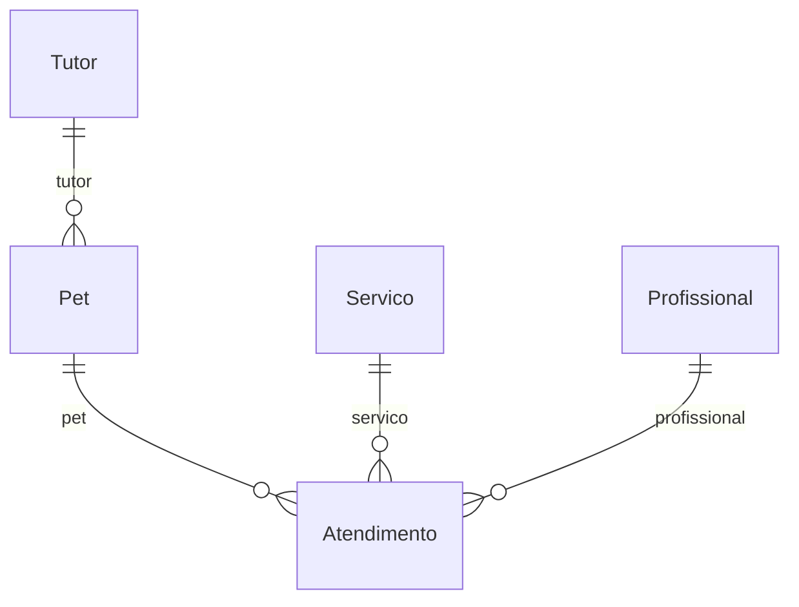
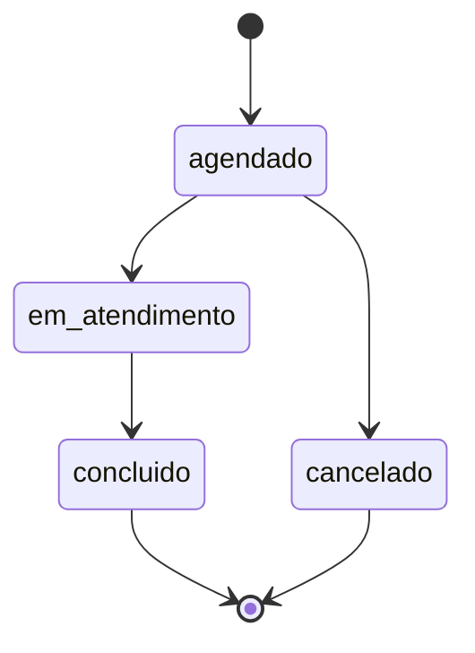

# Tema: Pet shop

> Manual do grupo. O **Manual de Construção** ensina *como* fazer cada etapa; este arquivo diz *o que* o seu grupo constrói: campos, regras, rotas e telas de cada módulo. Siga os dois juntos.

## O problema

O pet shop agenda banho, tosa e consultas por telefone e caderno. Horários se sobrepõem, o histórico de cada pet se perde e o dono não sabe quanto faturou no mês.

## Os 6 módulos e quem faz cada um

| Módulo | Papel transversal de quem faz | Rota da API | Depende de |
| --- | --- | --- | --- |
| **A — Tutores** | PO / Scrum Master | `/tutores` | — |
| **B — Pets** | Git e Integração | `/pets` | Tutor |
| **C — Atendimentos** | Segurança | `/atendimentos` | Pet, Servico, Profissional |
| **D — Serviços** | Testes e Qualidade | `/servicos` | — |
| **E — Profissionais** | UX/UI e Acessibilidade | `/profissionais` | — |
| **F — Relatórios** | Documentação e Apresentação | `/relatorios` | todos (só leitura) |

### Como os dados se ligam



Leia assim: cada linha liga um módulo ao outro pelo campo indicado (por exemplo, o campo `tutor` guarda o `_id` do outro módulo).

## Roteiro por aula

| Aula | Tarefa de cada aluno no seu módulo | Seção deste arquivo |
| --- | --- | --- |
| 01 | Copiar os requisitos e as regras do seu módulo para o Documento de Visão e as rotas para o Contrato da API (C0) | Requisitos, Regras, Rotas |
| 02 | Criar o modelo, os componentes, a rota e o link no menu | Código de partida → Modelo |
| 03 | Tela de listagem com as colunas e o filtro | Telas |
| 04 | Formulário com as validações | Código de partida → Formulário |
| 05 | Serviço mock com pelo menos 3 registros | Código de partida → Dados para o mock |
| 06 | Revisão das telas (C1) | Telas |
| 07 | Linhas do seu módulo no Dicionário de Dados (C2) | Campos |
| 08 | Schema, registro no módulo e dados no seed | Código de partida → Schema |
| 09 | Service e controller com o CRUD | Rotas |
| 10 | DTOs, testes e Swagger (C3) | Código de partida → DTOs, Testes mínimos |
| 11 | Regras de negócio no service (e o fluxo de estados no módulo C) | Regras de negócio, Fluxo de estados |
| 12–13 | Autenticação, perfis e troca do mock pela API (C4) | Manual de Construção |
| 14–15 | Testes finais, documentação e banca (C5) | Testes mínimos |

## Módulo A — Tutores

**Responsável:** aluno com o papel **PO / Scrum Master** · **Rota da API:** `/api/v1/tutores` · **Coleção:** `tutores`

Cadastro das pessoas responsáveis pelos pets.

**Pastas:** `backend/src/tutores/` e `frontend/src/app/features/tutores/`

### Campos

| Campo | Rótulo na tela | Tipo | Obrigatório | Regras | Exemplo |
| --- | --- | --- | --- | --- | --- |
| `nome` | Nome | texto | sim | 3 a 80 caracteres | `Maria Souza` |
| `telefone` | Telefone | telefone | sim | formato (51) 99999-9999 | `(51) 99876-5432` |
| `email` | E-mail | e-mail | sim | **único** | `maria.souza@email.com` |
| `endereco` | Endereço | texto longo | não | até 150 caracteres | `Rua das Flores, 120 – Centro` |
| `ativo` | Ativo | sim/não | automático | padrão: sim | — |

`_id`, `createdAt` e `updatedAt` são criados automaticamente pelo MongoDB e pelo `timestamps: true`.

### Requisitos funcionais

- **RF01** — O sistema deve permitir cadastrar um tutor com os campos acima.
- **RF02** — O sistema deve listar os tutores, com busca por parte do nome (sem diferenciar maiúsculas).
- **RF03** — O sistema deve permitir editar um tutor existente.
- **RF04** — O sistema deve permitir excluir um tutor.

### Regras de negócio

| Código | Regra | Resposta da API quando é violada | Como implementar |
| --- | --- | --- | --- |
| **RN01** | Não pode haver dois tutores com o mesmo e-mail. | 409 — _Já existe um tutor com o e-mail "..."_ | Igual ao `garantirNomeUnico` de Produtos, buscando por `email`. |
| **RN02** | O telefone deve seguir o formato (51) 99999-9999. | 400 — _Telefone inválido. Use o formato (51) 99999-9999_ | Já vem no DTO com `@Matches`. Teste enviando "51999999999". |

### Rotas da API

| Método | Rota | O que faz | Respostas |
| --- | --- | --- | --- |
| GET | `/tutores` | Lista (filtro opcional `?busca=texto`) | 200 |
| GET | `/tutores/:id` | Busca pelo id | 200, 400, 404 |
| POST | `/tutores` | Cadastra | 201, 400, 409 |
| PATCH | `/tutores/:id` | Edita | 200, 400, 404 |
| DELETE | `/tutores/:id` | Exclui | 204, 400, 404 |

Filtro no service: `const filtro = busca ? { nome: { $regex: busca, $options: 'i' } } : {};`

> **Receitas úteis** ([guia/RECEITAS.md](../RECEITAS.md)): busca por texto → receita 1.

### Telas

- **Listagem** (`tutores-lista`): colunas Nome, Telefone, E-mail e ações. Filtro: busca por parte do nome (sem diferenciar maiúsculas). Mensagens de carregando, lista vazia, erro e sucesso.
- **Formulário** (`tutor-form`), usado para cadastrar e editar:

| Campo | Controle na tela |
| --- | --- |
| Nome * | `text` |
| Telefone * | `tel` |
| E-mail * | `email` |
| Endereço | `textarea` |

- **Menu:** link "Tutores" em `layout.html` e rota `tutores` em `app.routes.ts`.

### Código de partida

Use estes trechos junto com o Manual de Construção. Eles substituem os campos de Produtos pelos do seu módulo; o resto (service, controller, serviços do front, telas) segue o modelo de Produtos, como o manual ensina.

<details>
<summary><b>Modelo do front-end (aula 02)</b></summary>

```ts
// frontend/src/app/features/tutores/tutor.model.ts

/** Tutor como a API devolve (segue o contrato da API). */
export interface Tutor {
  _id: string;
  nome: string;
  telefone: string;
  email: string;
  endereco?: string;
  ativo: boolean;
  createdAt?: string;
  updatedAt?: string;
}

/** Dados enviados para criar ou editar. */
export interface TutorEntrada {
  nome: string;
  telefone: string;
  email: string;
  endereco?: string;
  ativo?: boolean;
}
```

</details>

<details>
<summary><b>Dados para o serviço mock (aula 05)</b></summary>

Comece com este registro e acrescente pelo menos mais 2, variando os casos.

```ts
private tutores: Tutor[] = [
  {
    _id: '1',
    nome: 'Maria Souza',
    telefone: '(51) 99876-5432',
    email: 'maria.souza@email.com',
    endereco: 'Rua das Flores, 120 – Centro',
    ativo: true,
  },
];
```

</details>

<details>
<summary><b>Formulário reativo (aula 04)</b></summary>

```ts
// frontend/src/app/features/tutores/tutor-form/tutor-form.ts — dentro da classe
protected readonly form = this.fb.nonNullable.group({
  nome: ['', [Validators.required, Validators.minLength(3), Validators.maxLength(80)]],
  telefone: ['', [Validators.required, Validators.pattern(/^\(\d{2}\) \d{4,5}-\d{4}$/)]],
  email: ['', [Validators.required, Validators.email]],
  endereco: ['', [Validators.maxLength(150)]],
});
```

</details>

<details>
<summary><b>Schema do MongoDB (aula 08)</b></summary>

```ts
// backend/src/tutores/schemas/tutor.schema.ts
import { Prop, Schema, SchemaFactory } from '@nestjs/mongoose';
import { HydratedDocument } from 'mongoose';

export type TutorDocument = HydratedDocument<Tutor>;

@Schema({ timestamps: true, collection: 'tutores' })
export class Tutor {
  @Prop({ required: true, trim: true, minlength: 3, maxlength: 80 })
  nome: string;

  @Prop({ required: true, trim: true })
  telefone: string;

  @Prop({ required: true, trim: true, lowercase: true, unique: true })
  email: string;

  @Prop({ trim: true, maxlength: 150 })
  endereco?: string;

  @Prop({ default: true })
  ativo: boolean;
}

export const TutorSchema = SchemaFactory.createForClass(Tutor);
```

</details>

<details>
<summary><b>DTOs de criação e edição (aula 10)</b></summary>

```ts
// backend/src/tutores/dto/create-tutor.dto.ts
import { ApiProperty, ApiPropertyOptional } from '@nestjs/swagger';
import {
  IsEmail,
  IsNotEmpty,
  IsOptional,
  IsString,
  Length,
  Matches,
  MaxLength,
} from 'class-validator';

export class CreateTutorDto {
  @ApiProperty({ example: 'Maria Souza' })
  @IsString()
  @IsNotEmpty({ message: 'Nome é obrigatório' })
  @Length(3, 80, { message: 'Nome deve ter entre 3 e 80 caracteres' })
  nome: string;

  @ApiProperty({ example: '(51) 99876-5432' })
  @IsString()
  @Matches(/^\(\d{2}\) \d{4,5}-\d{4}$/, {
    message: 'Telefone inválido. Use o formato (51) 99999-9999',
  })
  telefone: string;

  @ApiProperty({ example: 'maria.souza@email.com' })
  @IsEmail({}, { message: 'Informe um e-mail válido' })
  email: string;

  @ApiPropertyOptional({ example: 'Rua das Flores, 120 – Centro' })
  @IsOptional()
  @IsString()
  @MaxLength(150, { message: 'Endereço pode ter no máximo 150 caracteres' })
  endereco?: string;
}
```

```ts
// backend/src/tutores/dto/update-tutor.dto.ts
import { ApiPropertyOptional, PartialType } from '@nestjs/swagger';
import { IsBoolean, IsOptional } from 'class-validator';
import { CreateTutorDto } from './create-tutor.dto';

export class UpdateTutorDto extends PartialType(CreateTutorDto) {
  @ApiPropertyOptional({ example: true })
  @IsOptional()
  @IsBoolean()
  ativo?: boolean;
}
```

</details>

### Testes mínimos (aula 10)

- [ ] `criar` salva um tutor com dados válidos.
- [ ] `buscarPorId` lança `NotFoundException` (404) quando o tutor não existe.
- [ ] `buscarPorId` lança `BadRequestException` (400) para um id inválido.
- [ ] Regra: não pode haver dois tutores com o mesmo e-mail.
- [ ] Regra: o telefone deve seguir o formato (51) 99999-9999.

## Módulo B — Pets

**Responsável:** aluno com o papel **Git e Integração** · **Rota da API:** `/api/v1/pets` · **Coleção:** `pets`

Cadastro dos animais, cada um ligado ao seu tutor.

**Depende de:** Tutor (`tutores`). Até a aula 12 o front usa mocks, então você não precisa esperar os colegas: use ids de exemplo (`'1'`, `'2'`).

**Pastas:** `backend/src/pets/` e `frontend/src/app/features/pets/`

### Campos

| Campo | Rótulo na tela | Tipo | Obrigatório | Regras | Exemplo |
| --- | --- | --- | --- | --- | --- |
| `nome` | Nome | texto | sim | 2 a 60 caracteres | `Thor` |
| `especie` | Espécie | lista de opções | sim | `cachorro`, `gato`, `ave`, `outro` | `cachorro` |
| `raca` | Raça | texto | não | até 60 caracteres | `Labrador` |
| `dataNascimento` | Data de nascimento | data | não | — | `2021-03-15` |
| `tutor` | Tutor | referência → Tutor | sim | — | _id de Tutor |
| `ativo` | Ativo | sim/não | automático | padrão: sim | — |

`_id`, `createdAt` e `updatedAt` são criados automaticamente pelo MongoDB e pelo `timestamps: true`.

### Requisitos funcionais

- **RF05** — O sistema deve permitir cadastrar um pet com os campos acima.
- **RF06** — O sistema deve listar os pets, com filtro por espécie.
- **RF07** — O sistema deve permitir editar um pet existente.
- **RF08** — O sistema deve permitir excluir um pet.

### Regras de negócio

| Código | Regra | Resposta da API quando é violada | Como implementar |
| --- | --- | --- | --- |
| **RN03** | A data de nascimento não pode ser no futuro. | 400 — _A data de nascimento não pode ser futura_ | No service, antes de salvar: `if (dto.dataNascimento && new Date(dto.dataNascimento) > new Date())`. |
| **RN04** | O tutor informado precisa existir. | 404 — _Tutor ... não encontrado_ | Receita 5 de `guia/RECEITAS.md`: injete o `TutoresService` e chame `buscarPorId(dto.tutor)`. |

### Rotas da API

| Método | Rota | O que faz | Respostas |
| --- | --- | --- | --- |
| GET | `/pets` | Lista (filtro opcional `?especie=cachorro`) | 200 |
| GET | `/pets/:id` | Busca pelo id | 200, 400, 404 |
| POST | `/pets` | Cadastra | 201, 400, 404 |
| PATCH | `/pets/:id` | Edita | 200, 400, 404 |
| DELETE | `/pets/:id` | Exclui | 204, 400, 404 |

Filtro no service: `const filtro = especie ? { especie } : {};`

> **Receitas úteis** ([guia/RECEITAS.md](../RECEITAS.md)): mostrar e escolher referências → receitas 3 e 4 · datas → receita 6.

### Telas

- **Listagem** (`pets-lista`): colunas Nome, Espécie, Raça, Data de nascimento e ações. Filtro: filtro por espécie. Mensagens de carregando, lista vazia, erro e sucesso.
- **Formulário** (`pet-form`), usado para cadastrar e editar:

| Campo | Controle na tela |
| --- | --- |
| Nome * | `text` |
| Espécie * | `select` |
| Raça | `text` |
| Data de nascimento | `date` |
| Tutor * | `select (receita 4 de guia/RECEITAS.md)` |

- **Menu:** link "Pets" em `layout.html` e rota `pets` em `app.routes.ts`.

### Código de partida

Use estes trechos junto com o Manual de Construção. Eles substituem os campos de Produtos pelos do seu módulo; o resto (service, controller, serviços do front, telas) segue o modelo de Produtos, como o manual ensina.

<details>
<summary><b>Modelo do front-end (aula 02)</b></summary>

```ts
// frontend/src/app/features/pets/pet.model.ts
import { Referencia } from '../../core/models/referencia';

export const OPCOES_ESPECIE = ['cachorro', 'gato', 'ave', 'outro'] as const;
export type Especie = (typeof OPCOES_ESPECIE)[number];

/** Pet como a API devolve (segue o contrato da API). */
export interface Pet {
  _id: string;
  nome: string;
  especie: Especie;
  raca?: string;
  dataNascimento?: string; // ISO: '2026-11-20'
  tutor: Referencia; // _id ou { _id, nome } (populate)
  ativo: boolean;
  createdAt?: string;
  updatedAt?: string;
}

/** Dados enviados para criar ou editar. */
export interface PetEntrada {
  nome: string;
  especie: Especie;
  raca?: string;
  dataNascimento?: string; // ISO: '2026-11-20'
  tutor: string; // _id do Tutor
  ativo?: boolean;
}
```

</details>

<details>
<summary><b>Dados para o serviço mock (aula 05)</b></summary>

Comece com este registro e acrescente pelo menos mais 2, variando os casos.

```ts
private pets: Pet[] = [
  {
    _id: '1',
    nome: 'Thor',
    especie: 'cachorro',
    raca: 'Labrador',
    dataNascimento: '2021-03-15',
    tutor: '1',
    ativo: true,
  },
];
```

</details>

<details>
<summary><b>Formulário reativo (aula 04)</b></summary>

```ts
// frontend/src/app/features/pets/pet-form/pet-form.ts — dentro da classe
protected readonly form = this.fb.nonNullable.group({
  nome: ['', [Validators.required, Validators.minLength(2), Validators.maxLength(60)]],
  especie: ['' as Especie | '', [Validators.required]],
  raca: ['', [Validators.maxLength(60)]],
  dataNascimento: ['', []],
  tutor: ['', [Validators.required]],
});
```

</details>

<details>
<summary><b>Schema do MongoDB (aula 08)</b></summary>

```ts
// backend/src/pets/schemas/pet.schema.ts
import { Prop, Schema, SchemaFactory } from '@nestjs/mongoose';
import { HydratedDocument, Types } from 'mongoose';

export const OPCOES_ESPECIE = ['cachorro', 'gato', 'ave', 'outro'] as const;
export type Especie = (typeof OPCOES_ESPECIE)[number];
export type PetDocument = HydratedDocument<Pet>;

@Schema({ timestamps: true, collection: 'pets' })
export class Pet {
  @Prop({ required: true, trim: true, minlength: 2, maxlength: 60 })
  nome: string;

  @Prop({ type: String, required: true, enum: OPCOES_ESPECIE })
  especie: Especie;

  @Prop({ trim: true, maxlength: 60 })
  raca?: string;

  @Prop({ type: Date })
  dataNascimento?: Date;

  // Referência ao módulo Tutor: guarda só o _id
  @Prop({ type: Types.ObjectId, ref: 'Tutor', required: true })
  tutor: Types.ObjectId;

  @Prop({ default: true })
  ativo: boolean;
}

export const PetSchema = SchemaFactory.createForClass(Pet);
PetSchema.index({ tutor: 1 });
PetSchema.index({ especie: 1 });
```

</details>

<details>
<summary><b>DTOs de criação e edição (aula 10)</b></summary>

```ts
// backend/src/pets/dto/create-pet.dto.ts
import { ApiProperty, ApiPropertyOptional } from '@nestjs/swagger';
import {
  IsDateString,
  IsIn,
  IsMongoId,
  IsNotEmpty,
  IsOptional,
  IsString,
  Length,
  MaxLength,
} from 'class-validator';
import { OPCOES_ESPECIE, type Especie } from '../schemas/pet.schema';

export class CreatePetDto {
  @ApiProperty({ example: 'Thor' })
  @IsString()
  @IsNotEmpty({ message: 'Nome é obrigatório' })
  @Length(2, 60, { message: 'Nome deve ter entre 2 e 60 caracteres' })
  nome: string;

  @ApiProperty({ enum: OPCOES_ESPECIE, example: 'cachorro' })
  @IsIn(OPCOES_ESPECIE, {
    message: `Espécie deve ser: ${OPCOES_ESPECIE.join(', ')}`,
  })
  especie: Especie;

  @ApiPropertyOptional({ example: 'Labrador' })
  @IsOptional()
  @IsString()
  @MaxLength(60, { message: 'Raça pode ter no máximo 60 caracteres' })
  raca?: string;

  @ApiPropertyOptional({ example: '2021-03-15' })
  @IsOptional()
  @IsDateString({}, { message: 'Data de nascimento deve ser uma data válida' })
  dataNascimento?: string;

  @ApiProperty({ example: '665f1c2b9a1e4b0012345678' })
  @IsMongoId({ message: 'Tutor: id inválido' })
  tutor: string;
}
```

```ts
// backend/src/pets/dto/update-pet.dto.ts
import { ApiPropertyOptional, PartialType } from '@nestjs/swagger';
import { IsBoolean, IsOptional } from 'class-validator';
import { CreatePetDto } from './create-pet.dto';

export class UpdatePetDto extends PartialType(CreatePetDto) {
  @ApiPropertyOptional({ example: true })
  @IsOptional()
  @IsBoolean()
  ativo?: boolean;
}
```

</details>

### Testes mínimos (aula 10)

- [ ] `criar` salva um pet com dados válidos.
- [ ] `buscarPorId` lança `NotFoundException` (404) quando o pet não existe.
- [ ] `buscarPorId` lança `BadRequestException` (400) para um id inválido.
- [ ] Regra: a data de nascimento não pode ser no futuro.
- [ ] Regra: o tutor informado precisa existir.

## Módulo C — Atendimentos

**Responsável:** aluno com o papel **Segurança** · **Rota da API:** `/api/v1/atendimentos` · **Coleção:** `atendimentos`

Agenda de banho, tosa e consultas, com o fluxo de estados do atendimento.

**Depende de:** Pet (`pets`), Servico (`servicos`), Profissional (`profissionais`). Até a aula 12 o front usa mocks, então você não precisa esperar os colegas: use ids de exemplo (`'1'`, `'2'`).

**Pastas:** `backend/src/atendimentos/` e `frontend/src/app/features/atendimentos/`

### Campos

| Campo | Rótulo na tela | Tipo | Obrigatório | Regras | Exemplo |
| --- | --- | --- | --- | --- | --- |
| `pet` | Pet | referência → Pet | sim | — | _id de Pet |
| `servico` | Serviço | referência → Servico | sim | — | _id de Servico |
| `profissional` | Profissional | referência → Profissional | sim | — | _id de Profissional |
| `dataHora` | Data e hora | data e hora | sim | — | `2026-11-20T14:00:00.000Z` |
| `observacoes` | Observações | texto longo | não | até 300 caracteres | `Pet com medo de secador` |
| `status` | Status | lista de opções | automático | `agendado`, `em_atendimento`, `concluido`, `cancelado`; começa em `agendado` | — |

`_id`, `createdAt` e `updatedAt` são criados automaticamente pelo MongoDB e pelo `timestamps: true`.

### Requisitos funcionais

- **RF09** — O sistema deve permitir cadastrar um atendimento com os campos acima.
- **RF10** — O sistema deve listar os atendimentos, com filtro pelo status.
- **RF11** — O sistema deve permitir editar um atendimento existente.
- **RF12** — O sistema deve permitir mudar o status do atendimento, respeitando o fluxo de estados.

### Regras de negócio

| Código | Regra | Resposta da API quando é violada | Como implementar |
| --- | --- | --- | --- |
| **RN05** | Um profissional não pode ter dois atendimentos no mesmo dia e horário (exceto cancelados). | 409 — _O profissional já tem um atendimento neste horário_ | `findOne({ profissional: dto.profissional, dataHora: dto.dataHora, status: { $ne: 'cancelado' } })`. |
| **RN06** | Só é possível agendar para uma data e hora futuras. | 400 — _O atendimento precisa ser agendado para o futuro_ | `if (new Date(dto.dataHora) <= new Date())` no `criar`. |
| **RN07** | O status só pode mudar seguindo o fluxo abaixo. | 400 — _Não é possível passar de "..." para "..."_ | Mapa `TRANSICOES` (código abaixo). |

### Rotas da API

| Método | Rota | O que faz | Respostas |
| --- | --- | --- | --- |
| GET | `/atendimentos` | Lista (filtro opcional `?status=agendado`) | 200 |
| GET | `/atendimentos/:id` | Busca pelo id | 200, 400, 404 |
| POST | `/atendimentos` | Cadastra | 201, 400, 409 |
| PATCH | `/atendimentos/:id` | Edita | 200, 400, 404 |
| PATCH | `/atendimentos/:id/status` | Muda o status | 200, 400, 404 |

Filtro no service: `const filtro = status ? { status } : {};`

> **Receitas úteis** ([guia/RECEITAS.md](../RECEITAS.md)): mostrar e escolher referências → receitas 3 e 4 · datas → receita 6 · botões de status → receita 7.

### Fluxo de estados



Na tela de listagem, mostre só os botões das transições válidas para o status atual de cada linha.

<details>
<summary><b>Mapa de transições e método mudarStatus</b></summary>

```ts
// backend/src/atendimentos/atendimentos.service.ts — no topo do arquivo
import { Status } from './schemas/atendimento.schema';

// Mapa de transições VÁLIDAS: de → para (PDF 05, cap. 3)
const TRANSICOES: Record<Status, Status[]> = {
  agendado: ['em_atendimento', 'cancelado'],
  em_atendimento: ['concluido'],
  concluido: [], // estado final
  cancelado: [], // estado final
};

// ...dentro da classe AtendimentosService:
async mudarStatus(id: string, novo: Status) {
  const atual = await this.buscarPorId(id);
  if (!TRANSICOES[atual.status].includes(novo)) {
    throw new BadRequestException(
      `Não é possível passar de "${atual.status}" para "${novo}"`,
    );
  }
  return this.atendimentoModel
    .findByIdAndUpdate(id, { status: novo }, { new: true })
    .lean()
    .exec();
}
```

</details>

<details>
<summary><b>DTO da mudança de status</b></summary>

```ts
// backend/src/atendimentos/dto/mudar-status.dto.ts
import { ApiProperty } from '@nestjs/swagger';
import { IsIn } from 'class-validator';
import { STATUS, type Status } from '../schemas/atendimento.schema';

export class MudarStatusDto {
  @ApiProperty({ enum: STATUS, example: 'em_atendimento' })
  @IsIn(STATUS, { message: `Status deve ser: ${STATUS.join(', ')}` })
  status: Status;
}
```

</details>

<details>
<summary><b>Rota no controller</b></summary>

```ts
// backend/src/atendimentos/atendimentos.controller.ts
@Patch(':id/status')
@ApiOperation({ summary: 'Muda o status (somente transições válidas)' })
@ApiResponse({ status: 400, description: 'Transição de status inválida' })
mudarStatus(@Param('id') id: string, @Body() dto: MudarStatusDto) {
  return this.atendimentosService.mudarStatus(id, dto.status);
}
```

</details>

### Telas

- **Listagem** (`atendimentos-lista`): colunas Pet, Serviço, Profissional, Data e hora, Status (com a etiqueta colorida) e ações. Filtro: filtro pelo status. Mensagens de carregando, lista vazia, erro e sucesso.
- **Formulário** (`atendimento-form`), usado para cadastrar e editar:

| Campo | Controle na tela |
| --- | --- |
| Pet * | `select (receita 4 de guia/RECEITAS.md)` |
| Serviço * | `select (receita 4 de guia/RECEITAS.md)` |
| Profissional * | `select (receita 4 de guia/RECEITAS.md)` |
| Data e hora * | `datetime-local` |
| Observações | `textarea` |

- **Menu:** link "Atendimentos" em `layout.html` e rota `atendimentos` em `app.routes.ts`.

### Código de partida

Use estes trechos junto com o Manual de Construção. Eles substituem os campos de Produtos pelos do seu módulo; o resto (service, controller, serviços do front, telas) segue o modelo de Produtos, como o manual ensina.

<details>
<summary><b>Modelo do front-end (aula 02)</b></summary>

```ts
// frontend/src/app/features/atendimentos/atendimento.model.ts
import { Referencia } from '../../core/models/referencia';

export const STATUS = ['agendado', 'em_atendimento', 'concluido', 'cancelado'] as const;
export type Status = (typeof STATUS)[number];

/** Atendimento como a API devolve (segue o contrato da API). */
export interface Atendimento {
  _id: string;
  pet: Referencia; // _id ou { _id, nome } (populate)
  servico: Referencia; // _id ou { _id, nome } (populate)
  profissional: Referencia; // _id ou { _id, nome } (populate)
  dataHora: string; // ISO: '2026-11-20T14:00'
  observacoes?: string;
  status: Status;
  createdAt?: string;
  updatedAt?: string;
}

/** Dados enviados para criar ou editar. */
export interface AtendimentoEntrada {
  pet: string; // _id do Pet
  servico: string; // _id do Servico
  profissional: string; // _id do Profissional
  dataHora: string; // ISO: '2026-11-20T14:00'
  observacoes?: string;
}
```

</details>

<details>
<summary><b>Dados para o serviço mock (aula 05)</b></summary>

Comece com este registro e acrescente pelo menos mais 2, variando os casos.

```ts
private atendimentos: Atendimento[] = [
  {
    _id: '1',
    pet: '1',
    servico: '1',
    profissional: '1',
    dataHora: '2026-11-20T14:00',
    observacoes: 'Pet com medo de secador',
    status: 'agendado',
  },
];
```

</details>

<details>
<summary><b>Formulário reativo (aula 04)</b></summary>

```ts
// frontend/src/app/features/atendimentos/atendimento-form/atendimento-form.ts — dentro da classe
protected readonly form = this.fb.nonNullable.group({
  pet: ['', [Validators.required]],
  servico: ['', [Validators.required]],
  profissional: ['', [Validators.required]],
  dataHora: ['', [Validators.required]],
  observacoes: ['', [Validators.maxLength(300)]],
});
```

</details>

<details>
<summary><b>Schema do MongoDB (aula 08)</b></summary>

```ts
// backend/src/atendimentos/schemas/atendimento.schema.ts
import { Prop, Schema, SchemaFactory } from '@nestjs/mongoose';
import { HydratedDocument, Types } from 'mongoose';

export const STATUS = [
  'agendado',
  'em_atendimento',
  'concluido',
  'cancelado',
] as const;
export type Status = (typeof STATUS)[number];

export type AtendimentoDocument = HydratedDocument<Atendimento>;

@Schema({ timestamps: true, collection: 'atendimentos' })
export class Atendimento {
  // Referência ao módulo Pet: guarda só o _id
  @Prop({ type: Types.ObjectId, ref: 'Pet', required: true })
  pet: Types.ObjectId;

  // Referência ao módulo Servico: guarda só o _id
  @Prop({ type: Types.ObjectId, ref: 'Servico', required: true })
  servico: Types.ObjectId;

  // Referência ao módulo Profissional: guarda só o _id
  @Prop({ type: Types.ObjectId, ref: 'Profissional', required: true })
  profissional: Types.ObjectId;

  @Prop({ type: Date, required: true })
  dataHora: Date;

  @Prop({ trim: true, maxlength: 300 })
  observacoes?: string;

  // Fluxo de estados: o status começa em "agendado" e só muda pela rota PATCH /atendimentos/:id/status
  @Prop({ type: String, enum: STATUS, default: 'agendado' })
  status: Status;
}

export const AtendimentoSchema = SchemaFactory.createForClass(Atendimento);
AtendimentoSchema.index({ pet: 1 });
AtendimentoSchema.index({ servico: 1 });
AtendimentoSchema.index({ profissional: 1 });
AtendimentoSchema.index({ status: 1 });
```

</details>

<details>
<summary><b>DTOs de criação e edição (aula 10)</b></summary>

```ts
// backend/src/atendimentos/dto/create-atendimento.dto.ts
import { ApiProperty, ApiPropertyOptional } from '@nestjs/swagger';
import {
  IsDateString,
  IsMongoId,
  IsOptional,
  IsString,
  MaxLength,
} from 'class-validator';

export class CreateAtendimentoDto {
  @ApiProperty({ example: '665f1c2b9a1e4b0012345678' })
  @IsMongoId({ message: 'Pet: id inválido' })
  pet: string;

  @ApiProperty({ example: '665f1c2b9a1e4b0012345678' })
  @IsMongoId({ message: 'Serviço: id inválido' })
  servico: string;

  @ApiProperty({ example: '665f1c2b9a1e4b0012345678' })
  @IsMongoId({ message: 'Profissional: id inválido' })
  profissional: string;

  @ApiProperty({ example: '2026-11-20T14:00:00.000Z' })
  @IsDateString({}, { message: 'Data e hora deve ser uma data válida' })
  dataHora: string;

  @ApiPropertyOptional({ example: 'Pet com medo de secador' })
  @IsOptional()
  @IsString()
  @MaxLength(300, { message: 'Observações pode ter no máximo 300 caracteres' })
  observacoes?: string;
}
```

```ts
// backend/src/atendimentos/dto/update-atendimento.dto.ts
import { PartialType } from '@nestjs/swagger';
import { CreateAtendimentoDto } from './create-atendimento.dto';

// O status NÃO entra aqui: ele só muda pela rota PATCH /:id/status
export class UpdateAtendimentoDto extends PartialType(CreateAtendimentoDto) {}
```

</details>

### Testes mínimos (aula 10)

- [ ] `criar` salva um atendimento com dados válidos.
- [ ] `buscarPorId` lança `NotFoundException` (404) quando o atendimento não existe.
- [ ] `buscarPorId` lança `BadRequestException` (400) para um id inválido.
- [ ] Regra: um profissional não pode ter dois atendimentos no mesmo dia e horário (exceto cancelados).
- [ ] Regra: só é possível agendar para uma data e hora futuras.
- [ ] `mudarStatus` lança 400 numa transição inválida e aceita uma válida.

## Módulo D — Serviços

**Responsável:** aluno com o papel **Testes e Qualidade** · **Rota da API:** `/api/v1/servicos` · **Coleção:** `servicos`

Catálogo de serviços oferecidos, com preço e duração.

**Pastas:** `backend/src/servicos/` e `frontend/src/app/features/servicos/`

### Campos

| Campo | Rótulo na tela | Tipo | Obrigatório | Regras | Exemplo |
| --- | --- | --- | --- | --- | --- |
| `nome` | Nome | texto | sim | 3 a 60 caracteres; **único** | `Banho e tosa` |
| `categoria` | Categoria | lista de opções | sim | `banho`, `tosa`, `veterinario`, `outros` | `banho` |
| `preco` | Preço (R$) | número decimal | sim | mínimo 0 | `79.9` |
| `duracaoMinutos` | Duração (min) | número inteiro | sim | de 10 a 480 | `60` |
| `ativo` | Ativo | sim/não | automático | padrão: sim | — |

`_id`, `createdAt` e `updatedAt` são criados automaticamente pelo MongoDB e pelo `timestamps: true`.

### Requisitos funcionais

- **RF13** — O sistema deve permitir cadastrar um serviço com os campos acima.
- **RF14** — O sistema deve listar os serviços ativos, com filtro por categoria.
- **RF15** — O sistema deve permitir editar um serviço existente.
- **RF16** — O sistema deve permitir excluir um serviço; a exclusão apenas o inativa.

### Regras de negócio

| Código | Regra | Resposta da API quando é violada | Como implementar |
| --- | --- | --- | --- |
| **RN08** | Não pode haver dois serviços com o mesmo nome. | 409 — _Já existe um serviço com o nome "..."_ | Igual ao `garantirNomeUnico` de Produtos. |
| **RN09** | Excluir um serviço apenas o inativa; a listagem padrão mostra só os ativos. | 204 (exclusão vira `ativo: false`) | Receita 2 de `guia/RECEITAS.md`. |

### Rotas da API

| Método | Rota | O que faz | Respostas |
| --- | --- | --- | --- |
| GET | `/servicos` | Lista (filtro opcional `?categoria=banho`, `?todos=true` inclui os inativos) | 200 |
| GET | `/servicos/:id` | Busca pelo id | 200, 400, 404 |
| POST | `/servicos` | Cadastra | 201, 400, 409 |
| PATCH | `/servicos/:id` | Edita | 200, 400, 404 |
| DELETE | `/servicos/:id` | Inativa (exclusão lógica) | 204, 400, 404 |

Filtro no service: `const filtro = categoria ? { categoria } : {};`

> **Receitas úteis** ([guia/RECEITAS.md](../RECEITAS.md)): exclusão lógica → receita 2.

### Telas

- **Listagem** (`servicos-lista`): colunas Nome, Categoria, Preço (R$), Duração (min) e ações. Filtro: filtro por categoria. Mensagens de carregando, lista vazia, erro e sucesso.
- **Formulário** (`servico-form`), usado para cadastrar e editar:

| Campo | Controle na tela |
| --- | --- |
| Nome * | `text` |
| Categoria * | `select` |
| Preço (R$) * | `number, step 0.01` |
| Duração (min) * | `number, step 1` |

- **Menu:** link "Serviços" em `layout.html` e rota `servicos` em `app.routes.ts`.

### Código de partida

Use estes trechos junto com o Manual de Construção. Eles substituem os campos de Produtos pelos do seu módulo; o resto (service, controller, serviços do front, telas) segue o modelo de Produtos, como o manual ensina.

<details>
<summary><b>Modelo do front-end (aula 02)</b></summary>

```ts
// frontend/src/app/features/servicos/servico.model.ts
export const OPCOES_CATEGORIA = ['banho', 'tosa', 'veterinario', 'outros'] as const;
export type Categoria = (typeof OPCOES_CATEGORIA)[number];

/** Serviço como a API devolve (segue o contrato da API). */
export interface Servico {
  _id: string;
  nome: string;
  categoria: Categoria;
  preco: number;
  duracaoMinutos: number;
  ativo: boolean;
  createdAt?: string;
  updatedAt?: string;
}

/** Dados enviados para criar ou editar. */
export interface ServicoEntrada {
  nome: string;
  categoria: Categoria;
  preco: number;
  duracaoMinutos: number;
  ativo?: boolean;
}
```

</details>

<details>
<summary><b>Dados para o serviço mock (aula 05)</b></summary>

Comece com este registro e acrescente pelo menos mais 2, variando os casos.

```ts
private servicos: Servico[] = [
  {
    _id: '1',
    nome: 'Banho e tosa',
    categoria: 'banho',
    preco: 79.9,
    duracaoMinutos: 60,
    ativo: true,
  },
];
```

</details>

<details>
<summary><b>Formulário reativo (aula 04)</b></summary>

```ts
// frontend/src/app/features/servicos/servico-form/servico-form.ts — dentro da classe
protected readonly form = this.fb.nonNullable.group({
  nome: ['', [Validators.required, Validators.minLength(3), Validators.maxLength(60)]],
  categoria: ['' as Categoria | '', [Validators.required]],
  preco: [0, [Validators.required, Validators.min(0)]],
  duracaoMinutos: [
    10,
    [Validators.required, Validators.min(10), Validators.max(480), Validators.pattern(/^\d+$/)],
  ],
});
```

</details>

<details>
<summary><b>Schema do MongoDB (aula 08)</b></summary>

```ts
// backend/src/servicos/schemas/servico.schema.ts
import { Prop, Schema, SchemaFactory } from '@nestjs/mongoose';
import { HydratedDocument } from 'mongoose';

export const OPCOES_CATEGORIA = [
  'banho',
  'tosa',
  'veterinario',
  'outros',
] as const;
export type Categoria = (typeof OPCOES_CATEGORIA)[number];
export type ServicoDocument = HydratedDocument<Servico>;

@Schema({ timestamps: true, collection: 'servicos' })
export class Servico {
  @Prop({
    required: true,
    trim: true,
    minlength: 3,
    maxlength: 60,
    unique: true,
  })
  nome: string;

  @Prop({ type: String, required: true, enum: OPCOES_CATEGORIA })
  categoria: Categoria;

  @Prop({ required: true, min: 0 })
  preco: number;

  @Prop({ required: true, min: 10, max: 480 })
  duracaoMinutos: number;

  @Prop({ default: true })
  ativo: boolean;
}

export const ServicoSchema = SchemaFactory.createForClass(Servico);
ServicoSchema.index({ categoria: 1 });
```

</details>

<details>
<summary><b>DTOs de criação e edição (aula 10)</b></summary>

```ts
// backend/src/servicos/dto/create-servico.dto.ts
import { ApiProperty } from '@nestjs/swagger';
import {
  IsIn,
  IsInt,
  IsNotEmpty,
  IsNumber,
  IsString,
  Length,
  Max,
  Min,
} from 'class-validator';
import { OPCOES_CATEGORIA, type Categoria } from '../schemas/servico.schema';

export class CreateServicoDto {
  @ApiProperty({ example: 'Banho e tosa' })
  @IsString()
  @IsNotEmpty({ message: 'Nome é obrigatório' })
  @Length(3, 60, { message: 'Nome deve ter entre 3 e 60 caracteres' })
  nome: string;

  @ApiProperty({ enum: OPCOES_CATEGORIA, example: 'banho' })
  @IsIn(OPCOES_CATEGORIA, {
    message: `Categoria deve ser: ${OPCOES_CATEGORIA.join(', ')}`,
  })
  categoria: Categoria;

  @ApiProperty({ example: 79.9 })
  @IsNumber(
    { maxDecimalPlaces: 2 },
    { message: 'Preço (R$) deve ser um número' },
  )
  @Min(0, { message: 'Preço (R$) deve ser no mínimo 0' })
  preco: number;

  @ApiProperty({ example: 60 })
  @IsInt({ message: 'Duração (min) deve ser um número inteiro' })
  @Min(10, { message: 'Duração (min) deve ser no mínimo 10' })
  @Max(480, { message: 'Duração (min) deve ser no máximo 480' })
  duracaoMinutos: number;
}
```

```ts
// backend/src/servicos/dto/update-servico.dto.ts
import { ApiPropertyOptional, PartialType } from '@nestjs/swagger';
import { IsBoolean, IsOptional } from 'class-validator';
import { CreateServicoDto } from './create-servico.dto';

export class UpdateServicoDto extends PartialType(CreateServicoDto) {
  @ApiPropertyOptional({ example: true })
  @IsOptional()
  @IsBoolean()
  ativo?: boolean;
}
```

</details>

### Testes mínimos (aula 10)

- [ ] `criar` salva um serviço com dados válidos.
- [ ] `buscarPorId` lança `NotFoundException` (404) quando o serviço não existe.
- [ ] `buscarPorId` lança `BadRequestException` (400) para um id inválido.
- [ ] Regra: não pode haver dois serviços com o mesmo nome.
- [ ] Regra: excluir um serviço apenas o inativa; a listagem padrão mostra só os ativos.

## Módulo E — Profissionais

**Responsável:** aluno com o papel **UX/UI e Acessibilidade** · **Rota da API:** `/api/v1/profissionais` · **Coleção:** `profissionais`

Equipe que realiza os atendimentos.

**Pastas:** `backend/src/profissionais/` e `frontend/src/app/features/profissionais/`

### Campos

| Campo | Rótulo na tela | Tipo | Obrigatório | Regras | Exemplo |
| --- | --- | --- | --- | --- | --- |
| `nome` | Nome | texto | sim | 3 a 80 caracteres | `Maria Souza` |
| `funcao` | Função | lista de opções | sim | `banhista`, `tosador`, `veterinario` | `veterinario` |
| `telefone` | Telefone | telefone | sim | formato (51) 99999-9999 | `(51) 99876-5432` |
| `email` | E-mail | e-mail | sim | **único** | `carla.vet@petshop.com` |
| `crmv` | CRMV | texto | não | até 20 caracteres | `CRMV-RS 12345` |
| `ativo` | Ativo | sim/não | automático | padrão: sim | — |

`_id`, `createdAt` e `updatedAt` são criados automaticamente pelo MongoDB e pelo `timestamps: true`.

### Requisitos funcionais

- **RF17** — O sistema deve permitir cadastrar um profissional com os campos acima.
- **RF18** — O sistema deve listar os profissionais, com filtro por função.
- **RF19** — O sistema deve permitir editar um profissional existente.
- **RF20** — O sistema deve permitir excluir um profissional.

### Regras de negócio

| Código | Regra | Resposta da API quando é violada | Como implementar |
| --- | --- | --- | --- |
| **RN10** | Profissional com função "veterinario" precisa ter CRMV. | 400 — _O CRMV é obrigatório para veterinários_ | Validação contextual (manual, aula 11): no `criar` e no `atualizar`, `if (dto.funcao === 'veterinario' && !dto.crmv)`. |
| **RN11** | Não pode haver dois profissionais com o mesmo e-mail. | 409 — _Já existe um profissional com o e-mail "..."_ | Igual ao `garantirNomeUnico`, buscando por `email`. |

### Rotas da API

| Método | Rota | O que faz | Respostas |
| --- | --- | --- | --- |
| GET | `/profissionais` | Lista (filtro opcional `?funcao=banhista`) | 200 |
| GET | `/profissionais/:id` | Busca pelo id | 200, 400, 404 |
| POST | `/profissionais` | Cadastra | 201, 400, 409 |
| PATCH | `/profissionais/:id` | Edita | 200, 400, 404 |
| DELETE | `/profissionais/:id` | Exclui | 204, 400, 404 |

Filtro no service: `const filtro = funcao ? { funcao } : {};`

### Telas

- **Listagem** (`profissionais-lista`): colunas Nome, Função, Telefone, E-mail e ações. Filtro: filtro por função. Mensagens de carregando, lista vazia, erro e sucesso.
- **Formulário** (`profissional-form`), usado para cadastrar e editar:

| Campo | Controle na tela |
| --- | --- |
| Nome * | `text` |
| Função * | `select` |
| Telefone * | `tel` |
| E-mail * | `email` |
| CRMV | `text` |

- **Menu:** link "Profissionais" em `layout.html` e rota `profissionais` em `app.routes.ts`.

### Código de partida

Use estes trechos junto com o Manual de Construção. Eles substituem os campos de Produtos pelos do seu módulo; o resto (service, controller, serviços do front, telas) segue o modelo de Produtos, como o manual ensina.

<details>
<summary><b>Modelo do front-end (aula 02)</b></summary>

```ts
// frontend/src/app/features/profissionais/profissional.model.ts
export const OPCOES_FUNCAO = ['banhista', 'tosador', 'veterinario'] as const;
export type Funcao = (typeof OPCOES_FUNCAO)[number];

/** Profissional como a API devolve (segue o contrato da API). */
export interface Profissional {
  _id: string;
  nome: string;
  funcao: Funcao;
  telefone: string;
  email: string;
  crmv?: string;
  ativo: boolean;
  createdAt?: string;
  updatedAt?: string;
}

/** Dados enviados para criar ou editar. */
export interface ProfissionalEntrada {
  nome: string;
  funcao: Funcao;
  telefone: string;
  email: string;
  crmv?: string;
  ativo?: boolean;
}
```

</details>

<details>
<summary><b>Dados para o serviço mock (aula 05)</b></summary>

Comece com este registro e acrescente pelo menos mais 2, variando os casos.

```ts
private profissionais: Profissional[] = [
  {
    _id: '1',
    nome: 'Maria Souza',
    funcao: 'veterinario',
    telefone: '(51) 99876-5432',
    email: 'carla.vet@petshop.com',
    crmv: 'CRMV-RS 12345',
    ativo: true,
  },
];
```

</details>

<details>
<summary><b>Formulário reativo (aula 04)</b></summary>

```ts
// frontend/src/app/features/profissionais/profissional-form/profissional-form.ts — dentro da classe
protected readonly form = this.fb.nonNullable.group({
  nome: ['', [Validators.required, Validators.minLength(3), Validators.maxLength(80)]],
  funcao: ['' as Funcao | '', [Validators.required]],
  telefone: ['', [Validators.required, Validators.pattern(/^\(\d{2}\) \d{4,5}-\d{4}$/)]],
  email: ['', [Validators.required, Validators.email]],
  crmv: ['', [Validators.maxLength(20)]],
});
```

</details>

<details>
<summary><b>Schema do MongoDB (aula 08)</b></summary>

```ts
// backend/src/profissionais/schemas/profissional.schema.ts
import { Prop, Schema, SchemaFactory } from '@nestjs/mongoose';
import { HydratedDocument } from 'mongoose';

export const OPCOES_FUNCAO = ['banhista', 'tosador', 'veterinario'] as const;
export type Funcao = (typeof OPCOES_FUNCAO)[number];
export type ProfissionalDocument = HydratedDocument<Profissional>;

@Schema({ timestamps: true, collection: 'profissionais' })
export class Profissional {
  @Prop({ required: true, trim: true, minlength: 3, maxlength: 80 })
  nome: string;

  @Prop({ type: String, required: true, enum: OPCOES_FUNCAO })
  funcao: Funcao;

  @Prop({ required: true, trim: true })
  telefone: string;

  @Prop({ required: true, trim: true, lowercase: true, unique: true })
  email: string;

  @Prop({ trim: true, maxlength: 20 })
  crmv?: string;

  @Prop({ default: true })
  ativo: boolean;
}

export const ProfissionalSchema = SchemaFactory.createForClass(Profissional);
ProfissionalSchema.index({ funcao: 1 });
```

</details>

<details>
<summary><b>DTOs de criação e edição (aula 10)</b></summary>

```ts
// backend/src/profissionais/dto/create-profissional.dto.ts
import { ApiProperty, ApiPropertyOptional } from '@nestjs/swagger';
import {
  IsEmail,
  IsIn,
  IsNotEmpty,
  IsOptional,
  IsString,
  Length,
  Matches,
  MaxLength,
} from 'class-validator';
import { OPCOES_FUNCAO, type Funcao } from '../schemas/profissional.schema';

export class CreateProfissionalDto {
  @ApiProperty({ example: 'Maria Souza' })
  @IsString()
  @IsNotEmpty({ message: 'Nome é obrigatório' })
  @Length(3, 80, { message: 'Nome deve ter entre 3 e 80 caracteres' })
  nome: string;

  @ApiProperty({ enum: OPCOES_FUNCAO, example: 'veterinario' })
  @IsIn(OPCOES_FUNCAO, {
    message: `Função deve ser: ${OPCOES_FUNCAO.join(', ')}`,
  })
  funcao: Funcao;

  @ApiProperty({ example: '(51) 99876-5432' })
  @IsString()
  @Matches(/^\(\d{2}\) \d{4,5}-\d{4}$/, {
    message: 'Telefone inválido. Use o formato (51) 99999-9999',
  })
  telefone: string;

  @ApiProperty({ example: 'carla.vet@petshop.com' })
  @IsEmail({}, { message: 'Informe um e-mail válido' })
  email: string;

  @ApiPropertyOptional({ example: 'CRMV-RS 12345' })
  @IsOptional()
  @IsString()
  @MaxLength(20, { message: 'CRMV pode ter no máximo 20 caracteres' })
  crmv?: string;
}
```

```ts
// backend/src/profissionais/dto/update-profissional.dto.ts
import { ApiPropertyOptional, PartialType } from '@nestjs/swagger';
import { IsBoolean, IsOptional } from 'class-validator';
import { CreateProfissionalDto } from './create-profissional.dto';

export class UpdateProfissionalDto extends PartialType(CreateProfissionalDto) {
  @ApiPropertyOptional({ example: true })
  @IsOptional()
  @IsBoolean()
  ativo?: boolean;
}
```

</details>

### Testes mínimos (aula 10)

- [ ] `criar` salva um profissional com dados válidos.
- [ ] `buscarPorId` lança `NotFoundException` (404) quando o profissional não existe.
- [ ] `buscarPorId` lança `BadRequestException` (400) para um id inválido.
- [ ] Regra: profissional com função "veterinario" precisa ter CRMV.
- [ ] Regra: não pode haver dois profissionais com o mesmo e-mail.

## Módulo F — Relatórios

**Responsável:** aluno com o papel **Documentação e Apresentação** · **Rota da API:** `/api/v1/relatorios` · **Coleção:** nenhuma (lê as coleções dos colegas)

Painel com números do negócio, calculados a partir dos outros módulos.

**Pastas:** `backend/src/relatorios/` e `frontend/src/app/features/relatorios/` (o painel também aparece na tela Início).

Enquanto os colegas não têm schema (até a aula 08), trabalhe no front com um serviço mock que devolve números fixos, no mesmo formato das respostas abaixo.

### Requisitos funcionais

- **RF21** — O sistema deve exibir: totais de tutores, pets e atendimentos agendados.
- **RF22** — O sistema deve exibir: quantidade de atendimentos em cada status.
- **RF23** — O sistema deve exibir: atendimentos concluídos e faturamento por serviço.
- **RF24** — O painel deve mostrar uma mensagem amigável quando ainda não houver dados.

### Rotas da API

| Método | Rota | O que devolve | Exemplo de resposta (`dados`) |
| --- | --- | --- | --- |
| GET | `/relatorios/resumo` | Totais de tutores, pets e atendimentos agendados | `{ "tutores": 42, "pets": 57, "atendimentosAgendados": 9 }` |
| GET | `/relatorios/atendimentos-por-status` | Quantidade de atendimentos em cada status | `[{ "_id": "concluido", "quantidade": 31 }, ...]` |
| GET | `/relatorios/faturamento-por-servico` | Atendimentos concluídos e faturamento por serviço | `[{ "servico": "Banho e tosa", "quantidade": 12, "faturamento": 958.8 }, ...]` |

### Registrar os schemas dos colegas

<details>
<summary><b>relatorios.module.ts e construtor do service</b></summary>

```ts
// backend/src/relatorios/relatorios.module.ts
@Module({
  imports: [
    MongooseModule.forFeature([
      { name: Tutor.name, schema: TutorSchema },
      { name: Pet.name, schema: PetSchema },
      { name: Atendimento.name, schema: AtendimentoSchema },
    ]),
  ],
  controllers: [RelatoriosController],
  providers: [RelatoriosService],
})
export class RelatoriosModule {}

// backend/src/relatorios/relatorios.service.ts
@Injectable()
export class RelatoriosService {
  constructor(
    @InjectModel(Tutor.name) private readonly tutorModel: Model<TutorDocument>,
    @InjectModel(Pet.name) private readonly petModel: Model<PetDocument>,
    @InjectModel(Atendimento.name)
    private readonly atendimentoModel: Model<AtendimentoDocument>,
  ) {}

  // ...consultas abaixo
}
```

</details>

### Consultas

<details>
<summary><b>GET /relatorios/resumo</b></summary>

```ts
async resumo() {
  const [tutores, pets, atendimentosAgendados] = await Promise.all([
    this.tutorModel.countDocuments({ ativo: true }),
    this.petModel.countDocuments({ ativo: true }),
    this.atendimentoModel.countDocuments({ status: 'agendado' }),
  ]);
  return { tutores, pets, atendimentosAgendados };
}
```

</details>

<details>
<summary><b>GET /relatorios/atendimentos-por-status</b></summary>

```ts
async atendimentosPorStatus() {
  return this.atendimentoModel
    .aggregate([
      { $group: { _id: '$status', quantidade: { $sum: 1 } } },
      { $sort: { quantidade: -1 } },
    ])
    .exec();
}
```

</details>

<details>
<summary><b>GET /relatorios/faturamento-por-servico</b></summary>

```ts
async faturamentoPorServico() {
  return this.atendimentoModel
    .aggregate([
      { $match: { status: 'concluido' } },
      {
        $lookup: {
          from: 'servicos',
          localField: 'servico',
          foreignField: '_id',
          as: 's',
        },
      },
      { $unwind: '$s' },
      {
        $group: {
          _id: '$s.nome',
          quantidade: { $sum: 1 },
          faturamento: { $sum: '$s.preco' },
        },
      },
      {
        $project: { _id: 0, servico: '$_id', quantidade: 1, faturamento: 1 },
      },
      { $sort: { faturamento: -1 } },
    ])
    .exec();
}
```

</details>

As consultas com `$lookup` leem outra coleção pelo nome dela (`from`), sem precisar injetar o Model dessa coleção.

No controller, cada consulta é um `@Get('<rota>')` que só chama o método do service.

### Telas

- **Painel** (`relatorios-painel`): um cartão por número do `resumo` e uma tabela para cada consulta agrupada. Mostre "carregando", "sem dados" e erro.
- **Início:** coloque os cartões do resumo na tela inicial do sistema.

### Testes mínimos (aula 10)

- [ ] `resumo` devolve os três totais usando `countDocuments` (mock do Model).
- [ ] Cada consulta agrupada chama `aggregate` e devolve o resultado do Model.
- [ ] Quando não há dados, as consultas devolvem lista vazia (não lançam erro).
- [ ] O controller expõe as rotas com os nomes do contrato da API.

> **Desafio:** mostre as consultas em um gráfico de barras (Chart.js ou SVG feito à mão).

## Perfis de acesso sugeridos (aulas 12 e 13)

O papel de Segurança define a versão final com o PO. Sugestão de partida:

| Perfil | Pode |
| --- | --- |
| `admin` | Tudo, inclusive excluir e ver relatórios |
| `atendente` | Cadastrar, editar e mudar status; não exclui |
| `consulta` | Apenas listar e ver detalhes |
