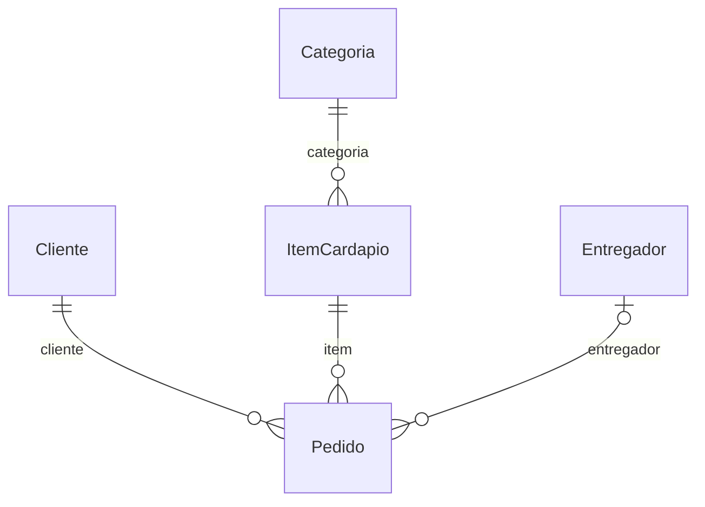
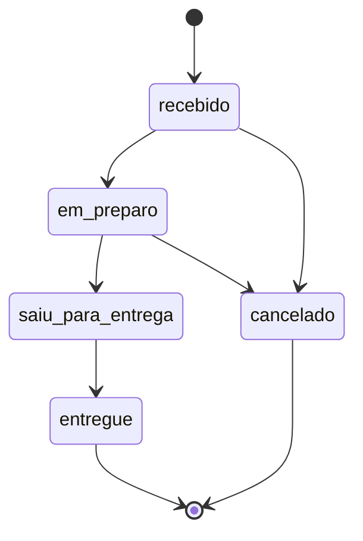

# Tema: Restaurante / delivery

> Manual do grupo. O **Manual de Construção** ensina *como* fazer cada etapa; este arquivo diz *o que* o seu grupo constrói: campos, regras, rotas e telas de cada módulo. Siga os dois juntos.

## O problema

O restaurante recebe pedidos por WhatsApp e anota em papel. Pedidos se perdem, o cliente não sabe se a comida já saiu e o dono não sabe quais pratos vendem mais.

## Os 6 módulos e quem faz cada um

| Módulo | Papel transversal de quem faz | Rota da API | Depende de |
| --- | --- | --- | --- |
| **A — Clientes** | PO / Scrum Master | `/clientes` | — |
| **B — Cardápio** | Git e Integração | `/cardapio` | Categoria |
| **C — Pedidos** | Segurança | `/pedidos` | Cliente, ItemCardapio, Entregador |
| **D — Categorias** | Testes e Qualidade | `/categorias` | — |
| **E — Entregadores** | UX/UI e Acessibilidade | `/entregadores` | — |
| **F — Relatórios** | Documentação e Apresentação | `/relatorios` | todos (só leitura) |

### Como os dados se ligam



Leia assim: cada linha liga um módulo ao outro pelo campo indicado (por exemplo, o campo `categoria` guarda o `_id` do outro módulo).

## Roteiro por aula

| Aula | Tarefa de cada aluno no seu módulo | Seção deste arquivo |
| --- | --- | --- |
| 01 | Copiar os requisitos e as regras do seu módulo para o Documento de Visão e as rotas para o Contrato da API (C0) | Requisitos, Regras, Rotas |
| 02 | Criar o modelo, os componentes, a rota e o link no menu | Código de partida → Modelo |
| 03 | Tela de listagem com as colunas e o filtro | Telas |
| 04 | Formulário com as validações | Código de partida → Formulário |
| 05 | Serviço mock com pelo menos 3 registros | Código de partida → Dados para o mock |
| 06 | Revisão das telas (C1) | Telas |
| 07 | Linhas do seu módulo no Dicionário de Dados (C2) | Campos |
| 08 | Schema, registro no módulo e dados no seed | Código de partida → Schema |
| 09 | Service e controller com o CRUD | Rotas |
| 10 | DTOs, testes e Swagger (C3) | Código de partida → DTOs, Testes mínimos |
| 11 | Regras de negócio no service (e o fluxo de estados no módulo C) | Regras de negócio, Fluxo de estados |
| 12–13 | Autenticação, perfis e troca do mock pela API (C4) | Manual de Construção |
| 14–15 | Testes finais, documentação e banca (C5) | Testes mínimos |

## Módulo A — Clientes

**Responsável:** aluno com o papel **PO / Scrum Master** · **Rota da API:** `/api/v1/clientes` · **Coleção:** `clientes`

Cadastro de quem faz pedidos, identificado pelo telefone.

**Pastas:** `backend/src/clientes/` e `frontend/src/app/features/clientes/`

### Campos

| Campo | Rótulo na tela | Tipo | Obrigatório | Regras | Exemplo |
| --- | --- | --- | --- | --- | --- |
| `nome` | Nome | texto | sim | 3 a 80 caracteres | `Maria Souza` |
| `telefone` | Telefone | telefone | sim | formato (51) 99999-9999; **único** | `(51) 99876-5432` |
| `endereco` | Endereço de entrega | texto longo | sim | 5 a 200 caracteres | `Rua Tiradentes, 45, ap. 302` |
| `bairro` | Bairro | texto | sim | 2 a 50 caracteres | `Centro` |
| `ativo` | Ativo | sim/não | automático | padrão: sim | — |

`_id`, `createdAt` e `updatedAt` são criados automaticamente pelo MongoDB e pelo `timestamps: true`.

### Requisitos funcionais

- **RF01** — O sistema deve permitir cadastrar um cliente com os campos acima.
- **RF02** — O sistema deve listar os clientes ativos, com busca por parte do nome (sem diferenciar maiúsculas).
- **RF03** — O sistema deve permitir editar um cliente existente.
- **RF04** — O sistema deve permitir excluir um cliente; a exclusão apenas o inativa.

### Regras de negócio

| Código | Regra | Resposta da API quando é violada | Como implementar |
| --- | --- | --- | --- |
| **RN01** | Não pode haver dois clientes com o mesmo telefone. | 409 — _Já existe um cliente com o telefone "..."_ | Igual ao `garantirNomeUnico` de Produtos, buscando por `telefone`. |
| **RN02** | Excluir um cliente apenas o inativa (o histórico de pedidos é mantido). | 204 (exclusão vira `ativo: false`) | Receita 2 de `guia/RECEITAS.md`. |

### Rotas da API

| Método | Rota | O que faz | Respostas |
| --- | --- | --- | --- |
| GET | `/clientes` | Lista (filtro opcional `?busca=texto`, `?todos=true` inclui os inativos) | 200 |
| GET | `/clientes/:id` | Busca pelo id | 200, 400, 404 |
| POST | `/clientes` | Cadastra | 201, 400, 409 |
| PATCH | `/clientes/:id` | Edita | 200, 400, 404 |
| DELETE | `/clientes/:id` | Inativa (exclusão lógica) | 204, 400, 404 |

Filtro no service: `const filtro = busca ? { nome: { $regex: busca, $options: 'i' } } : {};`

> **Receitas úteis** ([guia/RECEITAS.md](../RECEITAS.md)): busca por texto → receita 1 · exclusão lógica → receita 2.

### Telas

- **Listagem** (`clientes-lista`): colunas Nome, Telefone, Bairro e ações. Filtro: busca por parte do nome (sem diferenciar maiúsculas). Mensagens de carregando, lista vazia, erro e sucesso.
- **Formulário** (`cliente-form`), usado para cadastrar e editar:

| Campo | Controle na tela |
| --- | --- |
| Nome * | `text` |
| Telefone * | `tel` |
| Endereço de entrega * | `textarea` |
| Bairro * | `text` |

- **Menu:** link "Clientes" em `layout.html` e rota `clientes` em `app.routes.ts`.

### Código de partida

Use estes trechos junto com o Manual de Construção. Eles substituem os campos de Produtos pelos do seu módulo; o resto (service, controller, serviços do front, telas) segue o modelo de Produtos, como o manual ensina.

<details>
<summary><b>Modelo do front-end (aula 02)</b></summary>

```ts
// frontend/src/app/features/clientes/cliente.model.ts

/** Cliente como a API devolve (segue o contrato da API). */
export interface Cliente {
  _id: string;
  nome: string;
  telefone: string;
  endereco: string;
  bairro: string;
  ativo: boolean;
  createdAt?: string;
  updatedAt?: string;
}

/** Dados enviados para criar ou editar. */
export interface ClienteEntrada {
  nome: string;
  telefone: string;
  endereco: string;
  bairro: string;
  ativo?: boolean;
}
```

</details>

<details>
<summary><b>Dados para o serviço mock (aula 05)</b></summary>

Comece com este registro e acrescente pelo menos mais 2, variando os casos.

```ts
private clientes: Cliente[] = [
  {
    _id: '1',
    nome: 'Maria Souza',
    telefone: '(51) 99876-5432',
    endereco: 'Rua Tiradentes, 45, ap. 302',
    bairro: 'Centro',
    ativo: true,
  },
];
```

</details>

<details>
<summary><b>Formulário reativo (aula 04)</b></summary>

```ts
// frontend/src/app/features/clientes/cliente-form/cliente-form.ts — dentro da classe
protected readonly form = this.fb.nonNullable.group({
  nome: ['', [Validators.required, Validators.minLength(3), Validators.maxLength(80)]],
  telefone: ['', [Validators.required, Validators.pattern(/^\(\d{2}\) \d{4,5}-\d{4}$/)]],
  endereco: ['', [Validators.required, Validators.minLength(5), Validators.maxLength(200)]],
  bairro: ['', [Validators.required, Validators.minLength(2), Validators.maxLength(50)]],
});
```

</details>

<details>
<summary><b>Schema do MongoDB (aula 08)</b></summary>

```ts
// backend/src/clientes/schemas/cliente.schema.ts
import { Prop, Schema, SchemaFactory } from '@nestjs/mongoose';
import { HydratedDocument } from 'mongoose';

export type ClienteDocument = HydratedDocument<Cliente>;

@Schema({ timestamps: true, collection: 'clientes' })
export class Cliente {
  @Prop({ required: true, trim: true, minlength: 3, maxlength: 80 })
  nome: string;

  @Prop({ required: true, trim: true, unique: true })
  telefone: string;

  @Prop({ required: true, trim: true, minlength: 5, maxlength: 200 })
  endereco: string;

  @Prop({ required: true, trim: true, minlength: 2, maxlength: 50 })
  bairro: string;

  @Prop({ default: true })
  ativo: boolean;
}

export const ClienteSchema = SchemaFactory.createForClass(Cliente);
```

</details>

<details>
<summary><b>DTOs de criação e edição (aula 10)</b></summary>

```ts
// backend/src/clientes/dto/create-cliente.dto.ts
import { ApiProperty } from '@nestjs/swagger';
import { IsNotEmpty, IsString, Length, Matches } from 'class-validator';

export class CreateClienteDto {
  @ApiProperty({ example: 'Maria Souza' })
  @IsString()
  @IsNotEmpty({ message: 'Nome é obrigatório' })
  @Length(3, 80, { message: 'Nome deve ter entre 3 e 80 caracteres' })
  nome: string;

  @ApiProperty({ example: '(51) 99876-5432' })
  @IsString()
  @Matches(/^\(\d{2}\) \d{4,5}-\d{4}$/, {
    message: 'Telefone inválido. Use o formato (51) 99999-9999',
  })
  telefone: string;

  @ApiProperty({ example: 'Rua Tiradentes, 45, ap. 302' })
  @IsString()
  @IsNotEmpty({ message: 'Endereço de entrega é obrigatório' })
  @Length(5, 200, {
    message: 'Endereço de entrega deve ter entre 5 e 200 caracteres',
  })
  endereco: string;

  @ApiProperty({ example: 'Centro' })
  @IsString()
  @IsNotEmpty({ message: 'Bairro é obrigatório' })
  @Length(2, 50, { message: 'Bairro deve ter entre 2 e 50 caracteres' })
  bairro: string;
}
```

```ts
// backend/src/clientes/dto/update-cliente.dto.ts
import { ApiPropertyOptional, PartialType } from '@nestjs/swagger';
import { IsBoolean, IsOptional } from 'class-validator';
import { CreateClienteDto } from './create-cliente.dto';

export class UpdateClienteDto extends PartialType(CreateClienteDto) {
  @ApiPropertyOptional({ example: true })
  @IsOptional()
  @IsBoolean()
  ativo?: boolean;
}
```

</details>

### Testes mínimos (aula 10)

- [ ] `criar` salva um cliente com dados válidos.
- [ ] `buscarPorId` lança `NotFoundException` (404) quando o cliente não existe.
- [ ] `buscarPorId` lança `BadRequestException` (400) para um id inválido.
- [ ] Regra: não pode haver dois clientes com o mesmo telefone.
- [ ] Regra: excluir um cliente apenas o inativa (o histórico de pedidos é mantido).

## Módulo B — Cardápio

**Responsável:** aluno com o papel **Git e Integração** · **Rota da API:** `/api/v1/cardapio` · **Coleção:** `itens_cardapio`

Pratos e bebidas vendidos, cada um em uma categoria.

**Depende de:** Categoria (`categorias`). Até a aula 12 o front usa mocks, então você não precisa esperar os colegas: use ids de exemplo (`'1'`, `'2'`).

**Pastas:** `backend/src/cardapio/` e `frontend/src/app/features/cardapio/`

### Campos

| Campo | Rótulo na tela | Tipo | Obrigatório | Regras | Exemplo |
| --- | --- | --- | --- | --- | --- |
| `nome` | Nome | texto | sim | 3 a 60 caracteres; **único** | `Feijoada completa` |
| `descricao` | Descrição | texto longo | não | até 300 caracteres | `Acompanha arroz, couve e farofa` |
| `preco` | Preço (R$) | número decimal | sim | mínimo 1 | `42.9` |
| `categoria` | Categoria | referência → Categoria | sim | — | _id de Categoria |
| `disponivel` | Disponível hoje | sim/não | não | padrão: sim | `true` |
| `ativo` | Ativo | sim/não | automático | padrão: sim | — |

`_id`, `createdAt` e `updatedAt` são criados automaticamente pelo MongoDB e pelo `timestamps: true`.

### Requisitos funcionais

- **RF05** — O sistema deve permitir cadastrar um item do cardápio com os campos acima.
- **RF06** — O sistema deve listar os cardápio ativos, com busca por parte do nome (sem diferenciar maiúsculas).
- **RF07** — O sistema deve permitir editar um item do cardápio existente.
- **RF08** — O sistema deve permitir excluir um item do cardápio; a exclusão apenas o inativa.

### Regras de negócio

| Código | Regra | Resposta da API quando é violada | Como implementar |
| --- | --- | --- | --- |
| **RN03** | Não pode haver dois itens com o mesmo nome. | 409 — _Já existe um item com o nome "..."_ | Igual ao `garantirNomeUnico` de Produtos. |
| **RN04** | A categoria informada precisa existir. | 404 — _Categoria ... não encontrada_ | Receita 5 de `guia/RECEITAS.md`: injete o `CategoriasService`. |

### Rotas da API

| Método | Rota | O que faz | Respostas |
| --- | --- | --- | --- |
| GET | `/cardapio` | Lista (filtro opcional `?busca=texto`, `?todos=true` inclui os inativos) | 200 |
| GET | `/cardapio/:id` | Busca pelo id | 200, 400, 404 |
| POST | `/cardapio` | Cadastra | 201, 400, 409, 404 |
| PATCH | `/cardapio/:id` | Edita | 200, 400, 404 |
| DELETE | `/cardapio/:id` | Inativa (exclusão lógica) | 204, 400, 404 |

Filtro no service: `const filtro = busca ? { nome: { $regex: busca, $options: 'i' } } : {};`

> **Receitas úteis** ([guia/RECEITAS.md](../RECEITAS.md)): busca por texto → receita 1 · exclusão lógica → receita 2 · mostrar e escolher referências → receitas 3 e 4.

### Telas

- **Listagem** (`cardapio-lista`): colunas Nome, Preço (R$), Categoria, Disponível hoje e ações. Filtro: busca por parte do nome (sem diferenciar maiúsculas). Mensagens de carregando, lista vazia, erro e sucesso.
- **Formulário** (`item-cardapio-form`), usado para cadastrar e editar:

| Campo | Controle na tela |
| --- | --- |
| Nome * | `text` |
| Descrição | `textarea` |
| Preço (R$) * | `number, step 0.01` |
| Categoria * | `select (receita 4 de guia/RECEITAS.md)` |
| Disponível hoje | `checkbox` |

- **Menu:** link "Cardápio" em `layout.html` e rota `cardapio` em `app.routes.ts`.

### Código de partida

Use estes trechos junto com o Manual de Construção. Eles substituem os campos de Produtos pelos do seu módulo; o resto (service, controller, serviços do front, telas) segue o modelo de Produtos, como o manual ensina.

<details>
<summary><b>Modelo do front-end (aula 02)</b></summary>

```ts
// frontend/src/app/features/cardapio/item-cardapio.model.ts
import { Referencia } from '../../core/models/referencia';

/** Item do cardápio como a API devolve (segue o contrato da API). */
export interface ItemCardapio {
  _id: string;
  nome: string;
  descricao?: string;
  preco: number;
  categoria: Referencia; // _id ou { _id, nome } (populate)
  disponivel: boolean;
  ativo: boolean;
  createdAt?: string;
  updatedAt?: string;
}

/** Dados enviados para criar ou editar. */
export interface ItemCardapioEntrada {
  nome: string;
  descricao?: string;
  preco: number;
  categoria: string; // _id do Categoria
  disponivel: boolean;
  ativo?: boolean;
}
```

</details>

<details>
<summary><b>Dados para o serviço mock (aula 05)</b></summary>

Comece com este registro e acrescente pelo menos mais 2, variando os casos.

```ts
private cardapio: ItemCardapio[] = [
  {
    _id: '1',
    nome: 'Feijoada completa',
    descricao: 'Acompanha arroz, couve e farofa',
    preco: 42.9,
    categoria: '1',
    disponivel: true,
    ativo: true,
  },
];
```

</details>

<details>
<summary><b>Formulário reativo (aula 04)</b></summary>

```ts
// frontend/src/app/features/cardapio/item-cardapio-form/item-cardapio-form.ts — dentro da classe
protected readonly form = this.fb.nonNullable.group({
  nome: ['', [Validators.required, Validators.minLength(3), Validators.maxLength(60)]],
  descricao: ['', [Validators.maxLength(300)]],
  preco: [1, [Validators.required, Validators.min(1)]],
  categoria: ['', [Validators.required]],
  disponivel: [true, []],
});
```

</details>

<details>
<summary><b>Schema do MongoDB (aula 08)</b></summary>

```ts
// backend/src/cardapio/schemas/item-cardapio.schema.ts
import { Prop, Schema, SchemaFactory } from '@nestjs/mongoose';
import { HydratedDocument, Types } from 'mongoose';

export type ItemCardapioDocument = HydratedDocument<ItemCardapio>;

@Schema({ timestamps: true, collection: 'itens_cardapio' })
export class ItemCardapio {
  @Prop({
    required: true,
    trim: true,
    minlength: 3,
    maxlength: 60,
    unique: true,
  })
  nome: string;

  @Prop({ trim: true, maxlength: 300 })
  descricao?: string;

  @Prop({ required: true, min: 1 })
  preco: number;

  // Referência ao módulo Categoria: guarda só o _id
  @Prop({ type: Types.ObjectId, ref: 'Categoria', required: true })
  categoria: Types.ObjectId;

  @Prop({ default: true })
  disponivel: boolean;

  @Prop({ default: true })
  ativo: boolean;
}

export const ItemCardapioSchema = SchemaFactory.createForClass(ItemCardapio);
ItemCardapioSchema.index({ categoria: 1 });
```

</details>

<details>
<summary><b>DTOs de criação e edição (aula 10)</b></summary>

```ts
// backend/src/cardapio/dto/create-item-cardapio.dto.ts
import { ApiProperty, ApiPropertyOptional } from '@nestjs/swagger';
import {
  IsBoolean,
  IsMongoId,
  IsNotEmpty,
  IsNumber,
  IsOptional,
  IsString,
  Length,
  MaxLength,
  Min,
} from 'class-validator';

export class CreateItemCardapioDto {
  @ApiProperty({ example: 'Feijoada completa' })
  @IsString()
  @IsNotEmpty({ message: 'Nome é obrigatório' })
  @Length(3, 60, { message: 'Nome deve ter entre 3 e 60 caracteres' })
  nome: string;

  @ApiPropertyOptional({ example: 'Acompanha arroz, couve e farofa' })
  @IsOptional()
  @IsString()
  @MaxLength(300, { message: 'Descrição pode ter no máximo 300 caracteres' })
  descricao?: string;

  @ApiProperty({ example: 42.9 })
  @IsNumber(
    { maxDecimalPlaces: 2 },
    { message: 'Preço (R$) deve ser um número' },
  )
  @Min(1, { message: 'Preço (R$) deve ser no mínimo 1' })
  preco: number;

  @ApiProperty({ example: '665f1c2b9a1e4b0012345678' })
  @IsMongoId({ message: 'Categoria: id inválido' })
  categoria: string;

  @ApiPropertyOptional({ example: true })
  @IsOptional()
  @IsBoolean()
  disponivel?: boolean;
}
```

```ts
// backend/src/cardapio/dto/update-item-cardapio.dto.ts
import { ApiPropertyOptional, PartialType } from '@nestjs/swagger';
import { IsBoolean, IsOptional } from 'class-validator';
import { CreateItemCardapioDto } from './create-item-cardapio.dto';

export class UpdateItemCardapioDto extends PartialType(CreateItemCardapioDto) {
  @ApiPropertyOptional({ example: true })
  @IsOptional()
  @IsBoolean()
  ativo?: boolean;
}
```

</details>

### Testes mínimos (aula 10)

- [ ] `criar` salva um item do cardápio com dados válidos.
- [ ] `buscarPorId` lança `NotFoundException` (404) quando o item do cardápio não existe.
- [ ] `buscarPorId` lança `BadRequestException` (400) para um id inválido.
- [ ] Regra: não pode haver dois itens com o mesmo nome.
- [ ] Regra: a categoria informada precisa existir.

## Módulo C — Pedidos

**Responsável:** aluno com o papel **Segurança** · **Rota da API:** `/api/v1/pedidos` · **Coleção:** `pedidos`

Pedidos de entrega, com o fluxo de estados do pedido.

**Depende de:** Cliente (`clientes`), ItemCardapio (`cardapio`), Entregador (`entregadores`). Até a aula 12 o front usa mocks, então você não precisa esperar os colegas: use ids de exemplo (`'1'`, `'2'`).

**Pastas:** `backend/src/pedidos/` e `frontend/src/app/features/pedidos/`

### Campos

| Campo | Rótulo na tela | Tipo | Obrigatório | Regras | Exemplo |
| --- | --- | --- | --- | --- | --- |
| `cliente` | Cliente | referência → Cliente | sim | — | _id de Cliente |
| `item` | Item do cardápio | referência → ItemCardapio | sim | — | _id de ItemCardapio |
| `quantidade` | Quantidade | número inteiro | sim | de 1 a 20 | `2` |
| `entregador` | Entregador | referência → Entregador | não | — | _id de Entregador |
| `observacoes` | Observações | texto longo | não | até 200 caracteres | `Sem cebola` |
| `status` | Status | lista de opções | automático | `recebido`, `em_preparo`, `saiu_para_entrega`, `entregue`, `cancelado`; começa em `recebido` | — |

`_id`, `createdAt` e `updatedAt` são criados automaticamente pelo MongoDB e pelo `timestamps: true`.

### Requisitos funcionais

- **RF09** — O sistema deve permitir cadastrar um pedido com os campos acima.
- **RF10** — O sistema deve listar os pedidos, com filtro pelo status.
- **RF11** — O sistema deve permitir editar um pedido existente.
- **RF12** — O sistema deve permitir mudar o status do pedido, respeitando o fluxo de estados.

### Regras de negócio

| Código | Regra | Resposta da API quando é violada | Como implementar |
| --- | --- | --- | --- |
| **RN05** | Só é possível pedir um item que esteja disponível. | 400 — _Este item não está disponível hoje_ | Busque o item com o `CardapioService` (receita 5 de `guia/RECEITAS.md`) e confira `disponivel`. |
| **RN06** | O pedido só pode passar para "saiu_para_entrega" se tiver entregador. | 400 — _Defina o entregador antes de enviar o pedido_ | No `mudarStatus`, antes de salvar: `if (novo === 'saiu_para_entrega' && !pedido.entregador)`. |
| **RN07** | O status só pode mudar seguindo o fluxo abaixo. | 400 — _Não é possível passar de "..." para "..."_ | Mapa `TRANSICOES` (código abaixo). |

### Rotas da API

| Método | Rota | O que faz | Respostas |
| --- | --- | --- | --- |
| GET | `/pedidos` | Lista (filtro opcional `?status=recebido`) | 200 |
| GET | `/pedidos/:id` | Busca pelo id | 200, 400, 404 |
| POST | `/pedidos` | Cadastra | 201, 400 |
| PATCH | `/pedidos/:id` | Edita | 200, 400, 404 |
| PATCH | `/pedidos/:id/status` | Muda o status | 200, 400, 404 |

Filtro no service: `const filtro = status ? { status } : {};`

> **Receitas úteis** ([guia/RECEITAS.md](../RECEITAS.md)): mostrar e escolher referências → receitas 3 e 4 · botões de status → receita 7.

### Fluxo de estados



Na tela de listagem, mostre só os botões das transições válidas para o status atual de cada linha.

<details>
<summary><b>Mapa de transições e método mudarStatus</b></summary>

```ts
// backend/src/pedidos/pedidos.service.ts — no topo do arquivo
import { Status } from './schemas/pedido.schema';

// Mapa de transições VÁLIDAS: de → para (PDF 05, cap. 3)
const TRANSICOES: Record<Status, Status[]> = {
  recebido: ['em_preparo', 'cancelado'],
  em_preparo: ['saiu_para_entrega', 'cancelado'],
  saiu_para_entrega: ['entregue'],
  entregue: [], // estado final
  cancelado: [], // estado final
};

// ...dentro da classe PedidosService:
async mudarStatus(id: string, novo: Status) {
  const atual = await this.buscarPorId(id);
  if (!TRANSICOES[atual.status].includes(novo)) {
    throw new BadRequestException(
      `Não é possível passar de "${atual.status}" para "${novo}"`,
    );
  }
  return this.pedidoModel
    .findByIdAndUpdate(id, { status: novo }, { new: true })
    .lean()
    .exec();
}
```

</details>

<details>
<summary><b>DTO da mudança de status</b></summary>

```ts
// backend/src/pedidos/dto/mudar-status.dto.ts
import { ApiProperty } from '@nestjs/swagger';
import { IsIn } from 'class-validator';
import { STATUS, type Status } from '../schemas/pedido.schema';

export class MudarStatusDto {
  @ApiProperty({ enum: STATUS, example: 'em_preparo' })
  @IsIn(STATUS, { message: `Status deve ser: ${STATUS.join(', ')}` })
  status: Status;
}
```

</details>

<details>
<summary><b>Rota no controller</b></summary>

```ts
// backend/src/pedidos/pedidos.controller.ts
@Patch(':id/status')
@ApiOperation({ summary: 'Muda o status (somente transições válidas)' })
@ApiResponse({ status: 400, description: 'Transição de status inválida' })
mudarStatus(@Param('id') id: string, @Body() dto: MudarStatusDto) {
  return this.pedidosService.mudarStatus(id, dto.status);
}
```

</details>

### Telas

- **Listagem** (`pedidos-lista`): colunas Cliente, Item do cardápio, Quantidade, Entregador, Status (com a etiqueta colorida) e ações. Filtro: filtro pelo status. Mensagens de carregando, lista vazia, erro e sucesso.
- **Formulário** (`pedido-form`), usado para cadastrar e editar:

| Campo | Controle na tela |
| --- | --- |
| Cliente * | `select (receita 4 de guia/RECEITAS.md)` |
| Item do cardápio * | `select (receita 4 de guia/RECEITAS.md)` |
| Quantidade * | `number, step 1` |
| Entregador | `select (receita 4 de guia/RECEITAS.md)` |
| Observações | `textarea` |

- **Menu:** link "Pedidos" em `layout.html` e rota `pedidos` em `app.routes.ts`.

### Código de partida

Use estes trechos junto com o Manual de Construção. Eles substituem os campos de Produtos pelos do seu módulo; o resto (service, controller, serviços do front, telas) segue o modelo de Produtos, como o manual ensina.

<details>
<summary><b>Modelo do front-end (aula 02)</b></summary>

```ts
// frontend/src/app/features/pedidos/pedido.model.ts
import { Referencia } from '../../core/models/referencia';

export const STATUS = [
  'recebido',
  'em_preparo',
  'saiu_para_entrega',
  'entregue',
  'cancelado',
] as const;
export type Status = (typeof STATUS)[number];

/** Pedido como a API devolve (segue o contrato da API). */
export interface Pedido {
  _id: string;
  cliente: Referencia; // _id ou { _id, nome } (populate)
  item: Referencia; // _id ou { _id, nome } (populate)
  quantidade: number;
  entregador?: Referencia; // _id ou { _id, nome } (populate)
  observacoes?: string;
  status: Status;
  createdAt?: string;
  updatedAt?: string;
}

/** Dados enviados para criar ou editar. */
export interface PedidoEntrada {
  cliente: string; // _id do Cliente
  item: string; // _id do ItemCardapio
  quantidade: number;
  entregador?: string; // _id do Entregador
  observacoes?: string;
}
```

</details>

<details>
<summary><b>Dados para o serviço mock (aula 05)</b></summary>

Comece com este registro e acrescente pelo menos mais 2, variando os casos.

```ts
private pedidos: Pedido[] = [
  {
    _id: '1',
    cliente: '1',
    item: '1',
    quantidade: 2,
    entregador: '1',
    observacoes: 'Sem cebola',
    status: 'recebido',
  },
];
```

</details>

<details>
<summary><b>Formulário reativo (aula 04)</b></summary>

```ts
// frontend/src/app/features/pedidos/pedido-form/pedido-form.ts — dentro da classe
protected readonly form = this.fb.nonNullable.group({
  cliente: ['', [Validators.required]],
  item: ['', [Validators.required]],
  quantidade: [
    1,
    [Validators.required, Validators.min(1), Validators.max(20), Validators.pattern(/^\d+$/)],
  ],
  entregador: ['', []],
  observacoes: ['', [Validators.maxLength(200)]],
});
```

</details>

<details>
<summary><b>Schema do MongoDB (aula 08)</b></summary>

```ts
// backend/src/pedidos/schemas/pedido.schema.ts
import { Prop, Schema, SchemaFactory } from '@nestjs/mongoose';
import { HydratedDocument, Types } from 'mongoose';

export const STATUS = [
  'recebido',
  'em_preparo',
  'saiu_para_entrega',
  'entregue',
  'cancelado',
] as const;
export type Status = (typeof STATUS)[number];

export type PedidoDocument = HydratedDocument<Pedido>;

@Schema({ timestamps: true, collection: 'pedidos' })
export class Pedido {
  // Referência ao módulo Cliente: guarda só o _id
  @Prop({ type: Types.ObjectId, ref: 'Cliente', required: true })
  cliente: Types.ObjectId;

  // Referência ao módulo ItemCardapio: guarda só o _id
  @Prop({ type: Types.ObjectId, ref: 'ItemCardapio', required: true })
  item: Types.ObjectId;

  @Prop({ required: true, min: 1, max: 20 })
  quantidade: number;

  // Referência ao módulo Entregador: guarda só o _id
  @Prop({ type: Types.ObjectId, ref: 'Entregador' })
  entregador?: Types.ObjectId;

  @Prop({ trim: true, maxlength: 200 })
  observacoes?: string;

  // Fluxo de estados: o status começa em "recebido" e só muda pela rota PATCH /pedidos/:id/status
  @Prop({ type: String, enum: STATUS, default: 'recebido' })
  status: Status;
}

export const PedidoSchema = SchemaFactory.createForClass(Pedido);
PedidoSchema.index({ cliente: 1 });
PedidoSchema.index({ item: 1 });
PedidoSchema.index({ entregador: 1 });
PedidoSchema.index({ status: 1 });
```

</details>

<details>
<summary><b>DTOs de criação e edição (aula 10)</b></summary>

```ts
// backend/src/pedidos/dto/create-pedido.dto.ts
import { ApiProperty, ApiPropertyOptional } from '@nestjs/swagger';
import {
  IsInt,
  IsMongoId,
  IsOptional,
  IsString,
  Max,
  MaxLength,
  Min,
} from 'class-validator';

export class CreatePedidoDto {
  @ApiProperty({ example: '665f1c2b9a1e4b0012345678' })
  @IsMongoId({ message: 'Cliente: id inválido' })
  cliente: string;

  @ApiProperty({ example: '665f1c2b9a1e4b0012345678' })
  @IsMongoId({ message: 'Item do cardápio: id inválido' })
  item: string;

  @ApiProperty({ example: 2 })
  @IsInt({ message: 'Quantidade deve ser um número inteiro' })
  @Min(1, { message: 'Quantidade deve ser no mínimo 1' })
  @Max(20, { message: 'Quantidade deve ser no máximo 20' })
  quantidade: number;

  @ApiPropertyOptional({ example: '665f1c2b9a1e4b0012345678' })
  @IsOptional()
  @IsMongoId({ message: 'Entregador: id inválido' })
  entregador?: string;

  @ApiPropertyOptional({ example: 'Sem cebola' })
  @IsOptional()
  @IsString()
  @MaxLength(200, { message: 'Observações pode ter no máximo 200 caracteres' })
  observacoes?: string;
}
```

```ts
// backend/src/pedidos/dto/update-pedido.dto.ts
import { PartialType } from '@nestjs/swagger';
import { CreatePedidoDto } from './create-pedido.dto';

// O status NÃO entra aqui: ele só muda pela rota PATCH /:id/status
export class UpdatePedidoDto extends PartialType(CreatePedidoDto) {}
```

</details>

### Testes mínimos (aula 10)

- [ ] `criar` salva um pedido com dados válidos.
- [ ] `buscarPorId` lança `NotFoundException` (404) quando o pedido não existe.
- [ ] `buscarPorId` lança `BadRequestException` (400) para um id inválido.
- [ ] Regra: só é possível pedir um item que esteja disponível.
- [ ] Regra: o pedido só pode passar para "saiu_para_entrega" se tiver entregador.
- [ ] `mudarStatus` lança 400 numa transição inválida e aceita uma válida.

## Módulo D — Categorias

**Responsável:** aluno com o papel **Testes e Qualidade** · **Rota da API:** `/api/v1/categorias` · **Coleção:** `categorias`

Seções do cardápio: pratos, bebidas, sobremesas etc.

**Pastas:** `backend/src/categorias/` e `frontend/src/app/features/categorias/`

### Campos

| Campo | Rótulo na tela | Tipo | Obrigatório | Regras | Exemplo |
| --- | --- | --- | --- | --- | --- |
| `nome` | Nome | texto | sim | 3 a 40 caracteres; **único** | `Pratos principais` |
| `descricao` | Descrição | texto longo | não | até 200 caracteres | `Pratos servidos no almoço e no jantar` |
| `ordem` | Ordem no cardápio | número inteiro | sim | de 1 a 99 | `1` |
| `ativo` | Ativo | sim/não | automático | padrão: sim | — |

`_id`, `createdAt` e `updatedAt` são criados automaticamente pelo MongoDB e pelo `timestamps: true`.

### Requisitos funcionais

- **RF13** — O sistema deve permitir cadastrar uma categoria com os campos acima.
- **RF14** — O sistema deve listar as categorias ativas, com busca por parte do nome (sem diferenciar maiúsculas).
- **RF15** — O sistema deve permitir editar uma categoria existente.
- **RF16** — O sistema deve permitir excluir uma categoria; a exclusão apenas a inativa.

### Regras de negócio

| Código | Regra | Resposta da API quando é violada | Como implementar |
| --- | --- | --- | --- |
| **RN08** | Não pode haver duas categorias com o mesmo nome. | 409 — _Já existe uma categoria com o nome "..."_ | Igual ao `garantirNomeUnico` de Produtos. |
| **RN09** | Não pode haver duas categorias com a mesma ordem no cardápio. | 409 — _Já existe uma categoria na posição ..._ | Mesmo método, buscando por `ordem`. |

### Rotas da API

| Método | Rota | O que faz | Respostas |
| --- | --- | --- | --- |
| GET | `/categorias` | Lista (filtro opcional `?busca=texto`, `?todos=true` inclui os inativos) | 200 |
| GET | `/categorias/:id` | Busca pelo id | 200, 400, 404 |
| POST | `/categorias` | Cadastra | 201, 400, 409 |
| PATCH | `/categorias/:id` | Edita | 200, 400, 404 |
| DELETE | `/categorias/:id` | Inativa (exclusão lógica) | 204, 400, 404 |

Filtro no service: `const filtro = busca ? { nome: { $regex: busca, $options: 'i' } } : {};`

> **Receitas úteis** ([guia/RECEITAS.md](../RECEITAS.md)): busca por texto → receita 1 · exclusão lógica → receita 2.

### Telas

- **Listagem** (`categorias-lista`): colunas Nome, Ordem no cardápio e ações. Filtro: busca por parte do nome (sem diferenciar maiúsculas). Mensagens de carregando, lista vazia, erro e sucesso.
- **Formulário** (`categoria-form`), usado para cadastrar e editar:

| Campo | Controle na tela |
| --- | --- |
| Nome * | `text` |
| Descrição | `textarea` |
| Ordem no cardápio * | `number, step 1` |

- **Menu:** link "Categorias" em `layout.html` e rota `categorias` em `app.routes.ts`.

### Código de partida

Use estes trechos junto com o Manual de Construção. Eles substituem os campos de Produtos pelos do seu módulo; o resto (service, controller, serviços do front, telas) segue o modelo de Produtos, como o manual ensina.

<details>
<summary><b>Modelo do front-end (aula 02)</b></summary>

```ts
// frontend/src/app/features/categorias/categoria.model.ts

/** Categoria como a API devolve (segue o contrato da API). */
export interface Categoria {
  _id: string;
  nome: string;
  descricao?: string;
  ordem: number;
  ativo: boolean;
  createdAt?: string;
  updatedAt?: string;
}

/** Dados enviados para criar ou editar. */
export interface CategoriaEntrada {
  nome: string;
  descricao?: string;
  ordem: number;
  ativo?: boolean;
}
```

</details>

<details>
<summary><b>Dados para o serviço mock (aula 05)</b></summary>

Comece com este registro e acrescente pelo menos mais 2, variando os casos.

```ts
private categorias: Categoria[] = [
  {
    _id: '1',
    nome: 'Pratos principais',
    descricao: 'Pratos servidos no almoço e no jantar',
    ordem: 1,
    ativo: true,
  },
];
```

</details>

<details>
<summary><b>Formulário reativo (aula 04)</b></summary>

```ts
// frontend/src/app/features/categorias/categoria-form/categoria-form.ts — dentro da classe
protected readonly form = this.fb.nonNullable.group({
  nome: ['', [Validators.required, Validators.minLength(3), Validators.maxLength(40)]],
  descricao: ['', [Validators.maxLength(200)]],
  ordem: [
    1,
    [Validators.required, Validators.min(1), Validators.max(99), Validators.pattern(/^\d+$/)],
  ],
});
```

</details>

<details>
<summary><b>Schema do MongoDB (aula 08)</b></summary>

```ts
// backend/src/categorias/schemas/categoria.schema.ts
import { Prop, Schema, SchemaFactory } from '@nestjs/mongoose';
import { HydratedDocument } from 'mongoose';

export type CategoriaDocument = HydratedDocument<Categoria>;

@Schema({ timestamps: true, collection: 'categorias' })
export class Categoria {
  @Prop({
    required: true,
    trim: true,
    minlength: 3,
    maxlength: 40,
    unique: true,
  })
  nome: string;

  @Prop({ trim: true, maxlength: 200 })
  descricao?: string;

  @Prop({ required: true, min: 1, max: 99 })
  ordem: number;

  @Prop({ default: true })
  ativo: boolean;
}

export const CategoriaSchema = SchemaFactory.createForClass(Categoria);
```

</details>

<details>
<summary><b>DTOs de criação e edição (aula 10)</b></summary>

```ts
// backend/src/categorias/dto/create-categoria.dto.ts
import { ApiProperty, ApiPropertyOptional } from '@nestjs/swagger';
import {
  IsInt,
  IsNotEmpty,
  IsOptional,
  IsString,
  Length,
  Max,
  MaxLength,
  Min,
} from 'class-validator';

export class CreateCategoriaDto {
  @ApiProperty({ example: 'Pratos principais' })
  @IsString()
  @IsNotEmpty({ message: 'Nome é obrigatório' })
  @Length(3, 40, { message: 'Nome deve ter entre 3 e 40 caracteres' })
  nome: string;

  @ApiPropertyOptional({ example: 'Pratos servidos no almoço e no jantar' })
  @IsOptional()
  @IsString()
  @MaxLength(200, { message: 'Descrição pode ter no máximo 200 caracteres' })
  descricao?: string;

  @ApiProperty({ example: 1 })
  @IsInt({ message: 'Ordem no cardápio deve ser um número inteiro' })
  @Min(1, { message: 'Ordem no cardápio deve ser no mínimo 1' })
  @Max(99, { message: 'Ordem no cardápio deve ser no máximo 99' })
  ordem: number;
}
```

```ts
// backend/src/categorias/dto/update-categoria.dto.ts
import { ApiPropertyOptional, PartialType } from '@nestjs/swagger';
import { IsBoolean, IsOptional } from 'class-validator';
import { CreateCategoriaDto } from './create-categoria.dto';

export class UpdateCategoriaDto extends PartialType(CreateCategoriaDto) {
  @ApiPropertyOptional({ example: true })
  @IsOptional()
  @IsBoolean()
  ativo?: boolean;
}
```

</details>

### Testes mínimos (aula 10)

- [ ] `criar` salva uma categoria com dados válidos.
- [ ] `buscarPorId` lança `NotFoundException` (404) quando a categoria não existe.
- [ ] `buscarPorId` lança `BadRequestException` (400) para um id inválido.
- [ ] Regra: não pode haver duas categorias com o mesmo nome.
- [ ] Regra: não pode haver duas categorias com a mesma ordem no cardápio.

## Módulo E — Entregadores

**Responsável:** aluno com o papel **UX/UI e Acessibilidade** · **Rota da API:** `/api/v1/entregadores` · **Coleção:** `entregadores`

Pessoas que fazem as entregas.

**Pastas:** `backend/src/entregadores/` e `frontend/src/app/features/entregadores/`

### Campos

| Campo | Rótulo na tela | Tipo | Obrigatório | Regras | Exemplo |
| --- | --- | --- | --- | --- | --- |
| `nome` | Nome | texto | sim | 3 a 80 caracteres | `Maria Souza` |
| `telefone` | Telefone | telefone | sim | formato (51) 99999-9999; **único** | `(51) 99876-5432` |
| `veiculo` | Veículo | lista de opções | sim | `moto`, `bicicleta`, `carro` | `moto` |
| `placa` | Placa | texto | não | 7 caracteres; use o formato abc1d23; salvo em maiúsculas | `IYB2C34` |
| `ativo` | Ativo | sim/não | automático | padrão: sim | — |

`_id`, `createdAt` e `updatedAt` são criados automaticamente pelo MongoDB e pelo `timestamps: true`.

### Requisitos funcionais

- **RF17** — O sistema deve permitir cadastrar um entregador com os campos acima.
- **RF18** — O sistema deve listar os entregadores ativos, com filtro por veículo.
- **RF19** — O sistema deve permitir editar um entregador existente.
- **RF20** — O sistema deve permitir excluir um entregador; a exclusão apenas o inativa.

### Regras de negócio

| Código | Regra | Resposta da API quando é violada | Como implementar |
| --- | --- | --- | --- |
| **RN10** | Não pode haver dois entregadores com o mesmo telefone. | 409 — _Já existe um entregador com o telefone "..."_ | Igual ao `garantirNomeUnico`, buscando por `telefone`. |
| **RN11** | Placa é obrigatória para moto e carro. | 400 — _A placa é obrigatória para moto e carro_ | Validação contextual (manual, aula 11): `if (dto.veiculo !== 'bicicleta' && !dto.placa)`. |

### Rotas da API

| Método | Rota | O que faz | Respostas |
| --- | --- | --- | --- |
| GET | `/entregadores` | Lista (filtro opcional `?veiculo=moto`, `?todos=true` inclui os inativos) | 200 |
| GET | `/entregadores/:id` | Busca pelo id | 200, 400, 404 |
| POST | `/entregadores` | Cadastra | 201, 400, 409 |
| PATCH | `/entregadores/:id` | Edita | 200, 400, 404 |
| DELETE | `/entregadores/:id` | Inativa (exclusão lógica) | 204, 400, 404 |

Filtro no service: `const filtro = veiculo ? { veiculo } : {};`

> **Receitas úteis** ([guia/RECEITAS.md](../RECEITAS.md)): exclusão lógica → receita 2.

### Telas

- **Listagem** (`entregadores-lista`): colunas Nome, Telefone, Veículo, Placa e ações. Filtro: filtro por veículo. Mensagens de carregando, lista vazia, erro e sucesso.
- **Formulário** (`entregador-form`), usado para cadastrar e editar:

| Campo | Controle na tela |
| --- | --- |
| Nome * | `text` |
| Telefone * | `tel` |
| Veículo * | `select` |
| Placa | `text` |

- **Menu:** link "Entregadores" em `layout.html` e rota `entregadores` em `app.routes.ts`.

### Código de partida

Use estes trechos junto com o Manual de Construção. Eles substituem os campos de Produtos pelos do seu módulo; o resto (service, controller, serviços do front, telas) segue o modelo de Produtos, como o manual ensina.

<details>
<summary><b>Modelo do front-end (aula 02)</b></summary>

```ts
// frontend/src/app/features/entregadores/entregador.model.ts
export const OPCOES_VEICULO = ['moto', 'bicicleta', 'carro'] as const;
export type Veiculo = (typeof OPCOES_VEICULO)[number];

/** Entregador como a API devolve (segue o contrato da API). */
export interface Entregador {
  _id: string;
  nome: string;
  telefone: string;
  veiculo: Veiculo;
  placa?: string;
  ativo: boolean;
  createdAt?: string;
  updatedAt?: string;
}

/** Dados enviados para criar ou editar. */
export interface EntregadorEntrada {
  nome: string;
  telefone: string;
  veiculo: Veiculo;
  placa?: string;
  ativo?: boolean;
}
```

</details>

<details>
<summary><b>Dados para o serviço mock (aula 05)</b></summary>

Comece com este registro e acrescente pelo menos mais 2, variando os casos.

```ts
private entregadores: Entregador[] = [
  {
    _id: '1',
    nome: 'Maria Souza',
    telefone: '(51) 99876-5432',
    veiculo: 'moto',
    placa: 'IYB2C34',
    ativo: true,
  },
];
```

</details>

<details>
<summary><b>Formulário reativo (aula 04)</b></summary>

```ts
// frontend/src/app/features/entregadores/entregador-form/entregador-form.ts — dentro da classe
protected readonly form = this.fb.nonNullable.group({
  nome: ['', [Validators.required, Validators.minLength(3), Validators.maxLength(80)]],
  telefone: ['', [Validators.required, Validators.pattern(/^\(\d{2}\) \d{4,5}-\d{4}$/)]],
  veiculo: ['' as Veiculo | '', [Validators.required]],
  placa: [
    '',
    [
      Validators.minLength(7),
      Validators.maxLength(7),
      Validators.pattern(/^[A-Za-z]{3}[0-9][A-Za-z0-9][0-9]{2}$/),
    ],
  ],
});
```

</details>

<details>
<summary><b>Schema do MongoDB (aula 08)</b></summary>

```ts
// backend/src/entregadores/schemas/entregador.schema.ts
import { Prop, Schema, SchemaFactory } from '@nestjs/mongoose';
import { HydratedDocument } from 'mongoose';

export const OPCOES_VEICULO = ['moto', 'bicicleta', 'carro'] as const;
export type Veiculo = (typeof OPCOES_VEICULO)[number];
export type EntregadorDocument = HydratedDocument<Entregador>;

@Schema({ timestamps: true, collection: 'entregadores' })
export class Entregador {
  @Prop({ required: true, trim: true, minlength: 3, maxlength: 80 })
  nome: string;

  @Prop({ required: true, trim: true, unique: true })
  telefone: string;

  @Prop({ type: String, required: true, enum: OPCOES_VEICULO })
  veiculo: Veiculo;

  @Prop({ trim: true, minlength: 7, maxlength: 7, uppercase: true })
  placa?: string;

  @Prop({ default: true })
  ativo: boolean;
}

export const EntregadorSchema = SchemaFactory.createForClass(Entregador);
EntregadorSchema.index({ veiculo: 1 });
```

</details>

<details>
<summary><b>DTOs de criação e edição (aula 10)</b></summary>

```ts
// backend/src/entregadores/dto/create-entregador.dto.ts
import { ApiProperty, ApiPropertyOptional } from '@nestjs/swagger';
import {
  IsIn,
  IsNotEmpty,
  IsOptional,
  IsString,
  Length,
  Matches,
} from 'class-validator';
import { OPCOES_VEICULO, type Veiculo } from '../schemas/entregador.schema';

export class CreateEntregadorDto {
  @ApiProperty({ example: 'Maria Souza' })
  @IsString()
  @IsNotEmpty({ message: 'Nome é obrigatório' })
  @Length(3, 80, { message: 'Nome deve ter entre 3 e 80 caracteres' })
  nome: string;

  @ApiProperty({ example: '(51) 99876-5432' })
  @IsString()
  @Matches(/^\(\d{2}\) \d{4,5}-\d{4}$/, {
    message: 'Telefone inválido. Use o formato (51) 99999-9999',
  })
  telefone: string;

  @ApiProperty({ enum: OPCOES_VEICULO, example: 'moto' })
  @IsIn(OPCOES_VEICULO, {
    message: `Veículo deve ser: ${OPCOES_VEICULO.join(', ')}`,
  })
  veiculo: Veiculo;

  @ApiPropertyOptional({ example: 'IYB2C34' })
  @IsOptional()
  @IsString()
  @Length(7, 7, { message: 'Placa deve ter 7 caracteres' })
  @Matches(/^[A-Za-z]{3}[0-9][A-Za-z0-9][0-9]{2}$/, {
    message: 'Placa inválida. Use o formato ABC1D23',
  })
  placa?: string;
}
```

```ts
// backend/src/entregadores/dto/update-entregador.dto.ts
import { ApiPropertyOptional, PartialType } from '@nestjs/swagger';
import { IsBoolean, IsOptional } from 'class-validator';
import { CreateEntregadorDto } from './create-entregador.dto';

export class UpdateEntregadorDto extends PartialType(CreateEntregadorDto) {
  @ApiPropertyOptional({ example: true })
  @IsOptional()
  @IsBoolean()
  ativo?: boolean;
}
```

</details>

### Testes mínimos (aula 10)

- [ ] `criar` salva um entregador com dados válidos.
- [ ] `buscarPorId` lança `NotFoundException` (404) quando o entregador não existe.
- [ ] `buscarPorId` lança `BadRequestException` (400) para um id inválido.
- [ ] Regra: não pode haver dois entregadores com o mesmo telefone.
- [ ] Regra: placa é obrigatória para moto e carro.

## Módulo F — Relatórios

**Responsável:** aluno com o papel **Documentação e Apresentação** · **Rota da API:** `/api/v1/relatorios` · **Coleção:** nenhuma (lê as coleções dos colegas)

Painel com pedidos em andamento, faturamento e itens mais vendidos.

**Pastas:** `backend/src/relatorios/` e `frontend/src/app/features/relatorios/` (o painel também aparece na tela Início).

Enquanto os colegas não têm schema (até a aula 08), trabalhe no front com um serviço mock que devolve números fixos, no mesmo formato das respostas abaixo.

### Requisitos funcionais

- **RF21** — O sistema deve exibir: pedidos em andamento, entregues e cancelados.
- **RF22** — O sistema deve exibir: os 5 itens mais vendidos (pedidos entregues).
- **RF23** — O sistema deve exibir: quantidade de pedidos em cada status.
- **RF24** — O painel deve mostrar uma mensagem amigável quando ainda não houver dados.

### Rotas da API

| Método | Rota | O que devolve | Exemplo de resposta (`dados`) |
| --- | --- | --- | --- |
| GET | `/relatorios/resumo` | Pedidos em andamento, entregues e cancelados | `{ "emAndamento": 7, "entregues": 152, "cancelados": 4 }` |
| GET | `/relatorios/itens-mais-vendidos` | Os 5 itens mais vendidos (pedidos entregues) | `[{ "item": "Feijoada completa", "quantidade": 48, "faturamento": 2059.2 }, ...]` |
| GET | `/relatorios/pedidos-por-status` | Quantidade de pedidos em cada status | `[{ "_id": "entregue", "quantidade": 152 }, ...]` |

### Registrar os schemas dos colegas

<details>
<summary><b>relatorios.module.ts e construtor do service</b></summary>

```ts
// backend/src/relatorios/relatorios.module.ts
@Module({
  imports: [
    MongooseModule.forFeature([{ name: Pedido.name, schema: PedidoSchema }]),
  ],
  controllers: [RelatoriosController],
  providers: [RelatoriosService],
})
export class RelatoriosModule {}

// backend/src/relatorios/relatorios.service.ts
@Injectable()
export class RelatoriosService {
  constructor(
    @InjectModel(Pedido.name)
    private readonly pedidoModel: Model<PedidoDocument>,
  ) {}

  // ...consultas abaixo
}
```

</details>

### Consultas

<details>
<summary><b>GET /relatorios/resumo</b></summary>

```ts
async resumo() {
  const [emAndamento, entregues, cancelados] = await Promise.all([
    this.pedidoModel.countDocuments({
      status: { $in: ['recebido', 'em_preparo', 'saiu_para_entrega'] },
    }),
    this.pedidoModel.countDocuments({ status: 'entregue' }),
    this.pedidoModel.countDocuments({ status: 'cancelado' }),
  ]);
  return { emAndamento, entregues, cancelados };
}
```

</details>

<details>
<summary><b>GET /relatorios/itens-mais-vendidos</b></summary>

```ts
async itensMaisVendidos() {
  return this.pedidoModel
    .aggregate([
      { $match: { status: 'entregue' } },
      {
        $lookup: {
          from: 'itens_cardapio',
          localField: 'item',
          foreignField: '_id',
          as: 'i',
        },
      },
      { $unwind: '$i' },
      {
        $group: {
          _id: '$i.nome',
          quantidade: { $sum: '$quantidade' },
          faturamento: { $sum: { $multiply: ['$quantidade', '$i.preco'] } },
        },
      },
      { $sort: { quantidade: -1 } },
      { $limit: 5 },
      { $project: { _id: 0, item: '$_id', quantidade: 1, faturamento: 1 } },
    ])
    .exec();
}
```

</details>

<details>
<summary><b>GET /relatorios/pedidos-por-status</b></summary>

```ts
async pedidosPorStatus() {
  return this.pedidoModel
    .aggregate([
      { $group: { _id: '$status', quantidade: { $sum: 1 } } },
      { $sort: { quantidade: -1 } },
    ])
    .exec();
}
```

</details>

As consultas com `$lookup` leem outra coleção pelo nome dela (`from`), sem precisar injetar o Model dessa coleção.

No controller, cada consulta é um `@Get('<rota>')` que só chama o método do service.

### Telas

- **Painel** (`relatorios-painel`): um cartão por número do `resumo` e uma tabela para cada consulta agrupada. Mostre "carregando", "sem dados" e erro.
- **Início:** coloque os cartões do resumo na tela inicial do sistema.

### Testes mínimos (aula 10)

- [ ] `resumo` devolve os três totais usando `countDocuments` (mock do Model).
- [ ] Cada consulta agrupada chama `aggregate` e devolve o resultado do Model.
- [ ] Quando não há dados, as consultas devolvem lista vazia (não lançam erro).
- [ ] O controller expõe as rotas com os nomes do contrato da API.

> **Desafio:** mostre as consultas em um gráfico de barras (Chart.js ou SVG feito à mão).

## Perfis de acesso sugeridos (aulas 12 e 13)

O papel de Segurança define a versão final com o PO. Sugestão de partida:

| Perfil | Pode |
| --- | --- |
| `admin` | Tudo, inclusive excluir e ver relatórios |
| `atendente` | Cadastrar, editar e mudar status; não exclui |
| `consulta` | Apenas listar e ver detalhes |
